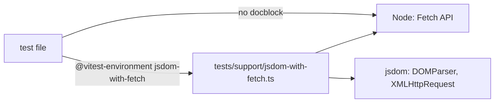
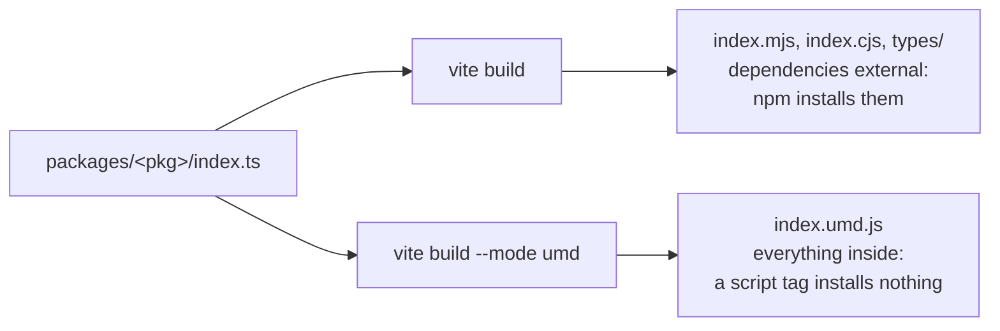
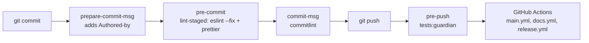
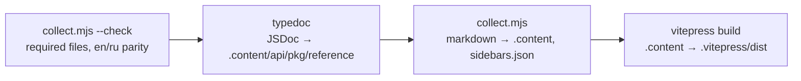

# Jext architecture

[Русская версия](../ru/ARCHITECTURE.md)

How the repository is laid out, how the monorepo works, what runs when and why it is set up this way.
Decisions behind it are recorded in [ADRs](../adr/README.md). Instructions for AI agents are in
[`AGENTS.md`](../../../AGENTS.md).

## Repository layout

```text
/
├── AGENTS.md                 # instructions for AI agents (single source)
├── CONTRIBUTING.md           # contributor preview, links to .github/docs/{en,ru}/CONTRIBUTING.md
├── SECURITY.md               # how to report a vulnerability privately
├── CLAUDE.md, GEMINI.md      # one line each: @AGENTS.md
├── .cursor/rules/            # Cursor rules scoped by file globs
├── skills/                   # skills for agents that use the Jext libraries (empty for now)
├── .github/
│   ├── docs/{en,ru}/         # human docs: README, CONTRIBUTING, ARCHITECTURE
│   ├── docs/adr/             # decisions that affect the whole repository
│   ├── docs/{en,ru}/RELEASING.md # how CI/CD and releases work
│   ├── ISSUE_TEMPLATE/       # bug and feature forms, blank issues off
│   └── workflows/            # main.yml (CI), docs.yml (site → Pages), release.yml (npm)
├── .changeset/               # pending version bumps for the next release (Changesets, ADR 0008)
├── .husky/                   # git hooks
├── packages/                 # npm workspaces
│   ├── collection/           # @metapraxis/jext-collection (active)
│   ├── http/                 # @metapraxis/jext-http (active)
│   └── jext/                 # @metapraxis/jext, aggregator: index.ts re-exports the packages
├── website/                  # documentation site built from the packages (see below)
├── tests/                    # cross-package tests only
│   ├── Feature/              # packages working together
│   ├── Browser/              # browser tests across packages (Vitest + Playwright)
│   └── support/              # shared test environment: jsdom with fetch, the browser test server
├── examples/                 # how the packages work together instead of the standard API (empty for now)
├── vitest.config.ts          # unit, integration, feature, performance: one Vitest project each
├── eslint.config.cjs         # ESLint 9 flat config
├── .prettierrc.cjs, .editorconfig
├── commitlint.config.cjs
├── vitest.browser.config.ts  # browser tests
└── tsconfig.json             # base TypeScript config and path aliases (`npm run typecheck`)
```

Every active package has the same shape:

```text
packages/<pkg>/
├── AGENTS.md, CLAUDE.md, GEMINI.md
├── README.md, RUADME.md      # readme in English and in Russian
├── CHANGELOG.md
├── adr/                      # decisions that affect only this package (created with the first one)
├── docs/{en,ru}/ARCHITECTURE.md
├── examples/                 # lessons: one task with jext, fetch, XHR, axios, ky, ofetch (see the package docs)
├── src/
├── tests/{Unit,Integration,Feature,Browser,Performance}/
├── package.json, tsconfig.json, vite.config.ts
```

## How the monorepo works

The root `package.json` declares npm workspaces `packages/*`. One `npm ci` installs every package into one
`node_modules` with one `package-lock.json`. Tooling (TypeScript, ESLint, Prettier, Vitest, Vite) lives in the
root, so all packages are checked the same way. Each package has its own `package.json`, version and Vite build, and
is published as `@metapraxis/jext-<name>` (the aggregator as `@metapraxis/jext`, ADR 0008). `packages/jext` depends
on the others by version: if a package's version does not match, npm looks for it in the registry and `npm install`
fails.

## Why `@Collection/*` imports work

Source code imports across a package through aliases, for example `@Collection/Array/ArrayExtensions`.
An alias is not a language feature: every tool that reads the code resolves it on its own, so it is declared
in four places.

| Tool       | Where                                              | Used for                    |
| ---------- | -------------------------------------------------- | --------------------------- |
| TypeScript | `tsconfig.json` → `compilerOptions.paths`          | type checking, IDE, ESLint  |
| Vitest     | `vitest.config.ts` → `alias`, `resolve.alias`      | every test type (`vitest.browser.config.ts` imports it) |
| Vite       | `packages/<pkg>/vite.config.ts` → `resolve.alias`  | per-package builds          |
| Vite (UMD) | `packages/jext/vite.config.ts` → `resolve.alias`   | the aggregator's UMD file, built from every package's source |

If an alias is missing in one of them, exactly that step breaks: types pass but tests fail, or tests pass but
the build fails.

Two more mappings are not aliases of the source: `@metapraxis/jext-http` → `packages/http/index.ts` and `@metapraxis/jext-collection` →
`packages/collection/index.ts`. They point a package name at its entry file, so the code that imports a package by
its name, as its users do, works without a build: the lessons in `packages/http/examples` and the aggregator
`packages/jext/index.ts`. They are declared in `tsconfig.json`, `vitest.config.ts` and the UMD build of
`packages/jext/vite.config.ts`; the other package builds do not need them.

## Tests

There are five test types ([ADR 0005](../adr/0005-test-taxonomy.md)), all on Vitest
([ADR 0010](../adr/0010-all-tests-vitest.md)). Four are projects of the root `vitest.config.ts` and run in Node;
browser tests have their own config.

| Type        | Config                                    | Looks in                                      |
| ----------- | ----------------------------------------- | --------------------------------------------- |
| Unit        | `vitest.config.ts`, project `unit`        | `packages/*/tests/Unit`                       |
| Integration | `vitest.config.ts`, project `integration` | `packages/*/tests/Integration`                |
| Feature     | `vitest.config.ts`, project `feature`     | `tests/Feature`, `packages/*/tests/Feature`   |
| Browser     | `vitest.browser.config.ts`                | `tests/Browser`, `packages/*/tests/Browser`   |
| Performance | `vitest.config.ts`, project `performance` | `packages/*/tests/Performance/*.perf.test.ts` |

- **Unit**: one function or class in isolation. Only inside packages.
- **Integration**: a package against something outside the code. For http that is a real request to a local
  `node:http` server started by the test file, which serves files from `tests/Integration/__fixtures__`. Tests
  never reach the internet.
- **Feature**: parts working together. Inside a package, its modules (collection across value types). In the
  root, whole packages (http fetches data, collection processes it).
- **Browser**: what only a real browser shows: upload progress through `XMLHttpRequest`, streams, the UMD file in a
  `<script>` tag. These tests run on Vitest Browser Mode ([ADR 0009](../adr/0009-browser-tests-vitest.md)):
  Vitest serves each test file through Vite and Playwright opens it in Chromium, Firefox and WebKit, so the code under
  test runs in the browser itself, with its own `fetch`, `XMLHttpRequest` and streams.

  ```mermaid
  flowchart LR
      T[test file] --> V[Vite server<br/>vitest.browser.config.ts]
      V --> P[Playwright:<br/>Chromium, Firefox, WebKit]
      P -- requests --> E["/__test/echo<br/>tests/support/browser-server.ts"]
  ```

  A browser cannot start a `node:http` server like the integration tests do, so the Vite server itself answers on
  `/__test/echo`, on the same origin (no CORS). It returns `{ method, path, headers, received }` (`received` is the
  number of body bytes), or `?status=`, `?type=` and `?body=` set the status, Content-Type and body. `npm run
  tests:browser` builds the packages first, because the root test loads `packages/jext/dist/index.umd.js` exactly as
  unpkg serves it. Locally `npx playwright install` downloads the browsers once; `-- --project chromium` runs one.
- **Performance**: measures and logs timings to compare versions. Not part of `npm run tests` and never a CI
  gate, because timings on shared runners are noisy.

Vitest compiles TypeScript and ES modules (ky, ofetch) through Vite, so tests need no transform settings. A test file
imports `describe`, `it`, `expect` and `vi` from `'vitest'`; there are no globals. `npm run tests:guardian` runs the
projects `unit`, `integration` and `feature`; `npm test -w @metapraxis/jext-<pkg>` runs the same for one package
(`npm run tests:<pkg>` in the root, which passes the package folder as a filter).

Tests run in plain Node, which has the Fetch API (`fetch`, `Response`, `Blob`, streams…) but no DOM. A file that needs
`DOMParser` or `XMLHttpRequest` (the HTML parser, the XHR transport, upload progress, every lesson) asks for jsdom on
its first line:

```ts
// @vitest-environment jsdom-with-fetch
```

Vitest looks for an environment named `jsdom-with-fetch` as the module `vitest-environment-jsdom-with-fetch`, and the
alias of that name in `vitest.config.ts` points it at `tests/support/jsdom-with-fetch.ts`. The environment starts jsdom
and puts Node's Fetch API back over it, because jsdom has no Fetch API and http needs both. It keeps jsdom's own
`FormData`, `Blob` and `URLSearchParams` in `jsdomBodies`, because jsdom's `XMLHttpRequest` accepts only those; the
form lessons of http use them. jsdom is opt-in because it costs: in jsdom the whole run took about four minutes, in
Node with jsdom for the 51 files that need it about 80 seconds.



### Test files

Every test type uses the same layout: a folder per subject and a file per scenario,
`tests/<Type>/<Subject>/<Subject>.<method>.<case>.test.ts`. Each file holds one `describe` and one `it`, so its
setup can sit in `beforeEach` (a `fetch` mock) or `beforeAll` (a local server) without hiding anything.

```text
packages/http/tests/
├── Unit/Parsers/JsonParser/
│   ├── JsonParser.parse.accept.test.ts
│   ├── JsonParser.parse.reject.test.ts
│   └── JsonParser.wrap.reject.test.ts
├── Feature/Bootstrap/Bootstrap.csv.test.ts
└── Integration/Http/Http.send.connection-dropped.test.ts
```

Names form a sentence in the report: `describe('<Subject>.<method> should <result>')` plus `it('when <condition>')`
gives "JsonParser.parse should accept the response › when Content-Type is application/json". Each dot in a file name
means a scope: the segments go from wide to narrow (subject, method, then narrower cases), and a hyphen only joins
the words of one segment. `Bootstrap.attachment.csv.test.ts` reads as `Bootstrap` › `attachment` › `csv`, and
`Http.send.connection-dropped.test.ts` as `Http` › `send` › one case `connection-dropped`. Every subject has
negative cases next to the positive ones, and tests declare generic types explicitly (`send<{ id: number }>`).
The full rules are in `AGENTS.md`, section Tests. `npm run tests:http` and `npm run tests:collection` run one
package from the root.

## Builds

| Command                        | Tool         | Output                                                    |
| ------------------------------ | ------------ | --------------------------------------------------------- |
| `npm run build` in a package   | Vite         | `vite build`: `dist/index.{mjs,cjs}` + `dist/types/`; then `vite build --mode umd`: `dist/index.umd.js` |
| `npm run packages:build`       | Vite         | the same for http, collection, then jext                  |
| `npm run typecheck`            | tsc          | type check of `packages/` (sources, tests, lessons, configs); writes nothing |

Vite is the only bundler. It builds each package as a library in two passes, because the two kinds of users need
different files:



- A bundler or Node reads `index.mjs` / `index.cjs`. npm has installed the dependencies next to the package, so they
  stay external and are not shipped twice.
- A browser without a bundler loads `index.umd.js` from unpkg or jsdelivr with a `<script>` tag. Nothing is
  installed there, and UMD has no way to load a dependency on its own, so this file bundles everything: http carries
  `fast-xml-parser`, and the aggregator carries both packages built from their source. `<script>` with
  `@metapraxis/jext/dist/index.umd.js` alone gives the global `Jext` (`Jext.collection(...)`, `Jext.http.get(...)`).

The UMD pass keeps the files of the first one (`emptyOutDir: false`) and writes no types.

The package builds are what npm publishes ([RELEASING.md](RELEASING.md)). Each package has its own `tsconfig.json`
(extends the root, `include` is `index.ts` and `src`, so tests and lessons stay out) and `vite.config.ts`:

- `index.ts` is the entry; `es` becomes `index.mjs` and `cjs` becomes `index.cjs`, so Node knows the format without
  a `"type"` field, and `umd` stays `index.umd.js` with a global (`JextHttp`, `JextCollection`, `Jext`).
- `vite-plugin-dts` writes `dist/types/index.d.ts` with the `@Http/*` / `@Collection/*` aliases rewritten to
  relative paths.
- Runtime dependencies stay external in `index.mjs` and `index.cjs`: `fast-xml-parser` in http
  ([ADR 0004](../adr/0004-no-runtime-dependencies.md)), both packages in jext; `index.umd.js` bundles them. The
  aggregator's tsconfig clears `paths`, so its types point at the published packages, not at their sources; that is
  why it builds last. Its UMD pass maps the package names and the `@Http/*` / `@Collection/*` aliases to the sources
  instead.

## What runs automatically



- `lint-staged` runs only on staged `packages/**/*.ts` files.
- `commitlint` enforces Conventional Commits with the type and scope lists in `commitlint.config.cjs`.
- `tests:guardian` is unit + integration + feature: fast enough for every push.
- GitHub Actions: `main.yml` (lint, prettier, typecheck, tests, `pack:dry`) and `docs.yml` (site build) run on
  pushes and pull requests to `main`; on `main`, `docs.yml` also deploys the site to Pages and `release.yml` opens the
  release pull request or publishes to npm. Details: [RELEASING.md](RELEASING.md).

## JSDoc

Comments in the code are the first layer of the documentation: editors show them on hover, and `.d.ts` files
carry them to JavaScript users together with the types. The API reference of the
[documentation site](#documentation-site) is built from them.

| What | Needs |
| --- | --- |
| Every class, interface, type alias and method, public or internal | `@summary`; `@description` when useful |
| A method or function | `@param` for each parameter, `@returns` unless it returns `void`, `@throws` for a deliberate throw |
| An interface property | a one-line `/** … */` |
| The public API: what `packages/<pkg>/index.ts` exports and the methods of the interfaces it returns | also `@example`, 1–5 lines |
| A member that implements a documented interface member | `/** @inheritDoc */` is enough |

Types are never written in braces (`@param {string} url`): TypeScript already has them in the signature, and braces
go stale when a type is renamed. A public method gets `@deprecated <replacement>` before it is removed and, after
1.0.0, `@since <version>` when it is added.

```ts
/**
 * @summary Limits the time one attempt may take; the request then ends with an `HttpError` with status `0`.
 *
 * @param ms - The time in milliseconds.
 * @returns A new request with the timeout.
 *
 * @example
 * const { error } = await http.get('/api/report').timeout(5000);
 */
timeout(ms: number): HttpRequest<T, E>;
```

`eslint-plugin-jsdoc` checks these rules in `eslint.config.cjs`, so `npm run lint` and the pre-commit hook fail on
a missing comment, parameter, return value or summary. `@example` is required only in the public API files listed
there: ESLint cannot tell what `index.ts` exports. The check covers `packages/http` and `packages/collection`; in
collection every class of the wrapper ladder is public API, because `collection()` returns it.

## Documentation and decisions

Three kinds of documents, each answers its own question:

| Document | Answers | Where |
| --- | --- | --- |
| `ARCHITECTURE.md` | how it is built now: layout, classes, flow, diagrams | `.github/docs/{en,ru}/` for the repository, `packages/<pkg>/docs/{en,ru}/` for a package |
| ADR | why it is built this way and what was rejected | `.github/docs/adr/` for the repository, `packages/<pkg>/adr/` for a package |
| `CHANGELOG.md` | what changed for users of a package | `packages/<pkg>/CHANGELOG.md` |

An ADR is written only for a decision that changes the architecture or how the project is used: structure or
patterns, package boundaries, public API or return types, a new dependency, a choice between real alternatives.
Bug fixes, renames, refactors inside a module, lint fixes, new tests and doc edits do not get one. A decision
that affects more than one package, the tooling or the process goes to `.github/docs/adr/`; anything else to
the package's `adr/`, numbered from `0001` in each place. Accepted ADRs are not edited: a new one supersedes them.

When a change touches an architectural concept, the matching `ARCHITECTURE.md` is updated in both languages in
the same change.

## Documentation site

The site is generated from the files that already live next to the code, so nothing is written twice. `website/`
is a private npm workspace (`jext-website`) with the configs and scripts; it is never published.

| Route | Comes from |
| --- | --- |
| `/` and `/ru/` | `.github/docs/{en,ru}/README.md` |
| `/api/`, `/dev/` (and `/ru/…`) | generated lists of the packages on the site, with the first paragraph of each readme |
| `/api/<pkg>/` | `packages/<pkg>/README.md` |
| `/ru/api/<pkg>/` | `packages/<pkg>/RUADME.md`, the Russian readme (the name is deliberate) |
| `/api/<pkg>/guide/` (and `/ru/…`) | `packages/<pkg>/examples/`: `README.md` / `RUADME.md` as the index, each lesson's `en.md` / `ru.md` with its six variants as tabs |
| `/api/<pkg>/reference/` | JSDoc of everything `packages/<pkg>/index.ts` exports, through TypeDoc; English only |
| `/dev/<pkg>/` and `/ru/dev/<pkg>/` | `packages/<pkg>/docs/{en,ru}/ARCHITECTURE.md`, Mermaid diagrams included |
| `/dev/<pkg>/adr/` | `packages/<pkg>/adr/`; English only, the Russian menu links to it |
| `/dev/repo/` | `.github/docs/{en,ru}/ARCHITECTURE.md`, `CONTRIBUTING.md` and `.github/docs/adr/` |

```text
website/
├── package.json              # jext-website: VitePress, TypeDoc and their plugins as devDependencies
├── site.config.mjs           # repository, branch, packages on the site, base path
├── typedoc.json              # API reference: entry points, validation, output into .content
├── tsconfig.typedoc.json     # the root tsconfig with the package aliases, for TypeDoc
├── typedoc/summary.mjs       # TypeDoc plugin: shows @summary as the summary of a page
├── scripts/collect.mjs       # copies and rewrites the markdown, writes index pages and sidebars
├── .vitepress/config.mts     # VitePress: locales en/ru, menus, local search, Mermaid
└── .content/                 # generated, ignored by git: the pages VitePress builds
```

`npm run docs:build` runs four steps:



1. **check** fails when a package listed in `site.config.mjs` misses `index.ts`, `README.md`, `RUADME.md`,
   `docs/{en,ru}/ARCHITECTURE.md` or `adr/README.md`, when an `en/` document has no `ru/` pair, or when a lesson
   misses a variant, a text, the `<!-- @variants -->` line, its feature test or its line in the lesson index.
2. **typedoc** writes markdown pages of the reference. Its validation is strict: a type used by the public API but
   not exported from `index.ts`, a broken `{@link}` or an undocumented export is an error, not a warning.
   TypeDoc does not render `@summary`, so `typedoc/summary.mjs` moves it into the summary of the comment.
3. **collect** copies the documents into routes and rewrites them: the line `[Русская версия](…)` /
   `[English version](…)` goes away (the site has a language switch), a relative link to another document becomes
   a link to its page, a link to any other file of the repository becomes a link to GitHub. In a lesson the line
   `<!-- @variants -->` becomes a `code-group` with the six variant files as tabs. A link to a file that
   does not exist stays as it is, and VitePress then fails the build on it as a dead link.
4. **vitepress build** renders `.content` into static HTML with search and diagrams.

Three commands use it:

| Command | When | What happens |
| --- | --- | --- |
| `npm run docs:dev` | while writing docs | steps 2–3, then a dev server on `localhost:5173` that reloads the page on save |
| `npm run docs:build` | before a commit, in CI | all four steps; any error stops it |
| `npm run docs:preview` | after a build | serves `website/.vitepress/dist` on `localhost:4173` exactly as it will be published |

`docs:dev` does not rerun `collect` on save: after editing a source document, run `npm run docs:collect` (or restart
`docs:dev`). On GitHub Actions the base path becomes `/<repository>/` for GitHub Pages; `DOCS_BASE` overrides it.
A package joins the site by being added to `packages` in `site.config.mjs`; `collection` joins after its redesign.

## Known problems

These are existing issues in the code, not in the tooling. They are listed so nobody "fixes" the tooling to
hide them.

- `collection()` returns `undefined` for booleans, `null`, bigint and other unhandled types.
- `tsconfig.json` has `strict: false`.
