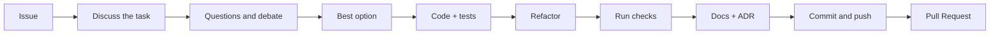

# Contributing to Jext

[Русская версия](../ru/CONTRIBUTING.md)

Thank you so much for your interest in Jext! We welcome any contribution, whether it's fixing a typo, implementing a
new feature, or improving the documentation. Every bit of help is important.

This document is our guide to making the contribution process simple and effective for both you and us.

## 🏁 Principles

Every Jext package exists to **beat the best-known libraries of its kind on developer experience and on speed**.
So the code has to be both fast and elegant, and a change is judged by both:

- **Speed is measured, not assumed.** A new or changed hot method gets a performance test against the competitors
  (`packages/<pkg>/tests/Performance`; for collection these are lodash, es-toolkit, remeda and ramda). It must be no
  slower than before and no slower than them.
- **DX is shown, not claimed.** The same task should take less code and read more clearly than with the
  alternatives. For http the lessons put jext next to fetch, XMLHttpRequest, axios, ky and ofetch.
- **Neither is traded away silently.** Elegance that costs speed, or speed that costs a clear API, is a decision:
  it gets an ADR with the numbers.

## 🤝 Code of Conduct

First and foremost, please read our [Code of Conduct](../../../CODE_OF_CONDUCT.md). We are committed to creating an
open and welcoming community and expect all participants to adhere to these rules.

## 🤔 How Can I Contribute?

There are many ways to contribute:

- **🐛 Reporting Bugs:** If you find a bug, please create an [Issue](https://github.com/method-hub/Jext/issues),
  describing the problem and the steps to reproduce it in as much detail as possible.
- **💡 Suggesting Enhancements:** Have an idea to make Jext better? Create an
  [Issue](https://github.com/method-hub/Jext/issues), detailing your proposal and why it would be beneficial.
- **📝 Writing Code:** You can take on one of the existing issues or propose your own.
- **📖 Improving Documentation:** Docs live in English and Russian; a fix in one language is welcome, and we will
  help with the other one.

## 🚀 Getting Started

Ready to make code changes? Great! Here's how to set up your environment. You need Node.js 22 or newer and npm 10
or newer.

**1. Clone the Repository**

```bash
git clone https://github.com/method-hub/Jext.git
cd Jext
```

If you have no write access to `method-hub/Jext`, fork it on GitHub first and push your branch to the fork:

```bash
git remote add fork https://github.com/<your-username>/Jext.git
```

**2. Install Dependencies**

The project is an npm workspaces monorepo; one command installs every package:

```bash
npm ci
```

This command also sets up the Git hooks (Husky) that check your commits and pushes automatically.

**3. Core Scripts**

Run everything from the repository root:

| Command | What it does |
| --- | --- |
| `npm run tests:guardian` | Unit, integration and feature tests (the pre-push hook runs this) |
| `npm run tests` | The same plus browser tests (`npx playwright install` once first) |
| `npm test -w @metapraxis/jext-<pkg>` | Tests of one package |
| `npm run lint` / `npm run lint:fix` | ESLint, JSDoc included |
| `npm run prettier` / `npm run prettier:fix` | Prettier check / write |
| `npm run typecheck` | TypeScript type check |
| `npm run packages:build` | Builds the three packages into their `dist/` |
| `npm run docs:dev` | The documentation site with hot reload on `localhost:5173` |
| `npm run docs:build` | Checks and builds the documentation site |

**4. Find Your Way Around**

- [ARCHITECTURE.md](ARCHITECTURE.md): how the monorepo, aliases, tests, builds and the docs site fit together.
- `packages/<pkg>/docs/en/ARCHITECTURE.md`: how one package is built, with diagrams.
- [AGENTS.md](../../../AGENTS.md): the full rule book. It is written for AI agents, but it is the most complete list
  of conventions for humans too.

## 🔀 Pull Request Process

When you are ready to change something, go through these steps.

1. **Start from an issue.** Describe the bug or the idea in an [Issue](https://github.com/method-hub/Jext/issues)
   first, or pick an existing one. For a large change, agree on the approach in the issue before writing code.
2. **Create a new branch.** Do not work directly in `main`. Name the branch after the type and the task, for example
   `feat/collection-shuffle` or `fix/http-timeout`.
3. **Write code and tests.** Every change comes with tests in the same commit: new behaviour gets new test files,
   and an existing test changes only when the API it covers changes. The test layout is described in
   [ARCHITECTURE.md › Tests](ARCHITECTURE.md#tests).
4. **Update the documentation.** If you changed how something works, update the matching `ARCHITECTURE.md` in both
   `en/` and `ru/`, the JSDoc of every method you touched and the examples that use it. For every user-visible
   change add a changeset (`npm run changeset`): it names the packages, the bump and one line that the release
   writes into their `CHANGELOG.md`; never edit `CHANGELOG.md` by hand ([RELEASING.md](RELEASING.md)). If you made a decision that changes the
   architecture or how the project is used, add an ADR (see
   Documentation and decisions below).
5. **Ensure all checks pass.** Run `npm run prettier`, `npm run lint` and `npm run tests:guardian`. If you touched a
   package on the docs site, its docs or `website/`, run `npm run docs:build` as well.
6. **Make a commit.** We use [Conventional Commits](https://www.conventionalcommits.org/) (see below). This is a
   **strict requirement**: the Git hook will not let you create a commit that does not follow it.
7. **Open a Pull Request.** Push your branch and open a Pull Request to `main` of `method-hub/Jext`. Fill out the PR
   template that appears automatically and link the issue (`Closes #123`).
8. **Go through the review.** CI must be green. Answer the review comments with new commits rather than force-pushes,
   so the reviewer sees what changed. A maintainer merges the PR once it is approved.

A change is done when:

- Prettier and ESLint show no new problems in the files you touched, JSDoc included;
- `npm run tests:guardian` passes and new behaviour has new tests;
- `ARCHITECTURE.md` and diagrams are updated, a user-visible change has a changeset, human docs in both `en/` and `ru/`, and an ADR exists
  if the change is a decision;
- `npm run docs:build` passes if you touched a package on the site, its docs or `website/`.

## ☑️ Commit Message Guidelines

We use `commitlint` to strictly enforce the format of commit messages (`commitlint.config.cjs`). This helps us
generate the changelog and makes navigating the project history easier.

**Message Structure:**

```text
<type>(<scope>): <short description>
```

**Example:** `feat(collection): add 'shuffle' to arrays`

### Available `<type>`s

- `feat`: A new feature.
- `fix`: A bug fix.
- `docs`: Documentation only changes.
- `style`: Code style changes (formatting, missing semicolons, etc.).
- `refactor`: A code change that neither fixes a bug nor adds a feature.
- `perf`: A code change that improves performance.
- `test`: Adding missing tests or correcting existing tests.
- `ci`: Changes to CI/CD configuration and scripts.
- `chore`: Other changes that don't modify source or test files (build configuration, tooling).

### Available `<scope>`s

- `main`: Core logic.
- `docs`: Changes related to documentation.
- `deps`: Dependency management or updates.
- `ci`: Changes to CI/CD (GitHub Actions).
- `format`: Formatting-related changes.
- `git`: Changes related to Git (hooks, `.gitignore`).
- `other`: Anything that doesn't fit into the other scopes.

A change inside one package uses the package name as its scope: `collection`, `http` or `jext`.

### Git hooks

| Hook | Runs |
| --- | --- |
| `pre-commit` | `lint-staged`: `eslint --fix` and Prettier on the staged `packages/**/*.ts` files |
| `commit-msg` | `commitlint` |
| `prepare-commit-msg` | adds an `Authored-by` line |
| `pre-push` | `npm run tests:guardian` |

## 🎨 Code Style

We use **Prettier** for automatic code formatting and **ESLint** for static code analysis. The configurations are
located in `.prettierrc.cjs` and `eslint.config.cjs` respectively: 4-space indent, single quotes, 120 columns.

- Every class, interface, type alias and method needs JSDoc, and the public API needs `@example`; ESLint checks it.
  The rules: [ARCHITECTURE.md › JSDoc](ARCHITECTURE.md#jsdoc).
- One class per file, default export, the file named after the class.
- Every class member has an explicit `public`, `protected` or `private`.
- Values are immutable: methods return a new value and never mutate the old one.
- Code inside a package is imported through aliases (`@Collection/*`, `@Http/*`).
- No runtime dependencies unless an ADR allows one.

## 📚 Documentation and decisions

- Human docs exist in English and Russian (`en/`, `ru/`) with the same sections in the same order. Change both in
  the same pull request.
- `ARCHITECTURE.md` answers how something is built now; an **ADR** (Architecture Decision Record) answers why it is
  built this way and what was rejected.
- Write an ADR only for a decision that changes the architecture or how the project is used: structure or patterns,
  package boundaries, public API or return types, a new dependency, a choice between real alternatives. Not for bug
  fixes, renames, refactors, lint fixes, tests or doc edits.
- A decision that affects more than one package, the tooling or the process goes to
  [`.github/docs/adr/`](../adr/README.md); anything else goes to `packages/<pkg>/adr/`. Copy
  [the template](../adr/0000-template.md), take the next number and add the ADR to the index of its folder. Accepted
  ADRs are not edited: a new ADR supersedes the old one.

## 🤖 Development with AI Agents

Jext is built to be developed together with AI agents. All instructions for them live in one file,
[`AGENTS.md`](../../../AGENTS.md), plus `packages/<pkg>/AGENTS.md` for each package. Claude Code reads it through
`CLAUDE.md`, Gemini through `GEMINI.md`, and Cursor and Codex read `AGENTS.md` directly, so every agent follows the
same rules as a human contributor. You stay the author: you are responsible for every line the agent writes.



1. **Give the agent the issue.** Paste the link or the text of the issue, so the agent works on a task with a clear
   goal and acceptance criteria rather than on a one-line wish.
2. **Talk the task through.** Ask the agent to restate the task in its own words, read the package `AGENTS.md` and
   `ARCHITECTURE.md`, and list the files it is going to touch. Do not let it write code yet.
3. **Ask questions and argue.** Let the agent ask its questions, and ask yours: what are the alternatives, what breaks,
   what happens to the public API, how is it tested. Push back on weak arguments and ask it to defend its choices.
4. **Choose the best option.** Agree on one approach. If the choice changes the architecture or how the project is
   used, it is a decision: the agent records it as an ADR.
5. **Implement the task and its tests.** The agent writes the code and the tests in the same change, following the
   test layout and naming rules, with negative cases next to the positive ones.
6. **Refactor.** Once the tests are green, ask the agent to clean up: remove duplication, simplify, check the naming
   and the JSDoc. The tests must stay green.
7. **Run the checks.** `npm run prettier`, `npm run lint`, `npm run tests:guardian`, and `npm run docs:build` when
   the docs site is affected. Read the output yourself, not only the agent's summary of it.
8. **Update the documentation.** The agent updates what the change touched: `ARCHITECTURE.md` and diagrams in both
   languages, JSDoc, examples, a changeset for a user-visible change, and adds an ADR to the right `adr/` folder if a decision
   was made.
9. **Commit and push.** The agent writes a Conventional Commit message with the right type and scope, pushes the
   branch and opens a Pull Request that fills the template. Review the diff yourself before you ask anyone else to.

A good first message to an agent:

```text
Here is issue #123: <link or text>. Read AGENTS.md and the package docs, restate the task, list the files you
will change and ask me everything that is unclear. Do not write code until we agree on the approach.
```

## 📄 License

By contributing, you agree that your contributions will be licensed under the [MIT License](../../../LICENSE) that
covers the project.
