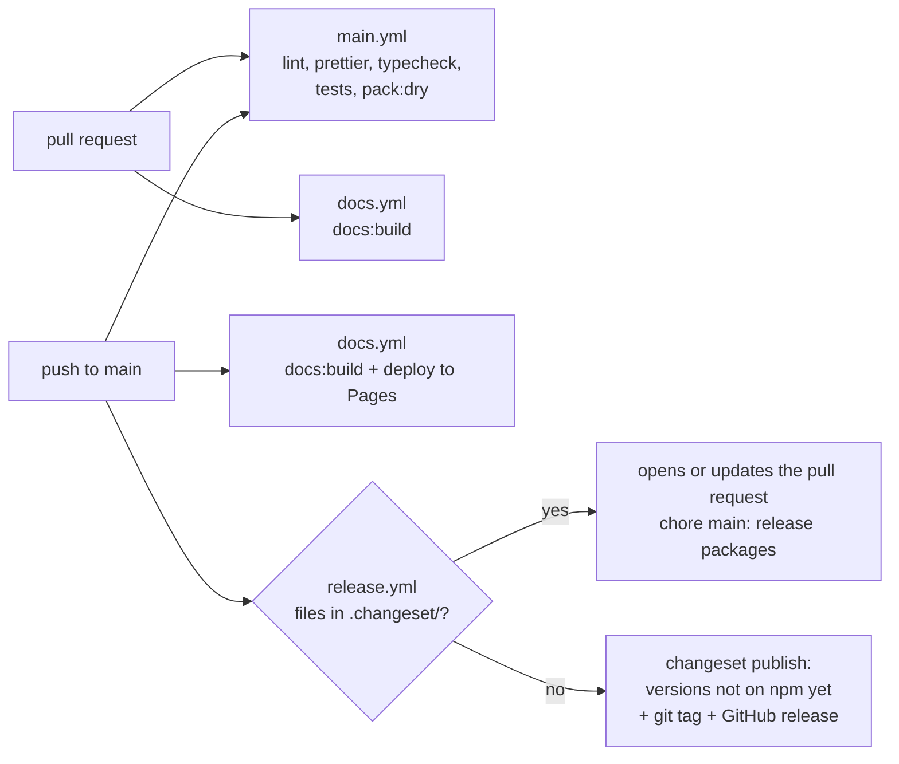

# Releasing Jext

[Русская версия](../ru/RELEASING.md)

How a change gets from a pull request to npm and to the documentation site. The decision behind it:
[ADR 0008](../adr/0008-versioning-and-releases.md).

## What is published

| Folder                | npm package                   | Contents of the tarball                                       |
| --------------------- | ----------------------------- | ------------------------------------------------------------- |
| `packages/http`       | `@metapraxis/jext-http`       | `dist/` (`index.mjs`, `index.cjs`, `index.umd.js`, `types/`), README, CHANGELOG, LICENSE |
| `packages/collection` | `@metapraxis/jext-collection` | the same                                                      |
| `packages/jext`       | `@metapraxis/jext`            | the same; depends on the two packages above, does not bundle them |

The root (`jext-monorepo`) and `website/` (`jext-website`) are private and never published. Each package builds
itself with `vite build` (`npm run packages:build` builds all three, the aggregator last because its types come from
the other two). `prepack` copies the root `LICENSE` into the package; the copy is ignored by git.

## The three workflows

- `.github/workflows/main.yml`: every pull request and push to `main`. ESLint, Prettier, the type check
  (`npm run typecheck`), unit, integration, feature and browser tests (Vitest) and `npm run pack:dry`, which builds
  the three packages and lists the files npm would publish.
- `.github/workflows/docs.yml`: on a pull request it only builds the site (`npm run docs:build`, which fails on a
  dead link or an undocumented export); on `main` it also deploys it to GitHub Pages at `/<repository>/`.
- `.github/workflows/release.yml`: only on `main` and only in `method-hub/Jext`. It runs
  [changesets/action](https://github.com/changesets/action), described below.

## Releasing step by step

1. **In a pull request**, for every change users notice, run `npm run changeset`. It asks which packages changed and
   how (patch, minor, major) and writes a short markdown file in `.changeset/`; the text becomes the CHANGELOG line.
   Commit it with the change. Internal changes (tests, docs, tooling) need no changeset.
2. **Merge the pull request.** `release.yml` sees pending changesets and opens the pull request
   "chore(main): release packages" (or updates it). It runs `npm run release:version`: changesets bumps the
   versions, raises the dependencies of `@metapraxis/jext` on the bumped packages, writes the CHANGELOG sections,
   deletes the used changeset files, and npm refreshes `package-lock.json`.
3. **Review and merge the release pull request** when you want to release. Several merged changes collect in it
   until then.
4. **`release.yml` publishes.** With no changesets left it runs `npm run release`: `packages:build`, then
   `changeset publish`, which publishes every package whose version is not on npm yet, with
   [provenance](https://docs.npmjs.com/generating-provenance-statements), creates the git tag
   (`@metapraxis/jext-http@0.1.0`) and a GitHub release with the CHANGELOG section.

A push to `main` without a version change publishes nothing: `changeset publish` skips versions npm already has.

`npm run release:status` shows which packages the pending changesets will bump.

## Before the first release (once, by the owner)

- npm: an automation (or granular, publish-only) token of an account in the `@metapraxis` organisation, saved as the
  repository secret `NPM_TOKEN` (Settings › Secrets and variables › Actions). Without it the release pull request
  still works and publishing is skipped with a warning.
- Settings › Actions › General › Workflow permissions: allow GitHub Actions to create and approve pull requests.
- Settings › Pages › Source: GitHub Actions.
- The release pull request is opened with `GITHUB_TOKEN`, so GitHub does not run CI on it by itself; push to its
  branch if you want the checks there. Its changes are only versions and CHANGELOGs.

## Checking locally

| Command                 | What it does                                                                   |
| ----------------------- | ------------------------------------------------------------------------------ |
| `npm run packages:build`| Builds the three packages into their `dist/`                                   |
| `npm run pack:dry`      | Builds and lists the files of each tarball, nothing is written                 |
| `npm run publish:dry`   | Builds and runs `npm publish --dry-run` for each package, nothing is published |
| `npm run release:status`| Lists the pending changesets and the bumps they make                           |

Never run `npm run release` or `npm publish` from a laptop: releases go through CI only.

## CHANGELOG

Each package has its own `CHANGELOG.md`. Changesets writes every new version right below the title. Everything that
happened before the first public release stays below it under "Before the first public release", in the
[Keep a Changelog](https://keepachangelog.com/en/1.1.0/) sections it was written in.
