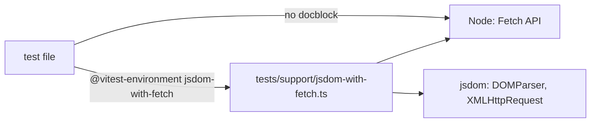
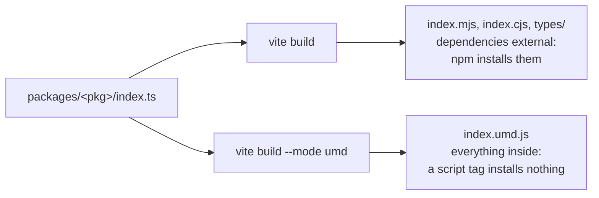
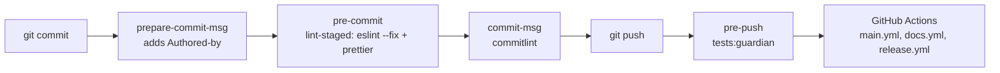
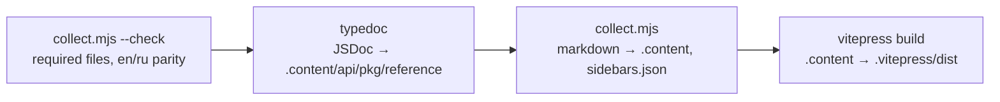

# Архитектура Jext

[English version](../en/ARCHITECTURE.md)

Как устроен репозиторий и монорепозиторий, что и когда запускается и почему всё настроено именно так.
Решения, стоящие за этим, записаны в [ADR](../adr/README.md). Инструкции для ИИ-агентов лежат в
[`AGENTS.md`](../../../AGENTS.md).

## Структура репозитория

```text
/
├── AGENTS.md                 # инструкции для ИИ-агентов (единый источник)
├── CONTRIBUTING.md           # превью для участников, ссылки на .github/docs/{en,ru}/CONTRIBUTING.md
├── SECURITY.md               # как сообщить об уязвимости приватно
├── CLAUDE.md, GEMINI.md      # по одной строке: @AGENTS.md
├── .cursor/rules/            # правила Cursor, привязанные к маскам файлов
├── skills/                   # скиллы для агентов, которые используют библиотеки Jext (пока пусто)
├── .github/
│   ├── docs/{en,ru}/         # документация для людей: README, CONTRIBUTING, ARCHITECTURE
│   ├── docs/adr/             # решения, которые касаются всего репозитория
│   ├── docs/{en,ru}/RELEASING.md # как устроены CI/CD и релизы
│   ├── ISSUE_TEMPLATE/       # формы bug и feature, пустые issue выключены
│   └── workflows/            # main.yml (CI), docs.yml (сайт → Pages), release.yml (npm)
├── .changeset/               # ожидающие поднятия версий для следующего релиза (Changesets, ADR 0008)
├── .husky/                   # git-хуки
├── packages/                 # npm workspaces
│   ├── collection/           # @metapraxis/jext-collection (активный)
│   ├── http/                 # @metapraxis/jext-http (активный)
│   └── jext/                 # @metapraxis/jext, агрегатор: index.ts реэкспортирует пакеты
├── website/                  # сайт документации, собранный из пакетов (см. ниже)
├── tests/                    # только межпакетные тесты
│   ├── Feature/              # пакеты вместе
│   ├── Browser/              # браузерные тесты между пакетами (Vitest + Playwright)
│   └── support/              # общее окружение тестов: jsdom с fetch, сервер браузерных тестов
├── examples/                 # как пакеты работают вместе вместо стандартного API (пока пусто)
├── vitest.config.ts          # unit, integration, feature, performance: по проекту Vitest на каждый
├── eslint.config.cjs         # flat config ESLint 9
├── .prettierrc.cjs, .editorconfig
├── commitlint.config.cjs
├── vitest.browser.config.ts  # браузерные тесты
└── tsconfig.json             # базовый конфиг TypeScript и алиасы путей (`npm run typecheck`)
```

Каждый активный пакет устроен одинаково:

```text
packages/<pkg>/
├── AGENTS.md, CLAUDE.md, GEMINI.md
├── README.md, RUADME.md      # readme на английском и на русском
├── CHANGELOG.md
├── adr/                      # решения, которые касаются только этого пакета (появляется с первым)
├── docs/{en,ru}/ARCHITECTURE.md
├── examples/                 # уроки: одна задача через jext, fetch, XHR, axios, ky, ofetch (см. доки пакета)
├── src/
├── tests/{Unit,Integration,Feature,Browser,Performance}/
├── package.json, tsconfig.json, vite.config.ts
```

## Как работает монорепозиторий

Корневой `package.json` объявляет npm workspaces `packages/*`. Один `npm ci` ставит все пакеты в один `node_modules`
с одним `package-lock.json`. Инструменты (TypeScript, ESLint, Prettier, Vitest, Vite) живут в корне, поэтому все
пакеты проверяются одинаково. У каждого пакета свой `package.json`, своя версия и своя сборка Vite, публикуется он
как `@metapraxis/jext-<name>` (агрегатор как `@metapraxis/jext`, ADR 0008). `packages/jext` зависит от остальных по
версии: если версия пакета не совпадает, npm ищет его в реестре, и `npm install` падает.

## Почему работают импорты `@Collection/*`

Исходники импортируют модули пакета через алиасы, например `@Collection/Array/ArrayExtensions`. Алиас — не
возможность языка: каждый инструмент, читающий код, разрешает его сам, поэтому он объявлен в четырёх местах.

| Инструмент | Где                                                | Для чего                       |
| ---------- | -------------------------------------------------- | ------------------------------ |
| TypeScript | `tsconfig.json` → `compilerOptions.paths`          | проверка типов, IDE, ESLint    |
| Vitest     | `vitest.config.ts` → `alias`, `resolve.alias`      | все виды тестов (`vitest.browser.config.ts` импортирует его) |
| Vite       | `packages/<pkg>/vite.config.ts` → `resolve.alias`  | сборка пакета                  |
| Vite (UMD) | `packages/jext/vite.config.ts` → `resolve.alias`   | UMD-файл агрегатора, собранный из исходников всех пакетов |

Если алиаса нет в одном из них, ломается именно этот шаг: типы сходятся, а тесты падают, или тесты проходят, а
сборка падает.

Ещё два соответствия не являются алиасами исходников: `@metapraxis/jext-http` → `packages/http/index.ts` и
`@metapraxis/jext-collection` → `packages/collection/index.ts`. Они ведут имя пакета к его входному файлу, поэтому код, который
импортирует пакет по имени, как его пользователи, работает без сборки: уроки в `packages/http/examples` и агрегатор
`packages/jext/index.ts`. Они объявлены в `tsconfig.json`, `vitest.config.ts` и UMD-сборке
`packages/jext/vite.config.ts`; остальным сборкам пакетов они не нужны.

## Тесты

Видов тестов пять ([ADR 0005](../adr/0005-test-taxonomy.md)), все на Vitest
([ADR 0010](../adr/0010-all-tests-vitest.md)). Четыре из них — проекты корневого `vitest.config.ts`, они идут в Node;
у браузерных тестов свой конфиг.

| Вид         | Конфиг                                    | Где ищет                                      |
| ----------- | ----------------------------------------- | --------------------------------------------- |
| Unit        | `vitest.config.ts`, проект `unit`         | `packages/*/tests/Unit`                       |
| Integration | `vitest.config.ts`, проект `integration`  | `packages/*/tests/Integration`                |
| Feature     | `vitest.config.ts`, проект `feature`      | `tests/Feature`, `packages/*/tests/Feature`   |
| Browser     | `vitest.browser.config.ts`                | `tests/Browser`, `packages/*/tests/Browser`   |
| Performance | `vitest.config.ts`, проект `performance`  | `packages/*/tests/Performance/*.perf.test.ts` |

- **Unit**: одна функция или класс в изоляции. Только внутри пакетов.
- **Integration**: пакет вместе с чем-то внешним. Для http это реальный запрос к локальному серверу на
  `node:http`, который поднимает сам тестовый файл и который отдаёт файлы из `tests/Integration/__fixtures__`.
  В интернет тесты не ходят.
- **Feature**: части вместе. Внутри пакета это его модули (collection с разными типами значений). В корне это
  целые пакеты (http получил данные, collection их обработала).
- **Browser**: то, что видно только в настоящем браузере: прогресс загрузки через `XMLHttpRequest`, потоки, UMD-файл
  в теге `<script>`. Эти тесты работают на Vitest Browser Mode
  ([ADR 0009](../adr/0009-browser-tests-vitest.md)): Vitest отдаёт каждый тестовый файл через Vite, а Playwright
  открывает его в Chromium, Firefox и WebKit, так что проверяемый код выполняется в самом браузере, с его `fetch`,
  `XMLHttpRequest` и потоками.

  ```mermaid
  flowchart LR
      T[test file] --> V[Vite server<br/>vitest.browser.config.ts]
      V --> P[Playwright:<br/>Chromium, Firefox, WebKit]
      P -- requests --> E["/__test/echo<br/>tests/support/browser-server.ts"]
  ```

  Браузер не может поднять сервер на `node:http`, как интеграционные тесты, поэтому сам сервер Vite отвечает на
  `/__test/echo` с того же origin (без CORS). Он возвращает `{ method, path, headers, received }` (`received` — число
  байт тела), а `?status=`, `?type=` и `?body=` задают статус, Content-Type и тело. `npm run tests:browser` сначала
  собирает пакеты, потому что корневой тест загружает `packages/jext/dist/index.umd.js` ровно так, как его отдаёт
  unpkg. Локально `npx playwright install` один раз скачивает браузеры; `-- --project chromium` запускает один.
- **Performance**: замеряет и логирует время, чтобы сравнивать версии. Не входит в `npm run tests` и никогда не
  валит CI: на общих раннерах замеры шумные.

Vitest сам компилирует TypeScript и ES-модули (ky, ofetch) через Vite, поэтому настроек трансформации у тестов нет.
Тестовый файл импортирует `describe`, `it`, `expect` и `vi` из `'vitest'`; глобальных функций нет.
`npm run tests:guardian` запускает проекты `unit`, `integration` и `feature`; `npm test -w @metapraxis/jext-<pkg>` —
то же для одного пакета (`npm run tests:<pkg>` в корне, который передаёт папку пакета как фильтр).

Тесты идут в обычном Node: Fetch API (`fetch`, `Response`, `Blob`, потоки…) в нём есть, а DOM нет. Файл, которому
нужны `DOMParser` или `XMLHttpRequest` (HTML-парсер, XHR-транспорт, прогресс загрузки, все уроки), просит jsdom первой
строкой:

```ts
// @vitest-environment jsdom-with-fetch
```

Окружение с именем `jsdom-with-fetch` Vitest ищет как модуль `vitest-environment-jsdom-with-fetch`, а алиас с этим
именем в `vitest.config.ts` ведёт его к `tests/support/jsdom-with-fetch.ts`. Окружение запускает jsdom и возвращает
поверх него Fetch API из Node: в jsdom его нет, а http нужно и то и другое. Собственные `FormData`, `Blob` и
`URLSearchParams` jsdom оно сохраняет в `jsdomBodies`, потому что `XMLHttpRequest` из jsdom принимает только их; ими
пользуются уроки http с формами. jsdom включается явно, потому что он дорогой: весь прогон в jsdom шёл около четырёх
минут, а в Node с jsdom только для 51 файла, которым он нужен, — около 80 секунд.



### Файлы тестов

У всех видов тестов одна раскладка: папка на субъект и файл на сценарий,
`tests/<Type>/<Subject>/<Subject>.<method>.<case>.test.ts`. В файле один `describe` и один `it`, поэтому подготовку
можно держать в `beforeEach` (мок `fetch`) или `beforeAll` (локальный сервер), и она ничего не прячет.

```text
packages/http/tests/
├── Unit/Parsers/JsonParser/
│   ├── JsonParser.parse.accept.test.ts
│   ├── JsonParser.parse.reject.test.ts
│   └── JsonParser.wrap.reject.test.ts
├── Feature/Bootstrap/Bootstrap.csv.test.ts
└── Integration/Http/Http.send.connection-dropped.test.ts
```

Имена складываются в предложение в отчёте: `describe('<Subject>.<method> should <result>')` и `it('when <condition>')`
дают «JsonParser.parse should accept the response › when Content-Type is application/json». Каждая точка в имени
файла означает скоуп: сегменты идут от широкого к узкому (субъект, метод, потом всё более узкие случаи), а дефис
только соединяет слова внутри одного сегмента. `Bootstrap.attachment.csv.test.ts` читается как `Bootstrap` ›
`attachment` › `csv`, а `Http.send.connection-dropped.test.ts` как `Http` › `send` › один случай
`connection-dropped`. У каждого субъекта рядом с позитивными есть негативные кейсы, а дженерики в тестах объявляются явно (`send<{ id: number }>`).
Полные правила в `AGENTS.md`, раздел Tests. `npm run tests:http` и `npm run tests:collection` запускают тесты
одного пакета из корня.

## Сборка

| Команда                        | Инструмент   | Результат                                                 |
| ------------------------------ | ------------ | --------------------------------------------------------- |
| `npm run build` в пакете       | Vite         | `vite build`: `dist/index.{mjs,cjs}` + `dist/types/`; затем `vite build --mode umd`: `dist/index.umd.js` |
| `npm run packages:build`       | Vite         | то же для http, collection, затем jext                    |
| `npm run typecheck`            | tsc          | проверка типов `packages/` (исходники, тесты, уроки, конфиги); ничего не пишет |

Vite — единственный сборщик. Он собирает каждый пакет как библиотеку в два прохода, потому что двум видам
пользователей нужны разные файлы:



- Сборщик или Node читают `index.mjs` / `index.cjs`. npm уже поставил зависимости рядом с пакетом, поэтому они
  остаются внешними и не поставляются дважды.
- Браузер без сборщика подключает `index.umd.js` с unpkg или jsdelivr тегом `<script>`. Там ничего не установлено, а
  UMD сам загрузить зависимость не умеет, поэтому этот файл содержит всё: http несёт `fast-xml-parser`, а агрегатор —
  оба пакета, собранные из исходников. Один `<script>` с `@metapraxis/jext/dist/index.umd.js` даёт глобальный `Jext`
  (`Jext.collection(...)`, `Jext.http.get(...)`).

UMD-проход сохраняет файлы первого (`emptyOutDir: false`) и типы не пишет.

Сборки пакетов — это то, что публикуется в npm ([RELEASING.md](RELEASING.md)). У каждого пакета свои
`tsconfig.json` (наследует корневой, `include` — это `index.ts` и `src`, так что тесты и уроки не попадают) и
`vite.config.ts`:

- точка входа — `index.ts`; `es` становится `index.mjs`, а `cjs` — `index.cjs`, так что Node понимает формат без поля
  `"type"`, а `umd` остаётся `index.umd.js` с глобальным именем (`JextHttp`, `JextCollection`, `Jext`).
- `vite-plugin-dts` пишет `dist/types/index.d.ts`, заменяя алиасы `@Http/*` / `@Collection/*` относительными путями.
- Зависимости времени выполнения остаются внешними в `index.mjs` и `index.cjs`: `fast-xml-parser` в http
  ([ADR 0004](../adr/0004-no-runtime-dependencies.md)), оба пакета в jext; `index.umd.js` содержит их внутри.
  tsconfig агрегатора очищает `paths`, так что его типы указывают на опубликованные пакеты, а не на их исходники;
  поэтому он собирается последним. Его UMD-проход, наоборот, ведёт имена пакетов и алиасы `@Http/*` / `@Collection/*`
  к исходникам.

## Что запускается автоматически



- `lint-staged` проверяет только застейдженные файлы `packages/**/*.ts`.
- `commitlint` требует Conventional Commits со списками типов и скоупов из `commitlint.config.cjs`.
- `tests:guardian` — это unit + integration + feature: достаточно быстро для каждого push.
- GitHub Actions: `main.yml` (lint, prettier, typecheck, тесты, `pack:dry`) и `docs.yml` (сборка сайта)
  запускаются на push и pull request в `main`; в `main` `docs.yml` ещё и выкладывает сайт на Pages, а `release.yml`
  открывает релизный pull request или публикует в npm. Подробности: [RELEASING.md](RELEASING.md).

## JSDoc

Комментарии в коде это первый слой документации: редактор показывает их при наведении, а файлы `.d.ts` несут их
вместе с типами пользователям JavaScript. Из них же собирается справочник API
[сайта документации](#сайт-документации).

| Что | Что нужно |
| --- | --- |
| Каждый класс, интерфейс, псевдоним типа и метод, публичный или внутренний | `@summary`; `@description`, когда полезно |
| Метод или функция | `@param` на каждый параметр, `@returns`, если возвращает не `void`, `@throws` для намеренного исключения |
| Свойство интерфейса | однострочный `/** … */` |
| Публичный API: то, что экспортирует `packages/<pkg>/index.ts`, и методы интерфейсов, которые он возвращает | ещё и `@example`, 1–5 строк |
| Член класса, реализующий описанный член интерфейса | достаточно `/** @inheritDoc */` |

Типы в фигурных скобках не пишем (`@param {string} url`): в TypeScript они уже есть в сигнатуре, а скобки
устаревают при переименовании типа. Публичный метод перед удалением получает `@deprecated <чем заменить>`, а после
1.0.0 новый метод получает `@since <версия>`.

```ts
/**
 * @summary Limits the time one attempt may take; the request then ends with an `HttpError` with status `0`.
 *
 * @param ms - The time in milliseconds.
 * @returns A new request with the timeout.
 *
 * @example
 * const { error } = await http.get('/api/report').timeout(5000);
 */
timeout(ms: number): HttpRequest<T, E>;
```

Правила проверяет `eslint-plugin-jsdoc` в `eslint.config.cjs`, поэтому `npm run lint` и pre-commit хук падают, если
нет комментария, параметра, возвращаемого значения или `@summary`. `@example` обязателен только в файлах публичного
API, перечисленных там же: ESLint не знает, что экспортирует `index.ts`. Проверка включена для `packages/http` и
`packages/collection`; в collection публичный API это каждый класс лестницы обёрток, потому что его возвращает
`collection()`.

## Документация и решения

Три вида документов, каждый отвечает на свой вопрос:

| Документ | Отвечает на вопрос | Где лежит |
| --- | --- | --- |
| `ARCHITECTURE.md` | как устроено сейчас: структура, классы, поток данных, диаграммы | `.github/docs/{en,ru}/` для репозитория, `packages/<pkg>/docs/{en,ru}/` для пакета |
| ADR | почему устроено именно так и что отвергли | `.github/docs/adr/` для репозитория, `packages/<pkg>/adr/` для пакета |
| `CHANGELOG.md` | что изменилось для пользователей пакета | `packages/<pkg>/CHANGELOG.md` |

ADR пишется только для решения, которое меняет архитектуру или способ использования проекта: структуру или
паттерны, границы пакетов, публичный API или возвращаемые типы, новую зависимость, выбор между реальными
альтернативами. Багфиксы, переименования, рефакторинг внутри модуля, правки линта, новые тесты и правки доков
ADR не получают. Решение, которое касается больше одного пакета, инструментов или процесса, кладётся в
`.github/docs/adr/`, остальное в `adr/` пакета. Нумерация в каждом месте своя, с `0001`. Принятые ADR не
редактируются: их заменяет новый.

Если изменение затрагивает архитектурный концепт, соответствующий `ARCHITECTURE.md` обновляется на обоих языках в
том же изменении.

## Сайт документации

Сайт собирается из файлов, которые и так лежат рядом с кодом, поэтому ничего не пишется дважды. `website/` это
приватный npm workspace (`jext-website`) с конфигами и скриптами; он никогда не публикуется.

| Адрес | Откуда берётся |
| --- | --- |
| `/` и `/ru/` | `.github/docs/{en,ru}/README.md` |
| `/api/`, `/dev/` (и `/ru/…`) | сгенерированные списки пакетов на сайте с первым абзацем каждого readme |
| `/api/<pkg>/` | `packages/<pkg>/README.md` |
| `/ru/api/<pkg>/` | `packages/<pkg>/RUADME.md`, русский readme (название выбрано намеренно) |
| `/api/<pkg>/guide/` (и `/ru/…`) | `packages/<pkg>/examples/`: `README.md` / `RUADME.md` как оглавление, `en.md` / `ru.md` каждого урока с шестью вариантами во вкладках |
| `/api/<pkg>/reference/` | JSDoc всего, что экспортирует `packages/<pkg>/index.ts`, через TypeDoc; только на английском |
| `/dev/<pkg>/` и `/ru/dev/<pkg>/` | `packages/<pkg>/docs/{en,ru}/ARCHITECTURE.md` вместе с диаграммами Mermaid |
| `/dev/<pkg>/adr/` | `packages/<pkg>/adr/`; только на английском, русское меню ссылается туда |
| `/dev/repo/` | `.github/docs/{en,ru}/ARCHITECTURE.md`, `CONTRIBUTING.md` и `.github/docs/adr/` |

```text
website/
├── package.json              # jext-website: VitePress, TypeDoc и их плагины в devDependencies
├── site.config.mjs           # репозиторий, ветка, пакеты на сайте, базовый путь
├── typedoc.json              # справочник API: точки входа, проверки, вывод в .content
├── tsconfig.typedoc.json     # корневой tsconfig с алиасами пакетов, для TypeDoc
├── typedoc/summary.mjs       # плагин TypeDoc: показывает @summary как описание страницы
├── scripts/collect.mjs       # копирует и переписывает markdown, пишет индексы и меню
├── .vitepress/config.mts     # VitePress: локали en/ru, меню, локальный поиск, Mermaid
└── .content/                 # генерируется, git его игнорирует: страницы, которые собирает VitePress
```

`npm run docs:build` выполняет четыре шага:



1. **check** падает, если у пакета из `site.config.mjs` нет `index.ts`, `README.md`, `RUADME.md`,
   `docs/{en,ru}/ARCHITECTURE.md` или `adr/README.md`, если у документа из `en/` нет пары в `ru/`, или если у урока
   нет варианта, текста, строки `<!-- @variants -->`, feature-теста или строчки в оглавлении уроков.
2. **typedoc** пишет markdown-страницы справочника. Проверки строгие: тип, который использует публичный API, но
   не экспортирован из `index.ts`, битый `{@link}` или экспорт без комментария это ошибка, а не предупреждение.
   TypeDoc не показывает `@summary`, поэтому `typedoc/summary.mjs` переносит его в описание комментария.
3. **collect** раскладывает документы по адресам и переписывает их: строка `[Русская версия](…)` /
   `[English version](…)` убирается (на сайте есть переключатель языка), относительная ссылка на другой документ
   становится ссылкой на его страницу, ссылка на любой другой файл репозитория становится ссылкой на GitHub. В уроке
   строка `<!-- @variants -->` превращается в `code-group`, где файлы шести вариантов стоят вкладками.
   Ссылка на несуществующий файл остаётся как есть, и VitePress роняет сборку на ней как на мёртвой ссылке.
4. **vitepress build** превращает `.content` в статический HTML с поиском и диаграммами.

Три команды:

| Команда | Когда | Что происходит |
| --- | --- | --- |
| `npm run docs:dev` | пока пишешь доки | шаги 2–3, затем dev-сервер на `localhost:5173`, который перезагружает страницу при сохранении |
| `npm run docs:build` | перед коммитом, в CI | все четыре шага; любая ошибка останавливает сборку |
| `npm run docs:preview` | после сборки | раздаёт `website/.vitepress/dist` на `localhost:4173` ровно так, как он будет опубликован |

`docs:dev` не перезапускает `collect` при сохранении: после правки исходного документа запусти
`npm run docs:collect` (или перезапусти `docs:dev`). В GitHub Actions базовый путь становится `/<repository>/` для
GitHub Pages; `DOCS_BASE` его переопределяет. Пакет попадает на сайт, когда его добавляют в `packages` в
`site.config.mjs`; `collection` появится после переработки.

## Известные проблемы

Это проблемы в коде, а не в инструментах. Они перечислены, чтобы никто не «чинил» инструменты, пряча их.

- `collection()` возвращает `undefined` для boolean, `null`, bigint и других необработанных типов.
- В `tsconfig.json` стоит `strict: false`.
