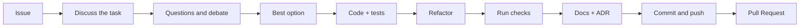

# Руководство по участию в проекте Jext

[English version](../en/CONTRIBUTING.md)

Огромное спасибо за ваш интерес к Jext! Мы рады любому вкладу, будь то исправление опечатки, реализация новой функции
или улучшение документации. Каждая помощь важна.

Этот документ — наше руководство по тому, как сделать процесс участия в проекте простым и эффективным как для вас,
так и для нас.

## 🏁 Принципы

Каждый пакет Jext существует, чтобы **обогнать самые известные библиотеки своего рода по удобству (DX) и по
скорости**. Поэтому код должен быть одновременно быстрым и элегантным, и изменение оценивается по обоим:

- **Скорость измеряется, а не предполагается.** Новый или изменённый горячий метод получает performance-тест против
  конкурентов (`packages/<pkg>/tests/Performance`; для collection это lodash, es-toolkit, remeda и ramda). Он не
  должен стать медленнее, чем был, и медленнее их.
- **DX показывается, а не заявляется.** Та же задача должна занимать меньше кода и читаться понятнее, чем у
  альтернатив. Для http уроки ставят jext рядом с fetch, XMLHttpRequest, axios, ky и ofetch.
- **Ничем не жертвуем молча.** Элегантность ценой скорости или скорость ценой понятного API — это решение: для него
  пишется ADR с цифрами.

## 🤝 Кодекс поведения (Code of Conduct)

Прежде всего, мы просим вас ознакомиться с нашим [Кодексом поведения](../../../CODE_OF_CONDUCT.md). Мы стремимся
создать открытое и дружелюбное сообщество и ожидаем, что все его участники будут следовать этим правилам.

## 🤔 Как я могу помочь?

Существует множество способов внести свой вклад:

- **🐛 Сообщать об ошибках:** Если вы нашли баг, пожалуйста, создайте
  [Issue](https://github.com/method-hub/Jext/issues), максимально подробно описав проблему и шаги для ее
  воспроизведения.
- **💡 Предлагать новые функции:** У вас есть идея, как сделать Jext лучше? Создайте
  [Issue](https://github.com/method-hub/Jext/issues), подробно описав ваше предложение и почему оно будет полезно.
- **📝 Писать код:** Вы можете взять одну из существующих задач или предложить свою.
- **📖 Улучшать документацию:** Документация есть на английском и русском; правка на одном языке тоже приветствуется,
  со вторым мы поможем.

## 🚀 Начало работы

Готовы внести изменения в код? Отлично! Вот как подготовить рабочее окружение. Понадобятся Node.js 22 или новее и
npm 10 или новее.

**1. Клонируйте репозиторий**

```bash
git clone https://github.com/method-hub/Jext.git
cd Jext
```

Если у вас нет прав на запись в `method-hub/Jext`, сначала сделайте форк на GitHub и отправляйте ветку в него:

```bash
git remote add fork https://github.com/<ваш-никнейм>/Jext.git
```

**2. Установите зависимости**

Проект — монорепозиторий на npm workspaces; одна команда ставит все пакеты:

```bash
npm ci
```

Эта команда также настроит Git-хуки (Husky), которые будут автоматически проверять ваши коммиты и пуши.

**3. Основные скрипты**

Все команды запускаются из корня репозитория:

| Команда | Что делает |
| --- | --- |
| `npm run tests:guardian` | Unit, integration и feature тесты (их запускает pre-push хук) |
| `npm run tests` | То же плюс браузерные тесты (сначала один раз `npx playwright install`) |
| `npm test -w @metapraxis/jext-<pkg>` | Тесты одного пакета |
| `npm run lint` / `npm run lint:fix` | ESLint, включая JSDoc |
| `npm run prettier` / `npm run prettier:fix` | Проверка / форматирование Prettier |
| `npm run typecheck` | Проверка типов TypeScript |
| `npm run packages:build` | Собирает три пакета в их `dist/` |
| `npm run docs:dev` | Сайт документации с горячей перезагрузкой на `localhost:5173` |
| `npm run docs:build` | Проверка и сборка сайта документации |

**4. Сориентируйтесь в проекте**

- [ARCHITECTURE.md](ARCHITECTURE.md): как устроены монорепозиторий, алиасы, тесты, сборки и сайт документации.
- `packages/<pkg>/docs/ru/ARCHITECTURE.md`: как устроен отдельный пакет, с диаграммами.
- [AGENTS.md](../../../AGENTS.md): полный свод правил. Он написан для ИИ-агентов, но это и самый полный список
  соглашений для людей.

## 🔀 Pull Request Process

Когда вы готовы что-то изменить, пройдите эти шаги.

1. **Начните с issue.** Сначала опишите баг или идею в [Issue](https://github.com/method-hub/Jext/issues) или
   возьмите существующий. Для большого изменения договоритесь о подходе в issue до того, как писать код.
2. **Создайте новую ветку.** Не работайте напрямую в `main`. Называйте ветку по типу и задаче, например
   `feat/collection-shuffle` или `fix/http-timeout`.
3. **Напишите код и тесты.** Каждое изменение приходит с тестами в том же коммите: новое поведение получает новые
   тестовые файлы, а существующий тест меняется только тогда, когда меняется API, которое он проверяет. Устройство
   тестов описано в [ARCHITECTURE.md › Тесты](ARCHITECTURE.md#тесты).
4. **Обновите документацию.** Если вы изменили то, как что-то работает, обновите соответствующий `ARCHITECTURE.md`
   в `en/` и `ru/`, JSDoc каждого затронутого метода и примеры, которые его используют. Для каждого изменения,
   заметного пользователю, добавьте changeset (`npm run changeset`): в нём пакеты, тип версии и одна строка, которую
   релиз запишет в их `CHANGELOG.md`; руками `CHANGELOG.md` не правится ([RELEASING.md](RELEASING.md)). Если вы приняли решение,
   которое меняет архитектуру или способ использования проекта, добавьте ADR (см. раздел «Документация и решения»
   ниже).
5. **Убедитесь, что все проверки проходят.** Запустите `npm run prettier`, `npm run lint` и `npm run tests:guardian`.
   Если вы затронули пакет на сайте документации, его документацию или `website/`, запустите ещё
   `npm run docs:build`.
6. **Сделайте коммит.** Мы используем [Conventional Commits](https://www.conventionalcommits.org/) (см. ниже). Это
   **обязательное требование**: Git-хук не даст создать коммит, который ему не соответствует.
7. **Откройте Pull Request.** Отправьте ветку и откройте Pull Request в `main` репозитория `method-hub/Jext`.
   Заполните шаблон PR, который появится автоматически, и укажите issue (`Closes #123`).
8. **Пройдите ревью.** CI должен быть зелёным. Отвечайте на замечания новыми коммитами, а не force-push, чтобы
   ревьюер видел, что изменилось. Мейнтейнер вливает PR после одобрения.

Изменение готово, когда:

- Prettier и ESLint не показывают новых проблем в затронутых файлах, включая JSDoc;
- `npm run tests:guardian` проходит, а у нового поведения есть новые тесты;
- `ARCHITECTURE.md` и диаграммы обновлены, у изменения, заметного пользователю, есть changeset, документация для людей — и в `en/`, и в `ru/`, а если
  изменение является решением, есть ADR;
- `npm run docs:build` проходит, если вы затронули пакет на сайте, его документацию или `website/`.

## ☑️ Правила оформления коммитов

Мы используем `commitlint` для строгого контроля формата сообщений коммитов (`commitlint.config.cjs`). Это помогает
нам генерировать changelog и упрощает навигацию по истории изменений.

**Структура сообщения:**

```text
<тип>(<область>): <короткое описание>
```

**Пример:** `feat(collection): add 'shuffle' to arrays`

### Доступные `<тип>`

- `feat`: Новая функциональность.
- `fix`: Исправление ошибки.
- `docs`: Изменения только в документации.
- `style`: Правки по кодстайлу (форматирование, пропущенные точки с запятой и т.п.).
- `refactor`: Рефакторинг кода без изменения его поведения.
- `perf`: Изменение кода, которое улучшает производительность.
- `test`: Добавление или исправление тестов.
- `ci`: Изменения в конфигурации и скриптах CI/CD.
- `chore`: Прочие изменения, не затрагивающие исходный код или тесты (конфигурация сборки, инструменты).

### Доступные `<область>`

- `main`: Основная логика, ядро.
- `docs`: Изменения, связанные с документацией.
- `deps`: Обновление или управление зависимостями.
- `ci`: Изменения в CI/CD (GitHub Actions).
- `format`: Изменения, связанные с форматированием.
- `git`: Правки, связанные с Git (хуки, `.gitignore`).
- `other`: Все, что не подошло под другие области.

Изменение внутри одного пакета использует как область имя пакета: `collection`, `http` или `jext`.

### Git-хуки

| Хук | Что запускает |
| --- | --- |
| `pre-commit` | `lint-staged`: `eslint --fix` и Prettier на индексированных файлах `packages/**/*.ts` |
| `commit-msg` | `commitlint` |
| `prepare-commit-msg` | добавляет строку `Authored-by` |
| `pre-push` | `npm run tests:guardian` |

## 🎨 Стиль кода

Мы используем **Prettier** для автоматического форматирования и **ESLint** для статического анализа кода. Конфигурации
находятся в файлах `.prettierrc.cjs` и `eslint.config.cjs` соответственно: отступ 4 пробела, одинарные кавычки,
120 колонок.

- У каждого класса, интерфейса, псевдонима типа и метода должен быть JSDoc, а у публичного API ещё и `@example`; это
  проверяет ESLint. Правила: [ARCHITECTURE.md › JSDoc](ARCHITECTURE.md#jsdoc).
- Один класс на файл, экспорт по умолчанию, файл назван по имени класса.
- У каждого члена класса явно указан `public`, `protected` или `private`.
- Значения неизменяемы: методы возвращают новое значение и никогда не меняют старое.
- Код внутри пакета импортируется через алиасы (`@Collection/*`, `@Http/*`).
- Никаких runtime-зависимостей, если их не разрешает ADR.

## 📚 Документация и решения

- Документация для людей есть на английском и русском (`en/`, `ru/`) с одинаковыми разделами в одинаковом порядке.
  Меняйте обе версии в одном pull request.
- `ARCHITECTURE.md` отвечает на вопрос, как что-то устроено сейчас; **ADR** (Architecture Decision Record) — почему
  это устроено именно так и что было отвергнуто.
- ADR пишется только для решения, которое меняет архитектуру или способ использования проекта: структуру или
  паттерны, границы пакетов, публичное API или возвращаемые типы, новую зависимость, выбор между реальными
  альтернативами. Не для исправлений багов, переименований, рефакторинга, правок линтера, тестов или документации.
- Решение, которое касается нескольких пакетов, инструментов или процесса, идёт в
  [`.github/docs/adr/`](../adr/README.md); всё остальное — в `packages/<pkg>/adr/`. Скопируйте
  [шаблон](../adr/0000-template.md), возьмите следующий номер и добавьте ADR в индекс своей папки. Принятые ADR не
  редактируются: новый ADR заменяет старый.

## 🤖 Разработка с ИИ-агентами

Jext рассчитан на разработку вместе с ИИ-агентами. Все инструкции для них лежат в одном файле,
[`AGENTS.md`](../../../AGENTS.md), плюс `packages/<pkg>/AGENTS.md` для каждого пакета. Claude Code читает его через
`CLAUDE.md`, Gemini — через `GEMINI.md`, Cursor и Codex читают `AGENTS.md` напрямую, поэтому любой агент следует тем же
правилам, что и человек. Автором остаётесь вы: вы отвечаете за каждую строку, которую написал агент.



1. **Дайте агенту issue.** Вставьте ссылку или текст issue, чтобы агент работал над задачей с понятной целью и
   критериями приёмки, а не над пожеланием в одну строку.
2. **Проговорите задачу.** Попросите агента пересказать задачу своими словами, прочитать `AGENTS.md` и
   `ARCHITECTURE.md` пакета и перечислить файлы, которые он собирается менять. Код пока не пишется.
3. **Задавайте вопросы и спорьте.** Дайте агенту задать свои вопросы и задайте свои: какие есть альтернативы, что
   сломается, что будет с публичным API, как это проверить тестами. Не принимайте слабые аргументы и просите агента
   отстоять свой выбор.
4. **Выберите наилучший вариант.** Договоритесь об одном подходе. Если выбор меняет архитектуру или способ
   использования проекта, это решение: агент оформляет его как ADR.
5. **Сделайте задачу и тесты.** Агент пишет код и тесты в одном изменении, по правилам устройства и именования тестов,
   с негативными случаями рядом с позитивными.
6. **Проведите рефакторинг.** Когда тесты зелёные, попросите агента навести порядок: убрать дублирование, упростить,
   проверить имена и JSDoc. Тесты должны остаться зелёными.
7. **Запустите проверки.** `npm run prettier`, `npm run lint`, `npm run tests:guardian` и `npm run docs:build`, если
   затронут сайт документации. Читайте вывод сами, а не только пересказ агента.
8. **Обновите документацию.** Агент обновляет то, что затронуло изменение: `ARCHITECTURE.md` и диаграммы на обоих
   языках, JSDoc, примеры, changeset для изменения, заметного пользователю, и добавляет ADR в нужную папку `adr/`, если было принято решение.
9. **Оформите коммит и отправьте.** Агент пишет сообщение в формате Conventional Commits с правильными типом и
   областью, отправляет ветку и открывает Pull Request по шаблону. Посмотрите diff сами, прежде чем звать ревьюеров.

Хорошее первое сообщение агенту:

```text
Вот issue #123: <ссылка или текст>. Прочитай AGENTS.md и документацию пакета, перескажи задачу, перечисли файлы,
которые изменишь, и спроси обо всём, что неясно. Не пиши код, пока мы не договоримся о подходе.
```

## 📄 Лицензия

Делая свой вклад, вы соглашаетесь с тем, что ваши изменения будут распространяться под [лицензией MIT](../../../LICENSE),
которая используется в этом проекте.
