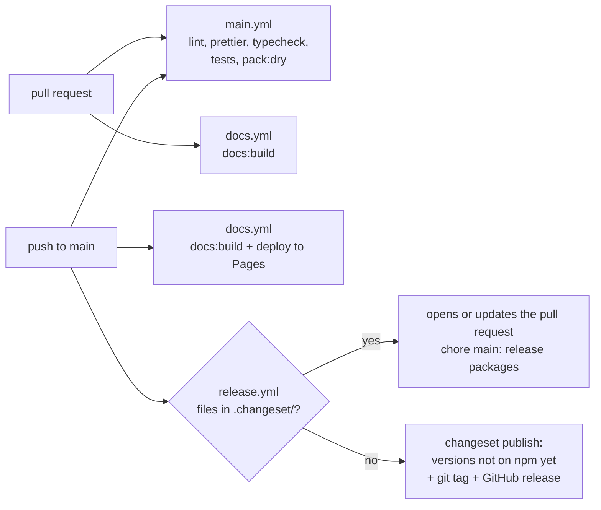

# Релизы Jext

[English version](../en/RELEASING.md)

Как изменение попадает из pull request в npm и на сайт документации. Решение, на котором это стоит:
[ADR 0008](../adr/0008-versioning-and-releases.md).

## Что публикуется

| Папка                 | Пакет npm                     | Что в архиве                                                  |
| --------------------- | ----------------------------- | ------------------------------------------------------------- |
| `packages/http`       | `@metapraxis/jext-http`       | `dist/` (`index.mjs`, `index.cjs`, `index.umd.js`, `types/`), README, CHANGELOG, LICENSE |
| `packages/collection` | `@metapraxis/jext-collection` | то же самое                                                   |
| `packages/jext`       | `@metapraxis/jext`            | то же самое; зависит от двух пакетов выше, но не встраивает их |

Корень (`jext-monorepo`) и `website/` (`jext-website`) приватные и никогда не публикуются. Каждый пакет собирается
сам через `vite build` (`npm run packages:build` собирает все три, агрегатор последним, потому что его типы берутся
из двух других). `prepack` копирует корневой `LICENSE` в пакет; копия игнорируется git.

## Три workflow

- `.github/workflows/main.yml`: каждый pull request и push в `main`. ESLint, Prettier, проверка типов
  (`npm run typecheck`), unit-, integration-, feature- и браузерные тесты (Vitest) и `npm run pack:dry`, который
  собирает три пакета и показывает файлы, которые опубликовал бы npm.
- `.github/workflows/docs.yml`: в pull request только собирает сайт (`npm run docs:build` падает на мёртвой ссылке
  или недокументированном экспорте); в `main` ещё и выкладывает его на GitHub Pages по адресу `/<репозиторий>/`.
- `.github/workflows/release.yml`: только в `main` и только в `method-hub/Jext`. Запускает
  [changesets/action](https://github.com/changesets/action), как описано ниже.

## Релиз по шагам

1. **В pull request** на каждое изменение, которое заметят пользователи, запустите `npm run changeset`. Он спросит,
   какие пакеты изменились и как (patch, minor, major), и запишет короткий markdown-файл в `.changeset/`; его текст
   станет строкой CHANGELOG. Закоммитьте его вместе с изменением. Внутренним изменениям (тесты, документация,
   инструменты) changeset не нужен.
2. **Смёржите pull request.** `release.yml` видит ожидающие changeset и открывает pull request
   «chore(main): release packages» (или обновляет его). Он запускает `npm run release:version`: changesets поднимает
   версии, поднимает зависимости `@metapraxis/jext` на поднятые пакеты, пишет разделы CHANGELOG, удаляет
   использованные файлы changeset, а npm обновляет `package-lock.json`.
3. **Проверьте и смёржите релизный pull request**, когда хотите выпустить релиз. До тех пор в нём копятся все
   смёрженные изменения.
4. **`release.yml` публикует.** Когда changeset не осталось, он запускает `npm run release`: `packages:build`, затем
   `changeset publish`, который публикует каждый пакет, чьей версии ещё нет в npm, с
   [provenance](https://docs.npmjs.com/generating-provenance-statements), создаёт git-тег
   (`@metapraxis/jext-http@0.1.0`) и GitHub release с разделом CHANGELOG.

Push в `main` без смены версии ничего не публикует: `changeset publish` пропускает версии, которые уже есть в npm.

`npm run release:status` показывает, какие пакеты поднимут ожидающие changeset.

## Перед первым релизом (один раз, владелец)

- npm: automation-токен (или granular, только на публикацию) аккаунта из организации `@metapraxis`, сохранённый как
  секрет репозитория `NPM_TOKEN` (Settings › Secrets and variables › Actions). Без него релизный pull request всё
  равно работает, а публикация пропускается с предупреждением.
- Settings › Actions › General › Workflow permissions: разрешить GitHub Actions создавать и одобрять pull requests.
- Settings › Pages › Source: GitHub Actions.
- Релизный pull request открывается с `GITHUB_TOKEN`, поэтому GitHub сам не запускает на нём CI; запушьте в
  его ветку, если нужны проверки. В нём меняются только версии и CHANGELOG.

## Проверка локально

| Команда                 | Что делает                                                                     |
| ----------------------- | ------------------------------------------------------------------------------ |
| `npm run packages:build`| Собирает три пакета в их `dist/`                                               |
| `npm run pack:dry`      | Собирает и показывает файлы каждого архива, ничего не записывает               |
| `npm run publish:dry`   | Собирает и запускает `npm publish --dry-run` для каждого пакета, ничего не публикует |
| `npm run release:status`| Показывает ожидающие changeset и какие версии они поднимут                     |

Никогда не запускайте `npm run release` или `npm publish` с ноутбука: релизы идут только через CI.

## CHANGELOG

У каждого пакета свой `CHANGELOG.md`. Changesets пишет каждую новую версию сразу под заголовком. Всё, что было до
первого публичного релиза, остаётся ниже под «Before the first public release», в разделах
[Keep a Changelog](https://keepachangelog.com/en/1.1.0/), в которых это писалось.
