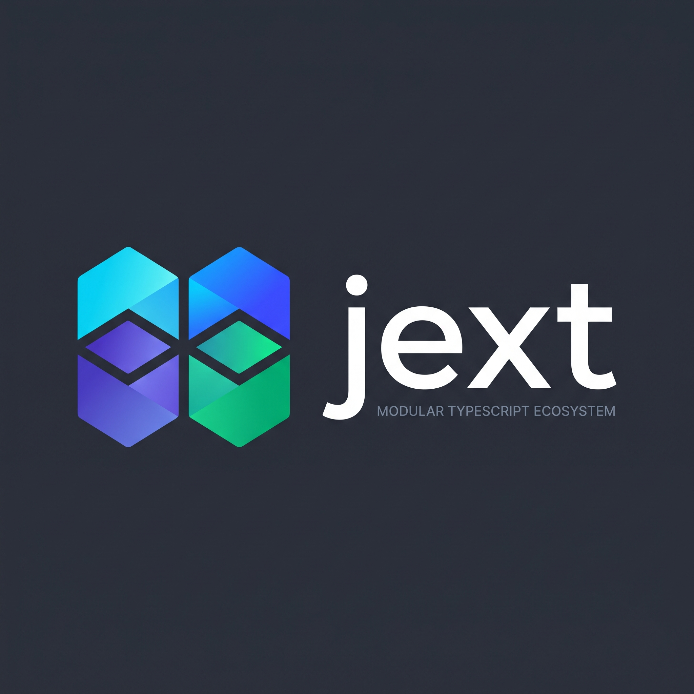

  
  
<i>A modern, fast, and feature-rich TypeScript library designed to simplify complex tasks.</i>

  

  
  
  
  
  
  
  
  

---

### 🧪 Project Status & Goals

**Jext** is currently under active development. Our mission is twofold, and this is what makes the project unique.
On one hand, we are building a **powerful, decomposed, and performant tool** for solving real-world, production-level 
tasks. We strive for a clean architecture and high-quality code to make Jext a reliable asset in any web developer's toolkit.

On the other hand, Jext is an **open educational playground**. We know how motivation can fade when working on pet projects
that risk being shelved and never seeing the light of day. Jext solves this problem. We have intentionally brought together
nearly the entire spectrum of modern web technologies under one roof:

- **Browser APIs**: From the DOM and Web Workers to low-level Web Crypto and WebSockets.
- **JavaScript & CSS**: Deep dives into the core language includes Houdini and TypedOM.
- **Paradigms**: Elegant functional programming.
- **Computer Science**: Classic algorithms and data structures.

This makes the project a living, constantly updated knowledge base. You can learn Web APIs by reading the source code and 
documentation, suggest improvements, and see your contribution become part of a large, meaningful whole. 

Your code won't be a "surrogate" that nobody needs—it will become part of a tool that other developers will use.
Join us to learn, create, and make web development better together

## 💡 Jext Philosophy

**Jext** (from **JsEXTensions** or **JsnEXT**) is our answer to the challenges of modern web development. Imagine a
Swiss Army knife for the JavaScript world: an incredibly versatile yet precise and convenient tool for any task.

At its core, Jext is built on an ambitious idea: to provide developers with a single, comprehensive toolkit that not
only encompasses the **entire browser API** (from the DOM and BOM to WebGL and WebSockets) but also extends it with a
rich set of ready-to-use libraries, data structures, and algorithms.

The key principle of our philosophy is **radical modularity**. Despite its vast arsenal of features, Jext is designed as
a fully decomposed system. Need a single string utility? Just import it without pulling in anything extra.
Want to use our Canvas abstraction? Grab only the Canvas module.

Jext gives you absolute freedom of choice: use it as a pinpoint tool for a specific task or as a full-fledged platform
covering all aspects of your project. We support both an elegant **functional style** with chainable calls and a classic
**imperative approach**, allowing you to write clean, efficient, and maintainable code in the way that suits you best.

Every package has one bar to clear: **beat the best-known libraries of its kind on developer experience and on
speed**. Not "as good as", but shorter, clearer code for the same task and faster results on the same data. We do not
take this on faith: performance tests run each package against its competitors, and the lessons solve the same task
with jext and with the popular alternatives side by side.

## 📚 Documentation

We've prepared detailed documentation to help you get up to speed quickly and start using the full power of the library.

*   [**Documentation in Russian**](.github/docs/ru/README.md)
*   [**Documentation in English**](.github/docs/en/README.md)
*   [**Architecture and monorepo (RU)**](.github/docs/ru/ARCHITECTURE.md)
*   [**Architecture and monorepo (EN)**](.github/docs/en/ARCHITECTURE.md)
*   [**Architecture decision records**](.github/docs/adr/README.md)

## 🤝 Contributing

We always welcome new ideas and help with development! Start with [CONTRIBUTING.md](CONTRIBUTING.md): it sums up how to
set up the project, the pull request process, the commit rules and how we work with AI agents, and links to the full
guides.

*   [**Contributor Guide (EN)**](.github/docs/en/CONTRIBUTING.md)
*   [**Contributor Guide (RU)**](.github/docs/ru/CONTRIBUTING.md)

---

  
Made with ❤️ by the Jext team

