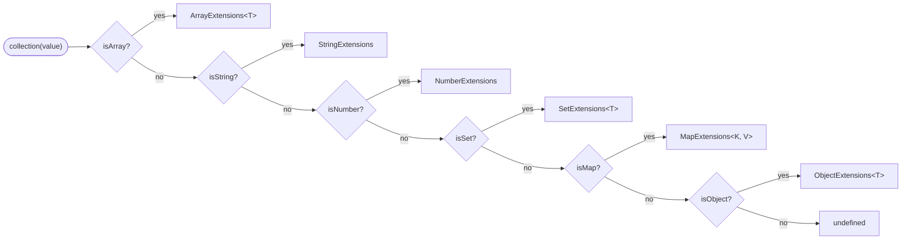
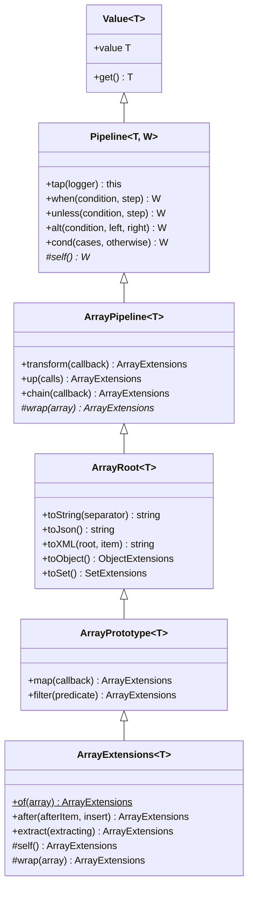
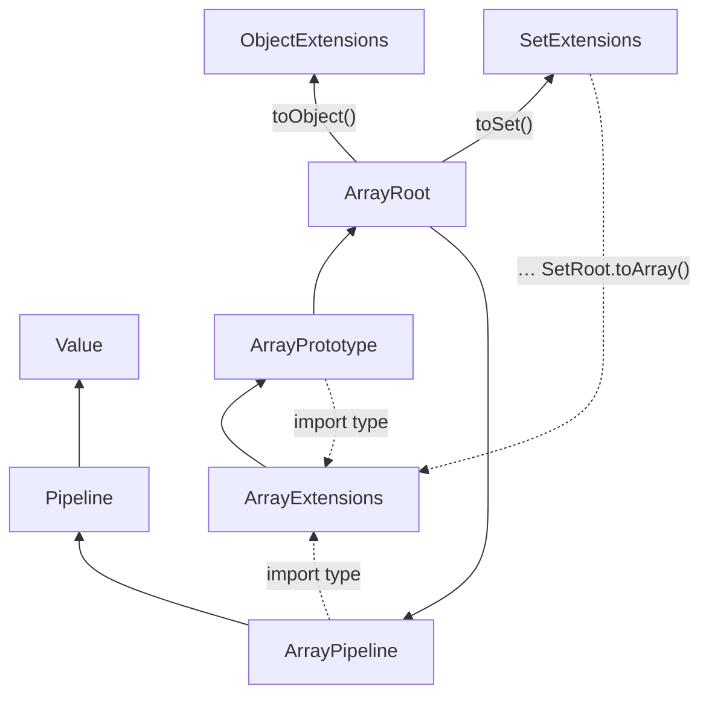
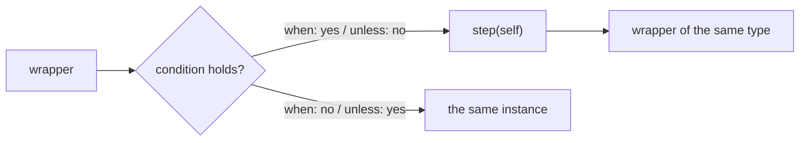
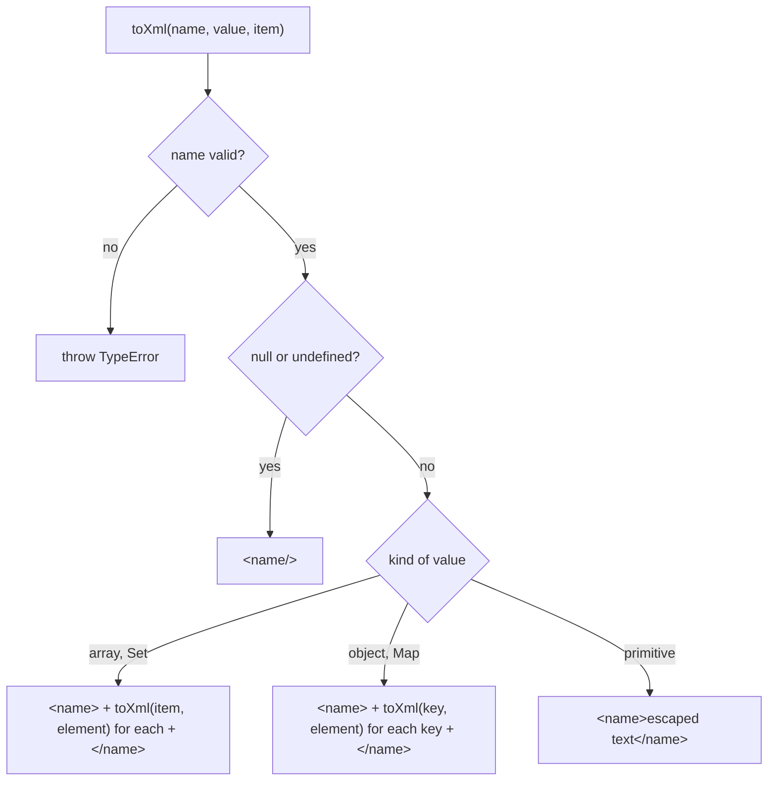
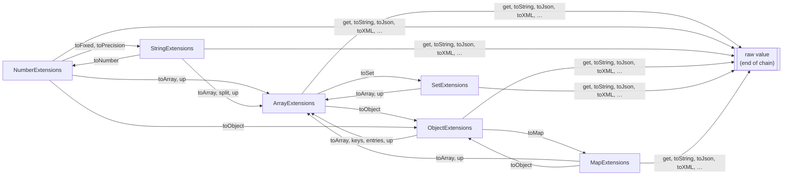

# collection architecture

[Русская версия](../ru/ARCHITECTURE.md)

`collection(value)` wraps a value in a typed object. Every method of that object returns one of four things:
a **new instance of the same wrapper**, the **same instance** (`this`), a **wrapper of another type**, or a
**raw value** that ends the chain. This document shows how the wrappers are built, how they create each other, what
every method returns and how the package is measured against other libraries.
Decision records: [ADR 0001](../../adr/0001-wrapper-ladder.md) (the ladder), [ADR 0002](../../adr/0002-pipeline-callbacks-receive-the-wrapper.md)
(pipeline callbacks receive the wrapper).

## 1. Entry: `collection()` picks a wrapper by the value type



Source: `index.ts`, type guards in `src/types.ts`. Arrays, sets and maps are objects too, so they are checked
before `isObject`. Any other value (boolean, `null`, bigint, Date…) returns `undefined` for now. The value is not
copied when it is wrapped: `collection(array).get()` is the same array. Every method that changes something works
on a copy.

```ts
collection([1, 2]);                 // ArrayExtensions<number>
collection('abc');                  // StringExtensions
collection(42);                     // NumberExtensions
collection(new Set([1]));           // SetExtensions<number>
collection(new Map([['a', 1]]));    // MapExtensions<string, number>
collection({ a: 1 });               // ObjectExtensions<{ a: number }>
```

## 2. Hierarchy: every type has the same five-layer ladder



From bottom to top:

| Layer           | File                       | Holds                                                                        |
| --------------- | -------------------------- | ---------------------------------------------------------------------------- |
| `Value`         | `src/Value.ts`             | The value, `get()` and `value`                                               |
| `Pipeline`      | `src/Pipeline.ts`          | `tap`, `when`, `unless`, `alt`, `cond`, shared by every type                 |
| `<T>Pipeline`   | `src/<T>/<T>Pipeline.ts`   | `transform`, `up`, `chain` for that type                                     |
| `<T>Root`       | `src/<T>/<T>Root.ts`       | Conversions: `toString`, `toJson`, `toXML`, `toArray`, `toObject`…            |
| `<T>Prototype`  | `src/<T>/<T>Prototype.ts`  | Native methods of the type that return a wrapper                             |
| `<T>Extensions` | `src/<T>/<T>Extensions.ts` | Jext methods; the only concrete class, the one `collection()` returns        |

Every layer except `<T>Extensions` is abstract. Only the Array ladder is drawn; the other types have the same
layers with their own methods:

| Type                  | `<T>Root`                                                  | `<T>Prototype`           | `<T>Extensions`         |
| --------------------- | ---------------------------------------------------------- | ------------------------ | ----------------------- |
| `ArrayExtensions<T>`  | `toString`, `toJson`, `toXML`, `toObject`, `toSet`         | `map`, `filter`          | `after`, `extract`      |
| `NumberExtensions`    | `toString`, `toJson`, `toBoolean`, `toArray`, `toObject`   | `toFixed`, `toPrecision` | `clamp`, `inRange`      |
| `StringExtensions`    | `toString`, `toJson`, `toXML`, `toNumber`, `toArray`       | `trim`, `split`          | `capitalize`, `palindrome` |
| `ObjectExtensions<T>` | `toString`, `toJson`, `toXML`, `toArray`, `toMap`          | `keys`, `entries`        | `pick`, `omit`          |
| `SetExtensions<T>`    | `toString`, `toJson`, `toXML`, `toArray`                   | `add`, `has`             | `map`, `filter`         |
| `MapExtensions<K, V>` | `toString`, `toJson`, `toXML`, `toObject`, `toArray`       | `set`, `has`             | `mapValues`, `filter`   |

Plain objects have no useful prototype methods, so `ObjectPrototype` wraps the `Object.keys` and `Object.entries`
statics. `MapPrototype` wraps `has` and `set` but not `get`: the name `get()` already belongs to `Value` and ends
every chain.

## 3. How a layer creates the next wrapper: `self()` and `wrap()`

A lower layer must return the concrete wrapper (`map` in `ArrayPrototype` returns `ArrayExtensions<U>`), but it
cannot import `ArrayExtensions` at runtime: `ArrayExtensions` extends it, so the import would be a cycle and the
class would be `undefined` when the lower layer is defined. Instead every `<T>Extensions` implements two protected
methods, and the lower layers call them:

| Method        | Declared in   | Does                                                                                   |
| ------------- | ------------- | -------------------------------------------------------------------------------------- |
| `self()`      | `Pipeline`    | Returns `this`, typed as the concrete wrapper `W`, for `when`, `unless`, `alt`, `cond`, `chain` |
| `wrap(value)` | `<T>Pipeline` | Returns `new <T>Extensions(value)`; may change the element type (`wrap<U>(array: U[])`) |

The lower layers import their own `<T>Extensions` with `import type`, which disappears from the compiled code.



Solid arrows are runtime imports, dotted ones are type-only. Conversions to another type do import that type at
runtime (`ArrayRoot` creates `ObjectExtensions` and `SetExtensions`, `SetRoot` creates `ArrayExtensions`), so the
types still form cycles with each other. They are safe when a module is entered through `index.ts` or a
`<T>Extensions` file: every class is defined before any method runs. Importing an abstract layer such as
`SetRoot` first fails; `tests/Feature/Imports` checks that every `<T>Extensions` works as the first import.

Step by step, `collection([3, 1, 2]).filter((n) => n > 1)`:

1. `collection()` sees an array and returns `new ArrayExtensions([3, 1, 2])`; the array is not copied.
2. `filter` lives in `ArrayPrototype`. `this.value.filter(predicate)` builds a new array `[3, 2]`.
3. `this.wrap([3, 2])` runs the implementation from `ArrayExtensions`: `new ArrayExtensions([3, 2])`.
4. The original `[3, 1, 2]` is untouched, the chain continues on the new wrapper.

## 4. Conditionals: steps receive the wrapper

`when`, `unless`, `alt` and `cond` take a **condition** and **steps**:

- a condition is a boolean or a predicate over the raw value, `(value: T) => boolean`; it must not change the value;
- a step is `(self: W) => W`: it receives the wrapper and returns a wrapper of the same type.

Because the step receives the wrapper, every method of the type is available in it, and the result keeps the type
of the chain:

```ts
collection([3, 1, 2])
    .when((array) => array.length > 2, (self) => self.filter((n) => n > 1)) // ArrayExtensions<number>
    .map((n) => n * 10)
    .get(); // [30, 20]
```

| Method                          | Runs                                                      | Returns when nothing runs |
| ------------------------------- | --------------------------------------------------------- | ------------------------- |
| `when(condition, step)`         | `step` when the condition holds                           | the same instance         |
| `unless(condition, step)`       | `step` when the condition does not hold                   | the same instance         |
| `alt(condition, left, right)`   | `left` when it holds, `right` otherwise; always one       | —                         |
| `cond(cases, otherwise?)`       | the step of the first `[condition, step]` pair that holds | `otherwise(self)`, or the same instance without it |
| `chain(callback)`               | always; may change the element type (`ArrayExtensions<R>`) | —                         |
| `tap(logger)`                   | `logger(value)` for a side effect                         | always the same instance  |



`cond` checks the pairs in order and stops at the first match; later steps never run:

```ts
collection(150).cond(
    [
        [(n) => n < 0, (self) => self.clamp(0, 0)],
        [(n) => n > 100, (self) => self.clamp(0, 100)],
    ],
    (self) => self, // optional otherwise
).get(); // 100
```

A step cannot change the type of the value: on an `ObjectExtensions<{ name: string }>` a step that adds `age` does
not compile. Declare the wider type up front (`collection<{ name: string; age?: number }>(user)`) or use `chain`,
which allows another element type.

## 5. Conversions (`<T>Root`) and the XML serializer

| Method                 | Array                     | Number                | String               | Object               | Set                  | Map                         |
| ---------------------- | ------------------------- | --------------------- | -------------------- | -------------------- | -------------------- | --------------------------- |
| `toString(…)`          | join, `', '`              | radix, 10             | the string           | `key: value`, `', '` | join, `', '`         | `key: value`, `', '`        |
| `toJson()`             | `JSON.stringify`          | `JSON.stringify`      | quoted string        | `JSON.stringify`     | as an array          | as an object                |
| `toXML(…)`             | `<items><item>`           | —                     | `<value>`            | `<object><key>`      | `<items><item>`      | `<map><key>`                |
| `toArray()`            | —                         | `[value]`             | characters           | values               | values               | `[key, value]` entries      |
| `toObject()`           | `{ 0: a, 1: b }`          | `{ value }`           | —                    | —                    | —                    | `String(key)` properties    |
| other                  | `toSet()`                 | `toBoolean()`         | `toNumber()`         | `toMap()`            | —                    | —                           |

Text and booleans are raw values; arrays, objects, sets and maps come back as wrappers, so the chain goes on:

```ts
collection(['a', 'b']).toObject().toMap().toArray().map(([key, item]) => `${key}=${item}`).get(); // ['0=a', '1=b']
```

Details that are easy to miss:

- `JSON.stringify` writes a `Set` and a `Map` as `{}`, so `SetRoot.toJson()` writes the values as an array and
  `MapRoot.toJson()` writes the entries as an object.
- `MapRoot.toJson()`, `toObject()` and `toXML()` turn keys into text with `String(key)`. Keys `1` and `'1'` become
  one property; the later entry wins.
- `StringRoot.toNumber()` gives `NaN` for an empty or blank string, unlike `Number('')`, which gives `0`.
- `StringRoot.toArray()` splits by code points, so an emoji stays one element.
- `NumberRoot.toJson()` writes `NaN` and `Infinity` as `null`, as `JSON.stringify` does.

`toXML` uses `toXml(name, value, item)` from `src/utils.ts`; the package has no XML dependency.



- A valid name starts with a letter or `_` and holds letters, digits, `_`, `-` and `.`. A key such as `'first name'`
  or `1` throws `TypeError`: the serializer does not invent names.
- `& < > " '` are escaped. No XML declaration is added.

```ts
collection([{ id: 1 }]).toXML('users', 'user'); // '<users><user><id>1</id></user></users>'
```

## 6. Transitions between types



Every type also returns new instances of itself (`map`, `filter`, `after`, `clamp`, `trim`, `pick`, `add`, `set`,
`mapValues`, `transform`, `chain`…), see the table below.

## 7. Method return table

Kinds: **new, same type** — a new instance of the same wrapper; **same instance** — `this`; **other wrapper** —
another `*Extensions`; **raw** — a plain value.

| Class                | Method                                               | Returns                                | Kind                         |
| -------------------- | ---------------------------------------------------- | -------------------------------------- | ---------------------------- |
| `Value`              | `get(), value`                                       | `T`                                    | raw                          |
| `Pipeline`           | `tap(logger)`                                        | `this`                                 | same instance                |
| `Pipeline`           | `when(condition, step), unless(condition, step)`     | `W`                                    | step result or same instance |
| `Pipeline`           | `alt(condition, left, right)`                        | `W`                                    | step result                  |
| `Pipeline`           | `cond(cases, otherwise?)`                            | `W`                                    | step result or same instance |
| `ArrayPipeline`      | `transform(callback)`                                | `ArrayExtensions<R>`                   | new, same type               |
| `ArrayPipeline`      | `up(calls)`                                          | `ArrayExtensions<R>`                   | new, same type               |
| `ArrayPipeline`      | `chain(callback)`                                    | `ArrayExtensions<R>`                   | callback result              |
| `ArrayRoot`          | `toString(separator), toJson(), toXML(root, item)`   | `string`                               | raw                          |
| `ArrayRoot`          | `toObject()`                                         | `ObjectExtensions<Record<number, T>>`  | other wrapper                |
| `ArrayRoot`          | `toSet()`                                            | `SetExtensions<T>`                     | other wrapper                |
| `ArrayPrototype`     | `map(callback)`                                      | `ArrayExtensions<U>`                   | new, same type               |
| `ArrayPrototype`     | `filter(predicate)`                                  | `ArrayExtensions<T>`                   | new, same type               |
| `ArrayExtensions`    | `of(array)` (static)                                 | `ArrayExtensions<T>`                   | new, same type               |
| `ArrayExtensions`    | `after(afterItem, insert), extract(extracting)`      | `ArrayExtensions<T>`                   | new, same type               |
| `NumberPipeline`     | `transform(callback)`                                | `NumberExtensions`                     | new, same type               |
| `NumberPipeline`     | `chain(callback)`                                    | `NumberExtensions`                     | callback result              |
| `NumberPipeline`     | `up(calls)`                                          | `ArrayExtensions<R>`                   | other wrapper                |
| `NumberRoot`         | `toString(radix), toJson()`                          | `string`                               | raw                          |
| `NumberRoot`         | `toBoolean()`                                        | `boolean`                              | raw                          |
| `NumberRoot`         | `toArray()`                                          | `ArrayExtensions<number>`              | other wrapper                |
| `NumberRoot`         | `toObject()`                                         | `ObjectExtensions<{ value: number }>`  | other wrapper                |
| `NumberPrototype`    | `toFixed(digits), toPrecision(precision)`            | `StringExtensions`                     | other wrapper                |
| `NumberExtensions`   | `of(value)` (static), `clamp(min, max)`              | `NumberExtensions`                     | new, same type               |
| `NumberExtensions`   | `inRange(min, max)`                                  | `boolean`                              | raw                          |
| `StringPipeline`     | `transform(callback)`                                | `StringExtensions`                     | new, same type               |
| `StringPipeline`     | `chain(callback)`                                    | `StringExtensions`                     | callback result              |
| `StringPipeline`     | `up(calls)`                                          | `ArrayExtensions<R>`                   | other wrapper                |
| `StringRoot`         | `toString(), toJson(), toXML(tag)`                   | `string`                               | raw                          |
| `StringRoot`         | `toNumber()`                                         | `NumberExtensions`                     | other wrapper                |
| `StringRoot`         | `toArray()`                                          | `ArrayExtensions<string>`              | other wrapper                |
| `StringPrototype`    | `trim()`                                             | `StringExtensions`                     | new, same type               |
| `StringPrototype`    | `split(separator, limit)`                            | `ArrayExtensions<string>`              | other wrapper                |
| `StringExtensions`   | `of(value)` (static), `capitalize()`                 | `StringExtensions`                     | new, same type               |
| `StringExtensions`   | `palindrome()`                                       | `boolean`                              | raw                          |
| `ObjectPipeline`     | `transform(callback)`                                | `ObjectExtensions<R>`                  | new, same type               |
| `ObjectPipeline`     | `chain(callback)`                                    | `ObjectExtensions<R>`                  | callback result              |
| `ObjectPipeline`     | `up(calls)`                                          | `ArrayExtensions<R>`                   | other wrapper                |
| `ObjectRoot`         | `toString(separator), toJson(), toXML(root)`         | `string`                               | raw                          |
| `ObjectRoot`         | `toArray()`                                          | `ArrayExtensions<T[keyof T]>`          | other wrapper                |
| `ObjectRoot`         | `toMap()`                                            | `MapExtensions<string, T[keyof T]>`    | other wrapper                |
| `ObjectPrototype`    | `keys()`                                             | `ArrayExtensions<string>`              | other wrapper                |
| `ObjectPrototype`    | `entries()`                                          | `ArrayExtensions<[string, T[keyof T]]>`| other wrapper                |
| `ObjectExtensions`   | `of(value)` (static)                                 | `ObjectExtensions<T>`                  | new, same type               |
| `ObjectExtensions`   | `pick(keys), omit(keys)`                             | `ObjectExtensions<Pick<T, K>>`, `ObjectExtensions<Omit<T, K>>` | new, same type |
| `SetPipeline`        | `transform(callback)`                                | `SetExtensions<R>`                     | new, same type               |
| `SetPipeline`        | `chain(callback)`                                    | `SetExtensions<R>`                     | callback result              |
| `SetPipeline`        | `up(calls)`                                          | `ArrayExtensions<R>`                   | other wrapper                |
| `SetRoot`            | `toString(separator), toJson(), toXML(root, item)`   | `string`                               | raw                          |
| `SetRoot`            | `toArray()`                                          | `ArrayExtensions<T>`                   | other wrapper                |
| `SetPrototype`       | `add(value)`                                         | `SetExtensions<T>`                     | new, same type               |
| `SetPrototype`       | `has(value)`                                         | `boolean`                              | raw                          |
| `SetExtensions`      | `of(set)` (static), `filter(predicate)`              | `SetExtensions<T>`                     | new, same type               |
| `SetExtensions`      | `map(callback)`                                      | `SetExtensions<U>`                     | new, same type               |
| `MapPipeline`        | `transform(callback)`                                | `MapExtensions<RK, RV>`                | new, same type               |
| `MapPipeline`        | `chain(callback)`                                    | `MapExtensions<RK, RV>`                | callback result              |
| `MapPipeline`        | `up(calls)`                                          | `ArrayExtensions<R>`                   | other wrapper                |
| `MapRoot`            | `toString(separator), toJson(), toXML(root)`         | `string`                               | raw                          |
| `MapRoot`            | `toObject()`                                         | `ObjectExtensions<Record<string, V>>`  | other wrapper                |
| `MapRoot`            | `toArray()`                                          | `ArrayExtensions<[K, V]>`              | other wrapper                |
| `MapPrototype`       | `set(key, value)`                                    | `MapExtensions<K, V>`                  | new, same type               |
| `MapPrototype`       | `has(key)`                                           | `boolean`                              | raw                          |
| `MapExtensions`      | `of(map)` (static), `filter(predicate)`              | `MapExtensions<K, V>`                  | new, same type               |
| `MapExtensions`      | `mapValues(callback)`                                | `MapExtensions<K, U>`                  | new, same type               |

## 8. Pure functions and copies

The logic of every `<T>Extensions` method lives in a pure function in `src/<T>/extensions/<name>.ts`, re-exported
from `src/<T>/extensions/index.ts`. The method only passes `this.value` and wraps the result:

```ts
// src/Number/NumberExtensions.ts
public clamp(min: number, max: number): NumberExtensions {
    return new NumberExtensions(clamp(this.value, min, max));
}
```

| Folder              | Functions                                                                                          |
| ------------------- | -------------------------------------------------------------------------------------------------- |
| `Array/extensions`  | `after`, `avg`, `before`, `chunk`, `compact`, `diff`, `dissimilar`, `distinctBy`, `empty`, `equal`, `except`, `extract`, `first`, `groupBy`, `keyBy`, `last`, `max`, `median`, `min`, `partition`, `pluck`, `random`, `repeat`, `repetitive`, `same`, `shuffle`, `sum`, `tally`, `unique`, `unzip`, `zip` |
| `Number/extensions` | `clamp`, `inRange`                                                                                 |
| `String/extensions` | `capitalize`, `palindrome`                                                                         |
| `Object/extensions` | `pick`, `omit`                                                                                     |
| `Set/extensions`    | `map`, `filter`                                                                                    |
| `Map/extensions`    | `mapValues`, `filter`                                                                              |

Only `after` and `extract` of the Array functions are wired into `ArrayExtensions` so far; the others are
importable functions waiting for their methods.

Who copies, so that nothing is copied twice:

- The pure function returns a new value and never changes its argument (`after`, `pick`, `omit`, `map`…). The
  method passes `this.value` without copying it first.
- A native method that already returns a new value (`Array.prototype.map`, `filter`, `String.prototype.trim`) is
  wrapped as it is.
- A native method that changes the value (`Set.prototype.add`, `Map.prototype.set`) runs on `new Set(this.value)` /
  `new Map(this.value)`.
- `transform` and `up` give their callbacks a copy, because a callback may change what it receives. Conditions,
  `tap` and the steps of `when` get the value or the wrapper without a copy: they read, and wrapper methods copy.
- Copies are shallow: nested objects are shared between the original and the result.

## 9. Performance tests

`tests/Performance/*.perf.test.ts` compare jext with the flagship FP libraries, installed as devDependencies of the
package: `lodash`, `es-toolkit` (and `es-toolkit/compat` where the core has no such function), `remeda` and `ramda`.
`tinybench` (2.9) runs every variant, and the test logs a table of
ops/sec per size. Run them with `npm run tests:performance`; they never gate CI.

| File                                                   | Compares                                             | Sizes                        |
| ------------------------------------------------------ | ---------------------------------------------------- | ---------------------------- |
| `ArrayExtensions.map.perf.test.ts`                     | `map` against the native method                      | 100 000                      |
| `ArrayExtensions.map.libraries.perf.test.ts`           | `map`                                                | 10, 1 000, 100 000, 1 000 000 |
| `ArrayExtensions.filter.libraries.perf.test.ts`        | `filter`                                             | 10 … 1 000 000               |
| `ArrayExtensions.chain.map-filter.perf.test.ts`        | `map → filter` against `_.chain`, `R.pipe`, ramda `pipe` | 10 … 1 000 000           |
| `unique.libraries.perf.test.ts`                        | `unique`                                             | 10 … 1 000 000               |
| `chunk.libraries.perf.test.ts`                         | `chunk` by 3                                         | 10 … 1 000 000               |
| `ObjectExtensions.pick.libraries.perf.test.ts`         | `pick` half of the keys                              | 10, 1 000, 100 000 keys      |
| `ObjectExtensions.omit.libraries.perf.test.ts`         | `omit` half of the keys                              | 10, 1 000, 100 000 keys      |
| `NumberExtensions.clamp.libraries.perf.test.ts`        | `clamp`, the function and the wrapper                | 10 … 1 000 000 calls         |
| `StringExtensions.capitalize.libraries.perf.test.ts`   | `capitalize` against `upperFirst` / remeda `capitalize` | 10 … 1 000 000 calls      |

Every variant must return the same value, which the test checks with `toEqual`, so a variant cannot win by doing
less. Small sizes show the cost of the wrapper itself, large sizes show who copies less. `omit` builds a new
object instead of deleting keys from a copy, because `delete` switches a V8 object to a slower dictionary mode, and
`clamp` uses plain comparisons, because `Math.min(Math.max())` measured several times slower.

## Next types

Other types (Bigint, Date, Json, RegExp, Symbol, WeakMap, WeakSet, Math) were removed until they are discussed.
