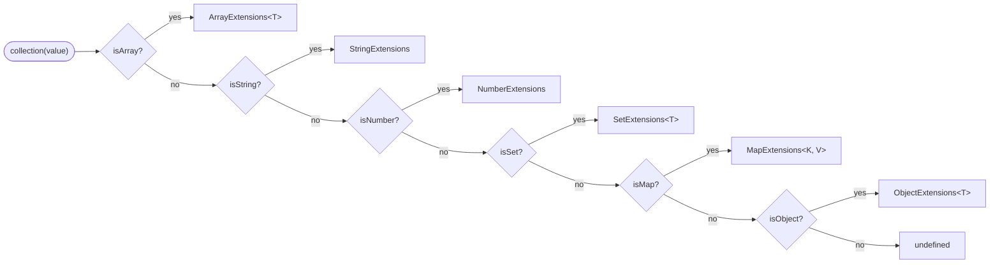
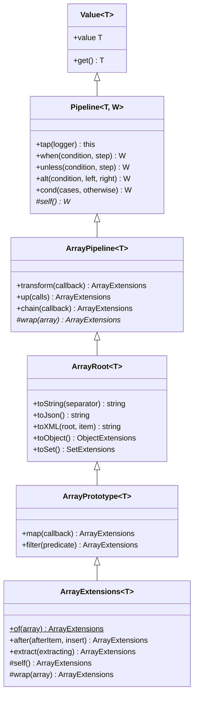
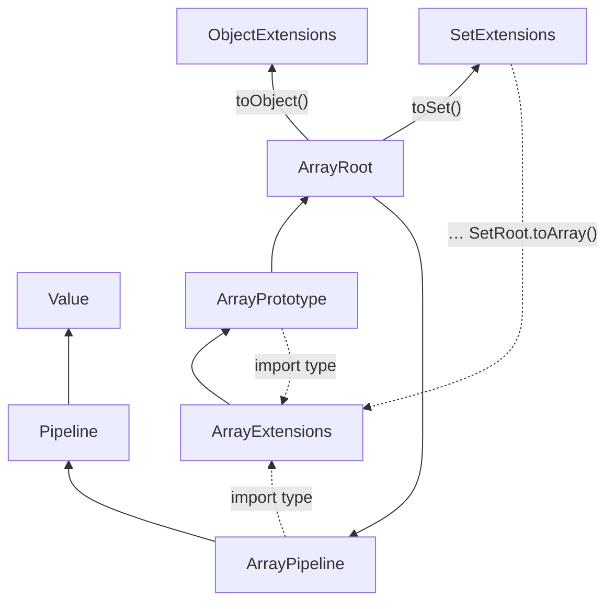
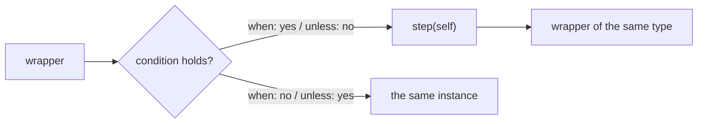
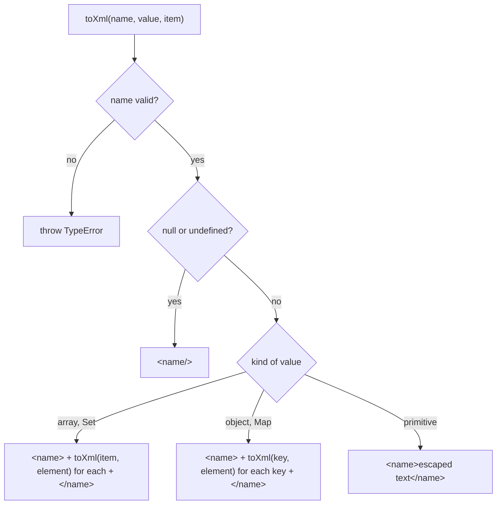
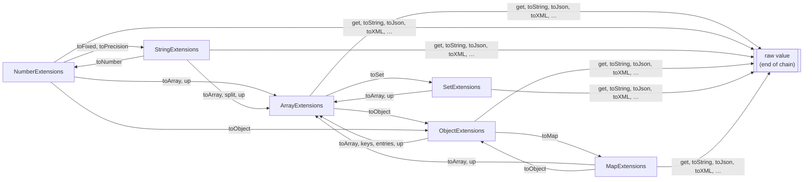

# Архитектура collection

[English version](../en/ARCHITECTURE.md)

`collection(value)` заворачивает значение в типизированный объект. Каждый метод этого объекта возвращает одно из
четырёх: **новый экземпляр той же обёртки**, **тот же экземпляр** (`this`), **обёртку другого типа** или **сырое
значение**, на котором цепочка заканчивается. Здесь показано, как устроены обёртки, как они создают друг друга, что
возвращает каждый метод и как пакет сравнивается с другими библиотеками.
Решения: [ADR 0001](../../adr/0001-wrapper-ladder.md) (лестница классов), [ADR 0002](../../adr/0002-pipeline-callbacks-receive-the-wrapper.md)
(callback'и пайплайна получают обёртку).

## 1. Вход: `collection()` выбирает обёртку по типу значения



Код: `index.ts`, проверки типов в `src/types.ts`. Массивы, Set и Map тоже объекты, поэтому их проверяют раньше
`isObject`. Любое другое значение (boolean, `null`, bigint, Date…) пока возвращает `undefined`. При заворачивании
значение не копируется: `collection(array).get()` возвращает тот же массив. Каждый метод, который что-то меняет,
работает на копии.

```ts
collection([1, 2]);                 // ArrayExtensions<number>
collection('abc');                  // StringExtensions
collection(42);                     // NumberExtensions
collection(new Set([1]));           // SetExtensions<number>
collection(new Map([['a', 1]]));    // MapExtensions<string, number>
collection({ a: 1 });               // ObjectExtensions<{ a: number }>
```

## 2. Иерархия: у каждого типа одна и та же лестница из пяти слоёв



Снизу вверх:

| Слой            | Файл                       | Что в нём                                                                    |
| --------------- | -------------------------- | ---------------------------------------------------------------------------- |
| `Value`         | `src/Value.ts`             | Значение, `get()` и `value`                                                  |
| `Pipeline`      | `src/Pipeline.ts`          | `tap`, `when`, `unless`, `alt`, `cond`, общие для всех типов                 |
| `<T>Pipeline`   | `src/<T>/<T>Pipeline.ts`   | `transform`, `up`, `chain` для этого типа                                    |
| `<T>Root`       | `src/<T>/<T>Root.ts`       | Преобразования: `toString`, `toJson`, `toXML`, `toArray`, `toObject`…        |
| `<T>Prototype`  | `src/<T>/<T>Prototype.ts`  | Нативные методы типа, которые возвращают обёртку                             |
| `<T>Extensions` | `src/<T>/<T>Extensions.ts` | Методы Jext; единственный конкретный класс, его и возвращает `collection()`  |

Все слои, кроме `<T>Extensions`, абстрактные. Нарисована только лестница Array; у остальных типов те же слои со
своими методами:

| Тип                   | `<T>Root`                                                  | `<T>Prototype`           | `<T>Extensions`         |
| --------------------- | ---------------------------------------------------------- | ------------------------ | ----------------------- |
| `ArrayExtensions<T>`  | `toString`, `toJson`, `toXML`, `toObject`, `toSet`         | `map`, `filter`          | `after`, `extract`      |
| `NumberExtensions`    | `toString`, `toJson`, `toBoolean`, `toArray`, `toObject`   | `toFixed`, `toPrecision` | `clamp`, `inRange`      |
| `StringExtensions`    | `toString`, `toJson`, `toXML`, `toNumber`, `toArray`       | `trim`, `split`          | `capitalize`, `palindrome` |
| `ObjectExtensions<T>` | `toString`, `toJson`, `toXML`, `toArray`, `toMap`          | `keys`, `entries`        | `pick`, `omit`          |
| `SetExtensions<T>`    | `toString`, `toJson`, `toXML`, `toArray`                   | `add`, `has`             | `map`, `filter`         |
| `MapExtensions<K, V>` | `toString`, `toJson`, `toXML`, `toObject`, `toArray`       | `set`, `has`             | `mapValues`, `filter`   |

У обычных объектов нет полезных методов прототипа, поэтому `ObjectPrototype` заворачивает статические `Object.keys`
и `Object.entries`. `MapPrototype` заворачивает `has` и `set`, но не `get`: имя `get()` уже занято методом `Value`,
который завершает любую цепочку.

## 3. Как слой создаёт следующую обёртку: `self()` и `wrap()`

Нижний слой должен вернуть конкретную обёртку (`map` в `ArrayPrototype` возвращает `ArrayExtensions<U>`), но не
может импортировать `ArrayExtensions` в рантайме: `ArrayExtensions` наследует его, импорт получился бы циклом, и в
момент объявления нижнего слоя класс был бы `undefined`. Поэтому каждый `<T>Extensions` реализует два защищённых
метода, а нижние слои вызывают их:

| Метод         | Где объявлен  | Что делает                                                                             |
| ------------- | ------------- | -------------------------------------------------------------------------------------- |
| `self()`      | `Pipeline`    | Возвращает `this` с типом конкретной обёртки `W` для `when`, `unless`, `alt`, `cond`, `chain` |
| `wrap(value)` | `<T>Pipeline` | Возвращает `new <T>Extensions(value)`; может поменять тип элементов (`wrap<U>(array: U[])`) |

Свой `<T>Extensions` нижние слои импортируют через `import type`, который исчезает из скомпилированного кода.



Сплошные стрелки это импорты в рантайме, пунктирные только типы. Преобразования в другой тип импортируют этот тип в
рантайме (`ArrayRoot` создаёт `ObjectExtensions` и `SetExtensions`, `SetRoot` создаёт `ArrayExtensions`), поэтому
типы по-прежнему образуют циклы между собой. Они безопасны, когда модуль загружается через `index.ts` или файл
`<T>Extensions`: все классы объявлены раньше, чем запустится любой метод. Если первым импортировать абстрактный
слой, например `SetRoot`, загрузка упадёт; `tests/Feature/Imports` проверяет, что каждый `<T>Extensions` работает
как первый импорт.

По шагам, `collection([3, 1, 2]).filter((n) => n > 1)`:

1. `collection()` видит массив и возвращает `new ArrayExtensions([3, 1, 2])`; массив не копируется.
2. `filter` живёт в `ArrayPrototype`. `this.value.filter(predicate)` строит новый массив `[3, 2]`.
3. `this.wrap([3, 2])` выполняет реализацию из `ArrayExtensions`: `new ArrayExtensions([3, 2])`.
4. Исходный `[3, 1, 2]` не тронут, цепочка продолжается на новой обёртке.

## 4. Условные методы: шаги получают обёртку

`when`, `unless`, `alt` и `cond` принимают **условие** и **шаги**:

- условие это boolean или предикат над сырым значением, `(value: T) => boolean`; менять значение он не должен;
- шаг это `(self: W) => W`: получает обёртку и возвращает обёртку того же типа.

Шаг получает обёртку, поэтому внутри доступны все методы типа, а результат сохраняет тип цепочки:

```ts
collection([3, 1, 2])
    .when((array) => array.length > 2, (self) => self.filter((n) => n > 1)) // ArrayExtensions<number>
    .map((n) => n * 10)
    .get(); // [30, 20]
```

| Метод                           | Что выполняет                                                    | Что вернёт, если ничего не выполнилось |
| ------------------------------- | ---------------------------------------------------------------- | -------------------------------------- |
| `when(condition, step)`         | `step`, когда условие выполнено                                  | тот же экземпляр                       |
| `unless(condition, step)`       | `step`, когда условие не выполнено                               | тот же экземпляр                       |
| `alt(condition, left, right)`   | `left`, когда выполнено, иначе `right`; всегда ровно один        | —                                      |
| `cond(cases, otherwise?)`       | шаг первой пары `[condition, step]`, чьё условие выполнено       | `otherwise(self)`, а без него тот же экземпляр |
| `chain(callback)`               | всегда; может поменять тип элементов (`ArrayExtensions<R>`)      | —                                      |
| `tap(logger)`                   | `logger(value)` ради побочного эффекта                           | всегда тот же экземпляр                |



`cond` проверяет пары по порядку и останавливается на первом совпадении; следующие шаги не запускаются:

```ts
collection(150).cond(
    [
        [(n) => n < 0, (self) => self.clamp(0, 0)],
        [(n) => n > 100, (self) => self.clamp(0, 100)],
    ],
    (self) => self, // otherwise, необязательно
).get(); // 100
```

Шаг не может поменять тип значения: на `ObjectExtensions<{ name: string }>` шаг, который добавляет `age`, не
скомпилируется. Объявите широкий тип заранее (`collection<{ name: string; age?: number }>(user)`) или используйте
`chain`, где тип элементов меняться может.

## 5. Преобразования (`<T>Root`) и XML-сериализатор

| Метод                  | Array                     | Number                | String               | Object               | Set                  | Map                         |
| ---------------------- | ------------------------- | --------------------- | -------------------- | -------------------- | -------------------- | --------------------------- |
| `toString(…)`          | join, `', '`              | основание, 10         | сама строка          | `key: value`, `', '` | join, `', '`         | `key: value`, `', '`        |
| `toJson()`             | `JSON.stringify`          | `JSON.stringify`      | строка в кавычках    | `JSON.stringify`     | как массив           | как объект                  |
| `toXML(…)`             | `<items><item>`           | —                     | `<value>`            | `<object><key>`      | `<items><item>`      | `<map><key>`                |
| `toArray()`            | —                         | `[value]`             | символы              | значения             | значения             | пары `[key, value]`         |
| `toObject()`           | `{ 0: a, 1: b }`          | `{ value }`           | —                    | —                    | —                    | свойства `String(key)`      |
| другое                 | `toSet()`                 | `toBoolean()`         | `toNumber()`         | `toMap()`            | —                    | —                           |

Текст и boolean возвращаются сырыми; массивы, объекты, Set и Map приходят обёртками, так что цепочка продолжается:

```ts
collection(['a', 'b']).toObject().toMap().toArray().map(([key, item]) => `${key}=${item}`).get(); // ['0=a', '1=b']
```

Детали, которые легко упустить:

- `JSON.stringify` пишет `Set` и `Map` как `{}`, поэтому `SetRoot.toJson()` пишет значения массивом, а
  `MapRoot.toJson()` пишет пары объектом.
- `MapRoot.toJson()`, `toObject()` и `toXML()` превращают ключи в текст через `String(key)`. Ключи `1` и `'1'`
  становятся одним свойством, побеждает более поздняя пара.
- `StringRoot.toNumber()` даёт `NaN` для пустой строки или строки из пробелов, в отличие от `Number('')`, который
  даёт `0`.
- `StringRoot.toArray()` делит строку по кодовым точкам, поэтому эмодзи остаётся одним элементом.
- `NumberRoot.toJson()` пишет `NaN` и `Infinity` как `null`, как и `JSON.stringify`.

`toXML` использует `toXml(name, value, item)` из `src/utils.ts`; зависимости для XML у пакета нет.



- Допустимое имя начинается с буквы или `_` и состоит из букв, цифр, `_`, `-` и `.`. Ключ вроде `'first name'` или
  `1` бросает `TypeError`: сериализатор не придумывает имена сам.
- `& < > " '` экранируются. XML-декларация не добавляется.

```ts
collection([{ id: 1 }]).toXML('users', 'user'); // '<users><user><id>1</id></user></users>'
```

## 6. Переходы между типами



Каждый тип также возвращает новые экземпляры себя (`map`, `filter`, `after`, `clamp`, `trim`, `pick`, `add`, `set`,
`mapValues`, `transform`, `chain`…), см. таблицу ниже.

## 7. Таблица возвращаемых значений

Виды: **новый, тот же тип** — новый экземпляр той же обёртки; **тот же экземпляр** — `this`; **другая обёртка** —
другой `*Extensions`; **сырое** — обычное значение.

| Класс                | Метод                                                | Возвращает                             | Вид                          |
| -------------------- | ---------------------------------------------------- | -------------------------------------- | ---------------------------- |
| `Value`              | `get(), value`                                       | `T`                                    | сырое                        |
| `Pipeline`           | `tap(logger)`                                        | `this`                                 | тот же экземпляр             |
| `Pipeline`           | `when(condition, step), unless(condition, step)`     | `W`                                    | результат шага или тот же экземпляр |
| `Pipeline`           | `alt(condition, left, right)`                        | `W`                                    | результат шага               |
| `Pipeline`           | `cond(cases, otherwise?)`                            | `W`                                    | результат шага или тот же экземпляр |
| `ArrayPipeline`      | `transform(callback)`                                | `ArrayExtensions<R>`                   | новый, тот же тип            |
| `ArrayPipeline`      | `up(calls)`                                          | `ArrayExtensions<R>`                   | новый, тот же тип            |
| `ArrayPipeline`      | `chain(callback)`                                    | `ArrayExtensions<R>`                   | результат callback'а         |
| `ArrayRoot`          | `toString(separator), toJson(), toXML(root, item)`   | `string`                               | сырое                        |
| `ArrayRoot`          | `toObject()`                                         | `ObjectExtensions<Record<number, T>>`  | другая обёртка               |
| `ArrayRoot`          | `toSet()`                                            | `SetExtensions<T>`                     | другая обёртка               |
| `ArrayPrototype`     | `map(callback)`                                      | `ArrayExtensions<U>`                   | новый, тот же тип            |
| `ArrayPrototype`     | `filter(predicate)`                                  | `ArrayExtensions<T>`                   | новый, тот же тип            |
| `ArrayExtensions`    | `of(array)` (static)                                 | `ArrayExtensions<T>`                   | новый, тот же тип            |
| `ArrayExtensions`    | `after(afterItem, insert), extract(extracting)`      | `ArrayExtensions<T>`                   | новый, тот же тип            |
| `NumberPipeline`     | `transform(callback)`                                | `NumberExtensions`                     | новый, тот же тип            |
| `NumberPipeline`     | `chain(callback)`                                    | `NumberExtensions`                     | результат callback'а         |
| `NumberPipeline`     | `up(calls)`                                          | `ArrayExtensions<R>`                   | другая обёртка               |
| `NumberRoot`         | `toString(radix), toJson()`                          | `string`                               | сырое                        |
| `NumberRoot`         | `toBoolean()`                                        | `boolean`                              | сырое                        |
| `NumberRoot`         | `toArray()`                                          | `ArrayExtensions<number>`              | другая обёртка               |
| `NumberRoot`         | `toObject()`                                         | `ObjectExtensions<{ value: number }>`  | другая обёртка               |
| `NumberPrototype`    | `toFixed(digits), toPrecision(precision)`            | `StringExtensions`                     | другая обёртка               |
| `NumberExtensions`   | `of(value)` (static), `clamp(min, max)`              | `NumberExtensions`                     | новый, тот же тип            |
| `NumberExtensions`   | `inRange(min, max)`                                  | `boolean`                              | сырое                        |
| `StringPipeline`     | `transform(callback)`                                | `StringExtensions`                     | новый, тот же тип            |
| `StringPipeline`     | `chain(callback)`                                    | `StringExtensions`                     | результат callback'а         |
| `StringPipeline`     | `up(calls)`                                          | `ArrayExtensions<R>`                   | другая обёртка               |
| `StringRoot`         | `toString(), toJson(), toXML(tag)`                   | `string`                               | сырое                        |
| `StringRoot`         | `toNumber()`                                         | `NumberExtensions`                     | другая обёртка               |
| `StringRoot`         | `toArray()`                                          | `ArrayExtensions<string>`              | другая обёртка               |
| `StringPrototype`    | `trim()`                                             | `StringExtensions`                     | новый, тот же тип            |
| `StringPrototype`    | `split(separator, limit)`                            | `ArrayExtensions<string>`              | другая обёртка               |
| `StringExtensions`   | `of(value)` (static), `capitalize()`                 | `StringExtensions`                     | новый, тот же тип            |
| `StringExtensions`   | `palindrome()`                                       | `boolean`                              | сырое                        |
| `ObjectPipeline`     | `transform(callback)`                                | `ObjectExtensions<R>`                  | новый, тот же тип            |
| `ObjectPipeline`     | `chain(callback)`                                    | `ObjectExtensions<R>`                  | результат callback'а         |
| `ObjectPipeline`     | `up(calls)`                                          | `ArrayExtensions<R>`                   | другая обёртка               |
| `ObjectRoot`         | `toString(separator), toJson(), toXML(root)`         | `string`                               | сырое                        |
| `ObjectRoot`         | `toArray()`                                          | `ArrayExtensions<T[keyof T]>`          | другая обёртка               |
| `ObjectRoot`         | `toMap()`                                            | `MapExtensions<string, T[keyof T]>`    | другая обёртка               |
| `ObjectPrototype`    | `keys()`                                             | `ArrayExtensions<string>`              | другая обёртка               |
| `ObjectPrototype`    | `entries()`                                          | `ArrayExtensions<[string, T[keyof T]]>`| другая обёртка               |
| `ObjectExtensions`   | `of(value)` (static)                                 | `ObjectExtensions<T>`                  | новый, тот же тип            |
| `ObjectExtensions`   | `pick(keys), omit(keys)`                             | `ObjectExtensions<Pick<T, K>>`, `ObjectExtensions<Omit<T, K>>` | новый, тот же тип |
| `SetPipeline`        | `transform(callback)`                                | `SetExtensions<R>`                     | новый, тот же тип            |
| `SetPipeline`        | `chain(callback)`                                    | `SetExtensions<R>`                     | результат callback'а         |
| `SetPipeline`        | `up(calls)`                                          | `ArrayExtensions<R>`                   | другая обёртка               |
| `SetRoot`            | `toString(separator), toJson(), toXML(root, item)`   | `string`                               | сырое                        |
| `SetRoot`            | `toArray()`                                          | `ArrayExtensions<T>`                   | другая обёртка               |
| `SetPrototype`       | `add(value)`                                         | `SetExtensions<T>`                     | новый, тот же тип            |
| `SetPrototype`       | `has(value)`                                         | `boolean`                              | сырое                        |
| `SetExtensions`      | `of(set)` (static), `filter(predicate)`              | `SetExtensions<T>`                     | новый, тот же тип            |
| `SetExtensions`      | `map(callback)`                                      | `SetExtensions<U>`                     | новый, тот же тип            |
| `MapPipeline`        | `transform(callback)`                                | `MapExtensions<RK, RV>`                | новый, тот же тип            |
| `MapPipeline`        | `chain(callback)`                                    | `MapExtensions<RK, RV>`                | результат callback'а         |
| `MapPipeline`        | `up(calls)`                                          | `ArrayExtensions<R>`                   | другая обёртка               |
| `MapRoot`            | `toString(separator), toJson(), toXML(root)`         | `string`                               | сырое                        |
| `MapRoot`            | `toObject()`                                         | `ObjectExtensions<Record<string, V>>`  | другая обёртка               |
| `MapRoot`            | `toArray()`                                          | `ArrayExtensions<[K, V]>`              | другая обёртка               |
| `MapPrototype`       | `set(key, value)`                                    | `MapExtensions<K, V>`                  | новый, тот же тип            |
| `MapPrototype`       | `has(key)`                                           | `boolean`                              | сырое                        |
| `MapExtensions`      | `of(map)` (static), `filter(predicate)`              | `MapExtensions<K, V>`                  | новый, тот же тип            |
| `MapExtensions`      | `mapValues(callback)`                                | `MapExtensions<K, U>`                  | новый, тот же тип            |

## 8. Чистые функции и копии

Логика каждого метода `<T>Extensions` живёт в чистой функции в `src/<T>/extensions/<name>.ts`, которую
реэкспортирует `src/<T>/extensions/index.ts`. Метод только передаёт `this.value` и заворачивает результат:

```ts
// src/Number/NumberExtensions.ts
public clamp(min: number, max: number): NumberExtensions {
    return new NumberExtensions(clamp(this.value, min, max));
}
```

| Папка               | Функции                                                                                            |
| ------------------- | -------------------------------------------------------------------------------------------------- |
| `Array/extensions`  | `after`, `avg`, `before`, `chunk`, `compact`, `diff`, `dissimilar`, `distinctBy`, `empty`, `equal`, `except`, `extract`, `first`, `groupBy`, `keyBy`, `last`, `max`, `median`, `min`, `partition`, `pluck`, `random`, `repeat`, `repetitive`, `same`, `shuffle`, `sum`, `tally`, `unique`, `unzip`, `zip` |
| `Number/extensions` | `clamp`, `inRange`                                                                                 |
| `String/extensions` | `capitalize`, `palindrome`                                                                         |
| `Object/extensions` | `pick`, `omit`                                                                                     |
| `Set/extensions`    | `map`, `filter`                                                                                    |
| `Map/extensions`    | `mapValues`, `filter`                                                                              |

Из функций Array в `ArrayExtensions` пока подключены только `after` и `extract`; остальные можно импортировать как
функции, методы для них появятся позже.

Кто копирует, чтобы ничего не копировалось дважды:

- Чистая функция возвращает новое значение и никогда не меняет аргумент (`after`, `pick`, `omit`, `map`…). Метод
  передаёт `this.value` без предварительной копии.
- Нативный метод, который сам возвращает новое значение (`Array.prototype.map`, `filter`, `String.prototype.trim`),
  заворачивается как есть.
- Нативный метод, который меняет значение (`Set.prototype.add`, `Map.prototype.set`), вызывается на
  `new Set(this.value)` / `new Map(this.value)`.
- `transform` и `up` дают callback'ам копию, потому что callback может менять то, что получил. Условия, `tap` и шаги
  `when` получают значение или обёртку без копии: они только читают, а методы обёртки копируют сами.
- Копии поверхностные: вложенные объекты общие у оригинала и результата.

## 9. Замеры производительности

`tests/Performance/*.perf.test.ts` сравнивают jext с флагманскими fp-библиотеками, которые стоят в devDependencies
пакета: `lodash`, `es-toolkit` (и `es-toolkit/compat`, где в ядре нет такой функции), `remeda` и `ramda`.
`tinybench` (2.9) прогоняет каждый вариант, а тест печатает таблицу ops/sec для
каждого размера. Запуск: `npm run tests:performance`; CI они никогда не блокируют.

| Файл                                                   | Что сравнивает                                       | Размеры                      |
| ------------------------------------------------------ | ---------------------------------------------------- | ---------------------------- |
| `ArrayExtensions.map.perf.test.ts`                     | `map` против нативного метода                        | 100 000                      |
| `ArrayExtensions.map.libraries.perf.test.ts`           | `map`                                                | 10, 1 000, 100 000, 1 000 000 |
| `ArrayExtensions.filter.libraries.perf.test.ts`        | `filter`                                             | 10 … 1 000 000               |
| `ArrayExtensions.chain.map-filter.perf.test.ts`        | `map → filter` против `_.chain`, `R.pipe`, `pipe` из ramda | 10 … 1 000 000         |
| `unique.libraries.perf.test.ts`                        | `unique`                                             | 10 … 1 000 000               |
| `chunk.libraries.perf.test.ts`                         | `chunk` по 3                                         | 10 … 1 000 000               |
| `ObjectExtensions.pick.libraries.perf.test.ts`         | `pick` половины ключей                               | 10, 1 000, 100 000 ключей    |
| `ObjectExtensions.omit.libraries.perf.test.ts`         | `omit` половины ключей                               | 10, 1 000, 100 000 ключей    |
| `NumberExtensions.clamp.libraries.perf.test.ts`        | `clamp`, функция и обёртка                           | 10 … 1 000 000 вызовов       |
| `StringExtensions.capitalize.libraries.perf.test.ts`   | `capitalize` против `upperFirst` / `capitalize` из remeda | 10 … 1 000 000 вызовов  |

Каждый вариант обязан вернуть то же значение, тест проверяет это через `toEqual`, поэтому выиграть, сделав меньше
работы, нельзя. Маленькие размеры показывают цену самой обёртки, большие показывают, кто меньше копирует. `omit`
строит новый объект вместо удаления ключей из копии, потому что `delete` переводит объект V8 в медленный словарный
режим, а `clamp` использует простые сравнения, потому что `Math.min(Math.max())` на замерах был в несколько раз
медленнее.

## Следующие типы

Остальные типы (Bigint, Date, Json, RegExp, Symbol, WeakMap, WeakSet, Math) удалены до отдельного обсуждения.
