# @metapraxis/jext-http architecture

[Русская версия](../ru/ARCHITECTURE.md)

How `http.send()` turns a `Response` into a value, why it is built this way and how to extend it. Decisions:
[`adr/`](../../adr/README.md).

## In one paragraph

`http.send(url, init)` calls `fetch` and hands the `Response` to a chain of decoders. Each decoder answers one
question, "is this response mine?", and the first one that says yes decodes it. If nobody does, the result is an
`ArrayBuffer`. The caller never names the format: it comes from the response (Content-Type, Content-Disposition,
status, and the body when Content-Type is missing), unless the caller chooses it with `.as(format)`. A schema
given to `.schema()` checks the decoded data at runtime. `.timeout()` limits each attempt, `.retry()` repeats a
failed one, and `extend()` makes a client that shares a base URL, headers, a timeout and retries.
`.onUploadProgress()` and `.onDownloadProgress()` report the progress of the bodies. `http.sse()` reads Server-Sent
Events with `for await` and reconnects after a drop. Hooks of a client run around every request, and `.dedupe()`
lets identical requests in flight share one response. `send()` never throws: it returns `{ data, error }`
([ADR 0004](../../adr/0004-result-instead-of-exceptions.md)).

## Pattern: Chain of Responsibility

The chain is a [Chain of Responsibility](https://refactoring.guru/design-patterns/chain-of-responsibility) in its
list form: `Root` keeps the decoders in order and asks them one by one, instead of each decoder holding a link to
the next. Why this pattern and what was rejected: [ADR 0001](../../adr/0001-parser-chain.md).

- **Handler** is `Decoder<T>`: `parse(data)` decides, `wrap(response)` decodes.
- **Chain** is `Chain<T>`, implemented by `Root`: it builds `Data` once and stops at the first `true`.
- **Facade** is `Http`: `send()` and the method helpers (`get`, `post`…) hide `fetch` and the chain.
- **Factory** is `Bootstrap`: it assembles the chain in priority order.

It is not a Composite: `Root` does not implement `Decoder`, chains are not nested, and only one decoder handles a
response.

## Classes

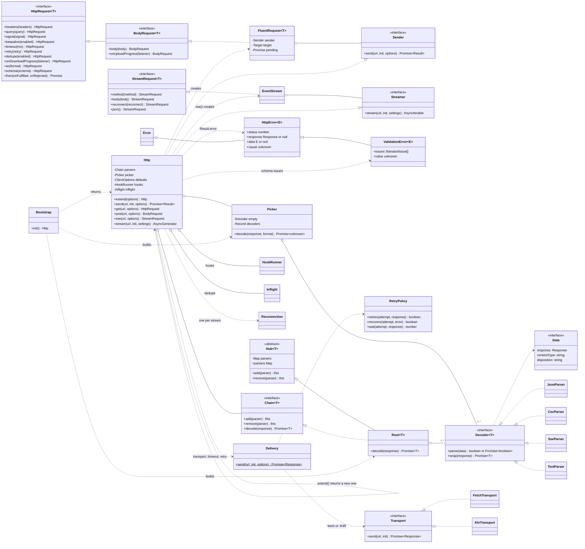

Only four of the thirteen decoders are drawn; all of them implement `Decoder` the same way.

| File | Holds |
| --- | --- |
| `index.ts` | the ready client `http`, `HttpError`, `ValidationError`, the `Result`, `ServerEvent`, `Format`, `Formats`, `StandardSchema`, `InferOutput`, `StreamRequest`, `StreamOptions`, `Reconnect`, `Hooks` and other types |
| `src/Bootstrap.ts` | the order of the chain and the decoder of each format |
| `src/Http.ts` | `send()`: the client settings, the hooks, `Inflight` or `Delivery`, then `chain.decode()` or `picker.decode()`, then the schema, wrapped into `Result`; `extend()`; `sse()` and `stream()` |
| `src/Error/HttpError.ts` | the error of a request that produced no data |
| `src/Error/ValidationError.ts` | the error of data that did not pass the schema |
| `src/Request/FluentRequest.ts` | the request object behind `get`, `post` and the other helpers |
| `src/Request/EventStream.ts` | the stream object behind `sse()` |
| `src/Request/Encoder.ts`, `QueryString.ts` | how `body()` and `query()` are encoded |
| `src/Root/Hub.ts` | the registry: decoders by class name, in insertion order |
| `src/Root/Root.ts` | the chain: asks decoders in order, falls back to `arrayBuffer()` |
| `src/Root/Picker.ts` | `.as(format)`: decodes with the decoder of the chosen format |
| `src/Request/BaseUrl.ts` | joins the `baseUrl` of a client and a relative URL |
| `src/Delivery/Delivery.ts`, `RetryPolicy.ts` | each attempt through a transport with a timeout, and when and how long to wait before a repeat |
| `src/Delivery/HookRunner.ts`, `Inflight.ts`, `Reconnection.ts` | the hooks of a client, identical requests in flight, the reconnect state of a stream |
| `src/Transport/` | `FetchTransport`, `XhrTransport` (for upload progress) and `Meter` (progress numbers) |
| `src/Contract/` | `Chain`, `Decoder`, `Data`, `ServerEvent`, `Result`, `Failure`, `Sender`, `HttpRequest`, `BodyRequest`, `RequestOptions`, `Query`, `Payload`, `Format`, `Formats`, `Decoding`, `StandardSchema`, `SendOptions`, `DeliveryOptions`, `RetryOptions`, `ClientOptions`, `Progress`, `Transport`, `Hooks`, `StreamRequest`, `StreamOptions`, `Streamer`, `Reconnect` |
| `src/Parsers/` | one decoder per format |

## One request

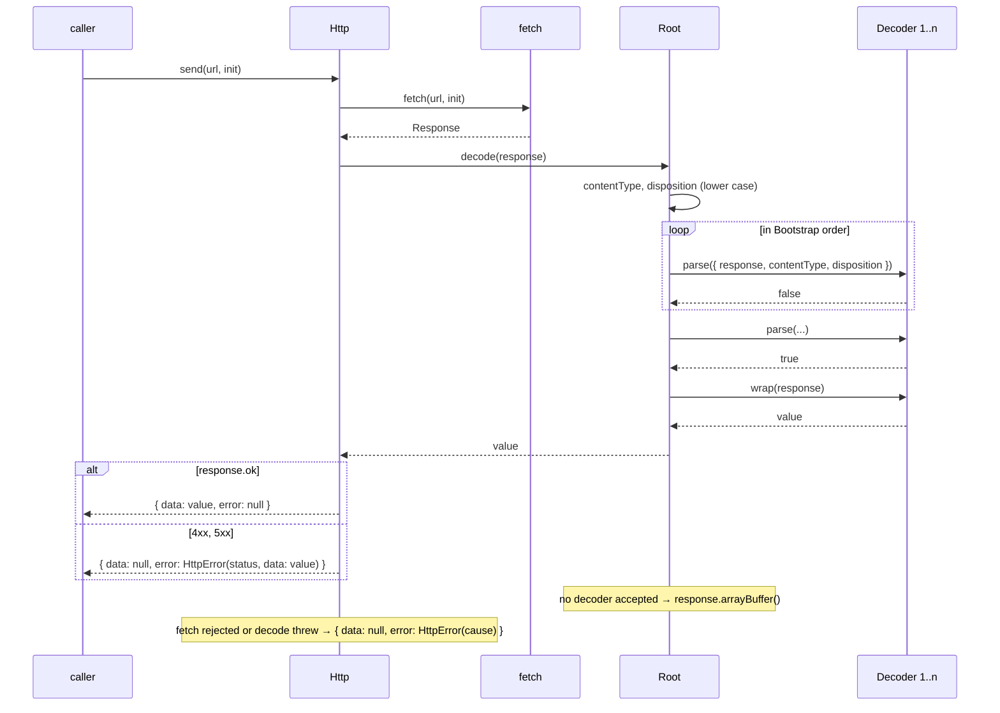

This is the default path. `.as(format)` replaces `Root` with `Picker` for a 2xx response, and `.schema()` adds a
validation step after decoding: see [Choosing the format](#choosing-the-format-as) and
[Validating the data](#validating-the-data-schema). `fetch` is called through `Delivery`, which adds the timeout and
the retries: see [Timeouts and retries](#timeouts-and-retries-timeout-retry).

## Request object

`http.get()`, `http.post()` and the other method helpers do not send anything. They return a **request object**:
a description of a request (method, URL, options) that can be refined link by link and is sent when it is
awaited ([ADR 0005](../../adr/0005-request-object.md)).

```ts
const { data, error } = await http
    .post<User, ApiError>('/api/users')
    .headers({ Authorization: `Bearer ${token}` })
    .query({ invite: true })
    .body({ name: 'Alice' });

await http.post<User>('/api/users', { headers: { Authorization: `Bearer ${token}` }, query: { invite: true }, body: { name: 'Alice' } }); // the same request
```

### The files and what each one does

| File | Kind | What it does | Who uses it |
| --- | --- | --- | --- |
| `src/Request/FluentRequest.ts` | class | Holds one request (`Target`: method, URL, options). Chain methods return a new `FluentRequest`; `then()` builds the URL and `RequestInit` and sends them once. | `Http.get/post/…` create it |
| `src/Request/Encoder.ts` | class, static | Turns a `.body()` value into what `fetch` sends and says which Content-Type it needs. | `FluentRequest.init()` |
| `src/Request/QueryString.ts` | class, static | Appends query parameters to a URL string. | `FluentRequest.url()` |
| `src/Contract/HttpRequest.ts` | interfaces | `HttpRequest<T, E>` (headers, query, signal, keepalive, timeout, retry, onDownloadProgress, as, schema, then) and `BodyRequest<T, E>` (+ body, onUploadProgress): what the caller is allowed to see. | return types of `Http.get/post/…` |
| `src/Contract/RequestOptions.ts` | interfaces | `RequestOptions` and `BodyRequestOptions`: the options object, named like the chain methods. | second argument of `Http.get/post/…` |
| `src/Contract/Query.ts` | types | `QueryValue` and `Query`: what `.query()` accepts. | `query()`, `QueryString` |
| `src/Contract/Payload.ts` | type | What `.body()` accepts. | `body()`, `Encoder` |
| `src/Contract/Sender.ts` | interface | `send(url, init, options): Promise<Result>`: the only thing `FluentRequest` knows about the client. | `Http` implements it |
| `src/Contract/SendOptions.ts` | interface | `{ format?, schema?, timeout?, retry? }`: what `.as()`, `.schema()`, `.timeout()` and `.retry()` hand to `send()`. | `FluentRequest.dispatch()`, `Http.send()` |

### Classes

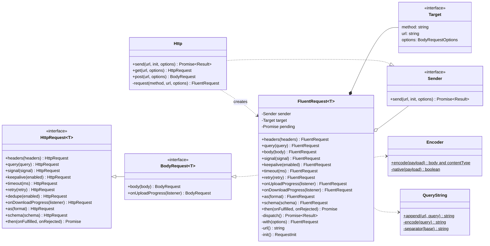

### The life of a request

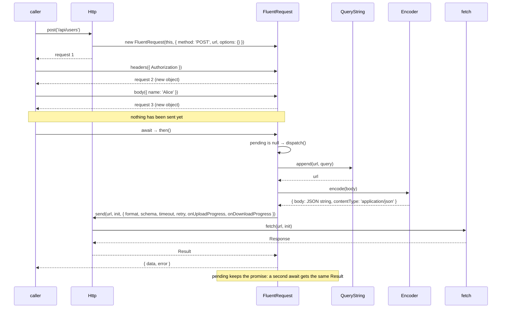

### Step by step

What each link stores, for the request from the example at the top. Header names come out in lower case
because they are kept in a `Headers` object.

| Call | New object? | `target.options` after it |
| --- | --- | --- |
| `http.post('/api/users')` | #1 | `{}` |
| `.headers({ Authorization: 'Bearer t' })` | #2 | `{ headers: Headers { authorization: 'Bearer t' } }` |
| `.query({ invite: true })` | #3 | `{ headers: …, query: { invite: true } }` |
| `.body({ name: 'Alice' })` | #4 | `{ headers: …, query: …, body: { name: 'Alice' } }` |

`await` on #4 calls `then()`, which builds the arguments of `send()`:

```ts
url  = '/api/users?invite=true'                  // url(): QueryString.append(target.url, options.query)
init = {                                         // init()
    method: 'POST',
    headers: Headers { authorization: 'Bearer t', 'content-type': 'application/json' },
    body: '{"name":"Alice"}',                    // Encoder.encode(options.body)
    signal: null,                                // options.signal ?? null
    keepalive: false,                            // options.keepalive ?? false
}
options = { format: undefined, schema: undefined, timeout: undefined, retry: undefined } // nothing chosen: Content-Type, no limits
```

### Immutable links and reuse

Every chain method calls the private `with(options)`. It copies `target.options`, merges the new value into the
copy and returns a new `FluentRequest` with the same `sender`, method and URL. The object it was called on does
not change.

- `headers()` copies the existing headers into a new `Headers` and sets the new ones on top: a header given
  again replaces the old value, the others stay.
- `query()` spreads the old and the new object: a key given again replaces the old value.
- `body()`, `signal()`, `keepalive()`, `timeout()`, `retry()`, `onUploadProgress()`, `onDownloadProgress()`, `as()`
  and `schema()` replace the old value: `.as('text').as('json')`
  decodes JSON.

That makes a prepared request a safe template:

```ts
const users = http.get<User[]>('/api/users').headers({ Authorization: `Bearer ${token}` });

const [first, second] = await Promise.all([users.query({ page: 1 }), users.query({ page: 2 })]);
// two requests, both with the token; users itself was never sent and is unchanged
```

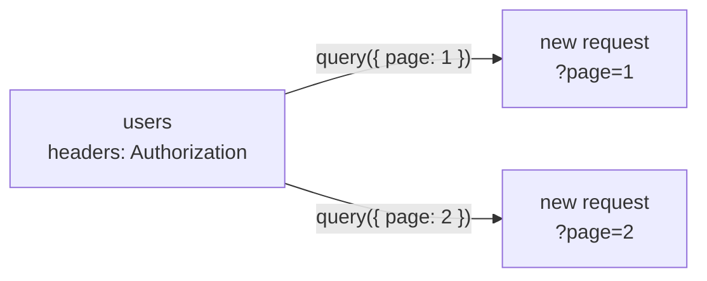

The only field that changes is the private `pending`: the cache of this one object's promise. A new object
starts with `pending = null`, so it sends its own request.

### Sent on `await`, and only once

`FluentRequest` is a *thenable*: it has a `then()` method, and `await` calls it. That is why nothing happens
until the request is awaited. A `Promise` would start working as soon as it was created, before the chain could
add headers or a body.

```ts
public then(onFulfilled, onRejected) {
    this.pending = this.pending ?? this.dispatch();   // first call: build and send; later calls: reuse
    return this.pending.then(onFulfilled, onRejected);
}
```

- `await request` twice, or `Promise.all([request, request])`, sends one request and gives the same `Result`.
- A request object works anywhere a `PromiseLike` is expected. It has no `catch()` or `finally()`; wrap it as
  `Promise.resolve(request)` when you need them. You rarely do, because the result never rejects.
- `dispatch()` catches errors thrown while the request is being built (today only a body that `JSON.stringify`
  cannot serialize, such as an object that refers to itself). It turns them into
  `{ data: null, error: HttpError }` with `status: 0` and the error in `cause`, and sends nothing. So the
  request object keeps the promise of `send()`: it never throws.

### `HttpRequest` and `BodyRequest`: who gets `body()`

One class, `FluentRequest`, implements both interfaces. What the caller can call depends on the type the helper
returns:

| Helper | Returns | `body()` |
| --- | --- | --- |
| `get`, `head`, `delete` | `HttpRequest<T, E>` | not available, so `http.get(url).body()` does not compile |
| `post`, `put`, `patch` | `BodyRequest<T, E>` | available |

`onUploadProgress()` follows the same rule: only a request with a body has something to upload.

Each method of `BodyRequest` returns `BodyRequest` again, so `.headers()` after `.post()` still has `body()`.
The interfaces name their own type instead of `this` because `FluentRequest` returns a new object, not the same
one. At runtime the method still exists on a GET request: the check is done by the compiler only.
`head<T = null>` defaults to `null`, because a HEAD response has no body.

### Options object = chain

The second argument of every helper has the same names as the chain methods:

| Option | Same as | Type |
| --- | --- | --- |
| `headers` | `.headers()` | `HeadersInit` |
| `query` | `.query()` | `Query` |
| `signal` | `.signal()` | `AbortSignal` |
| `keepalive` | `.keepalive()` | `boolean` |
| `as` | `.as()` | `Format` |
| `schema` | `.schema()` | `StandardSchema` |
| `timeout` | `.timeout()` | `number` |
| `retry` | `.retry()` | `Retry` (`number \| RetryOptions`) |
| `onDownloadProgress` | `.onDownloadProgress()` | `ProgressListener` |
| `onUploadProgress` (post, put, patch only) | `.onUploadProgress()` | `ProgressListener` |
| `body` (post, put, patch only) | `.body()` | `Payload` |

`Http.request()` puts the options object into `target.options` of the first `FluentRequest`. Chain methods
called afterwards merge into it by the rules above, so both styles can be mixed:
`http.get(url, { headers }).query({ page: 2 })`.

One difference: `as` and `schema` in the options object are applied at runtime the same way, but they do not
change the type of `data`. TypeScript infers a type only from a call: write `.as('csv')` or `.schema(User)` in
the chain when the type matters.

### `Encoder`: how `body()` is sent

`Encoder.encode(payload)` returns `{ body, contentType }`. `FluentRequest.init()` puts `body` into `RequestInit`
and sets `Content-Type` to `contentType` only when it is not `null` and the caller has not set Content-Type.

| The value passed to `body()` | What `fetch` sends | Content-Type |
| --- | --- | --- |
| `null` or no `body()` call | no body | not set |
| a string | the string | `text/plain;charset=UTF-8`, set by `fetch` |
| `FormData` | multipart | `multipart/form-data; boundary=…`, set by `fetch` |
| `URLSearchParams` | `a=1&b=2` | `application/x-www-form-urlencoded;charset=UTF-8`, set by `fetch` |
| `Blob` / `File` | the bytes | the Blob's `type`, set by `fetch` |
| `ArrayBuffer`, typed array, `DataView` | the bytes | not set |
| `ReadableStream` | the stream | not set |
| any other object, an array, a number, a boolean | `JSON.stringify(value)` | `application/json` |
| an object `JSON.stringify` cannot handle | nothing is sent | the result is an `HttpError`, see above |

Native bodies are passed through on purpose. For `FormData` only `fetch` knows the multipart boundary, so a
Content-Type set by hand would break the request.

### `QueryString`: how `query()` is added to the URL

`QueryString.append(url, query)` works on the URL string, so relative URLs (`/api/users`) work too.

| URL | `query` | Result |
| --- | --- | --- |
| `/api/users` | `{ page: 2 }` | `/api/users?page=2` |
| `/api/users?sort=name` | `{ page: 2 }` | `/api/users?sort=name&page=2` |
| `/api/users` | `{ tags: ['a', 'b'] }` | `/api/users?tags=a&tags=b` |
| `/api/users` | `{ a: null, b: undefined, c: 1 }` | `/api/users?c=1` |
| `/api/users` | `{ n: 0, active: false, q: '' }` | `/api/users?n=0&active=false&q=` |
| `/search` | `{ q: 'a&b' }` | `/search?q=a%26b` |
| `/page#top` | `{ x: 1 }` | `/page?x=1#top` |
| `/api/users?` | `{ page: 1 }` | `/api/users?page=1` |
| `/api/users` | `{ a: null }` | `/api/users` (unchanged) |

Only `null` and `undefined` are dropped. `0`, `false` and `''` are real values and stay. Values are encoded by
`URLSearchParams`, so a space becomes `+`.

### Why `Sender`

`FluentRequest` does not import `Http` or call `fetch`. It gets a `Sender`, an interface with one method
`send(url, init, options)`, which `Http` implements. That keeps the dependency one-way (`Http` → `FluentRequest`),
and lets unit tests pass a `vi.fn()` as the sender and look at the exact `url`, `init` and `options` the
request produced.
The transport stage (XHR for upload progress) will plug in behind the same interface.

### Where it is tested

| What | Tests |
| --- | --- |
| `FluentRequest` | `tests/Unit/Request/FluentRequest/`, with a stub `Sender`: lazy, once, merging, encoding, immutability, reuse, options = chain, an unbuildable body, `as` and `schema` (what reaches `send()` and the inferred types) |
| `Encoder` | `tests/Unit/Request/Encoder/` |
| `QueryString` | `tests/Unit/Request/QueryString/` (the table above) |
| helpers on `Http` | `tests/Unit/Http/Http.request.method`, `Http.get.*`, `Http.post.*`, `Http.get.body.forbidden` (the compile-time check) |
| over the wire | `tests/Integration/Http/Http.post.json`, `Http.get.query`, `Http.put.form-data`, `Http.patch.urlencoded`, `Http.delete`, `Http.get.aborted` (a local server echoes what it received) |

## Choosing the format: `.as()`

By default the format comes from the response. Servers get Content-Type wrong often enough: JSON sent as
`text/plain`, CSV as `application/octet-stream`, a JSON file that should be saved as a file. `.as(format)` tells
the client what the body is, and the type of `data` follows the format
([ADR 0006](../../adr/0006-format-and-schema.md)).

```ts
const { data: rows } = await http.get('/report').as('csv'); // rows: string[][] | null, whatever Content-Type says
const { data: user } = await http.get<User>('/api/users/1').as('json'); // user: User, even if sent as text/plain
const { data: file } = await http.get('/api/users/1').as('blob'); // the raw JSON as a Blob, for a download
```

### The files and what each one does

| File | Kind | What it does | Who uses it |
| --- | --- | --- | --- |
| `src/Contract/Format.ts` | interface, type | `Formats<T>`: one key per format, its value is the type of `data`. `Format` is the union of the keys: `'json' \| 'csv' \| …`. | `.as()`, `Picker`, `Decoding` |
| `src/Root/Picker.ts` | class | Holds one decoder per format and the empty decoder. `decode(response, format)` returns `null` for a response without a body, otherwise the value of the chosen decoder. | `Http.send()` |
| `src/Contract/Decoding.ts` | interface | `{ format?, schema? }`, the decoding part of `SendOptions`, the third argument of `send()`. | `FluentRequest`, `Http` |
| `src/Bootstrap.ts` | class | Builds `Picker` from the same decoder instances as the chain. | `index.ts` |

### Classes

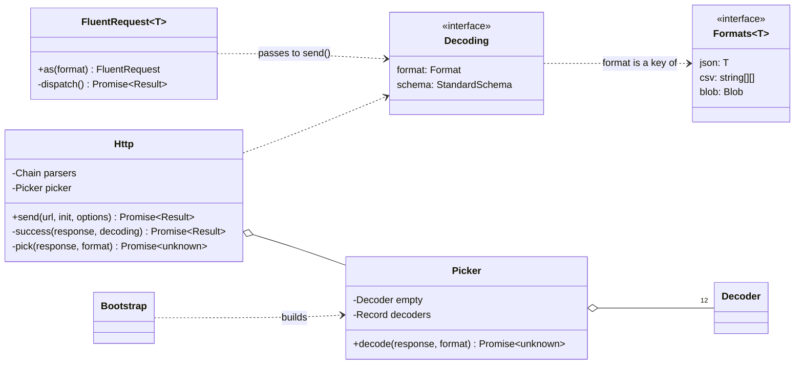

Only three of the eleven keys of `Formats` are drawn; the full list is in the table below.

### Each format, its decoder and its type

| `.as(…)` | Decoder | Type of `data` |
| --- | --- | --- |
| `'json'` | `JsonParser` | `T` of the request |
| `'ndjson'` | `NdjsonParser` | `T` of the request (an array: write `get<Event[]>`) |
| `'xml'` | `XmlParser` | `T` of the request |
| `'html'` | `DomParser` | `Document` |
| `'text'` | `TextParser` | `string` |
| `'csv'` | `CsvParser` | `string[][]` (split by tabs only when Content-Type is `text/tab-separated-values`, otherwise by commas) |
| `'formData'` | `FormDataParser` | `FormData` |
| `'urlencoded'` | `UrlEncodedParser` | `URLSearchParams` |
| `'blob'` | `MediaParser` | `Blob` |
| `'arrayBuffer'` | `BinaryParser` | `ArrayBuffer` |
| `'sse'` | `SseParser` | `AsyncIterable<ServerEvent>` |

`json`, `ndjson` and `xml` keep `T`, because only the caller knows what is inside. The others always decode to
the same type, so `T` is replaced. That is what the return type `HttpRequest<Formats<T>[F], E>` says: take the
`Formats` map for this `T` and read the key `F`.

```ts
http.get<User>(url).as('json'); // HttpRequest<User>
http.get<User>(url).as('csv'); // HttpRequest<string[][]>: User is gone
http.get<User>(url).as('yaml'); // does not compile: 'yaml' is not a Format
```

### How `Picker` decides

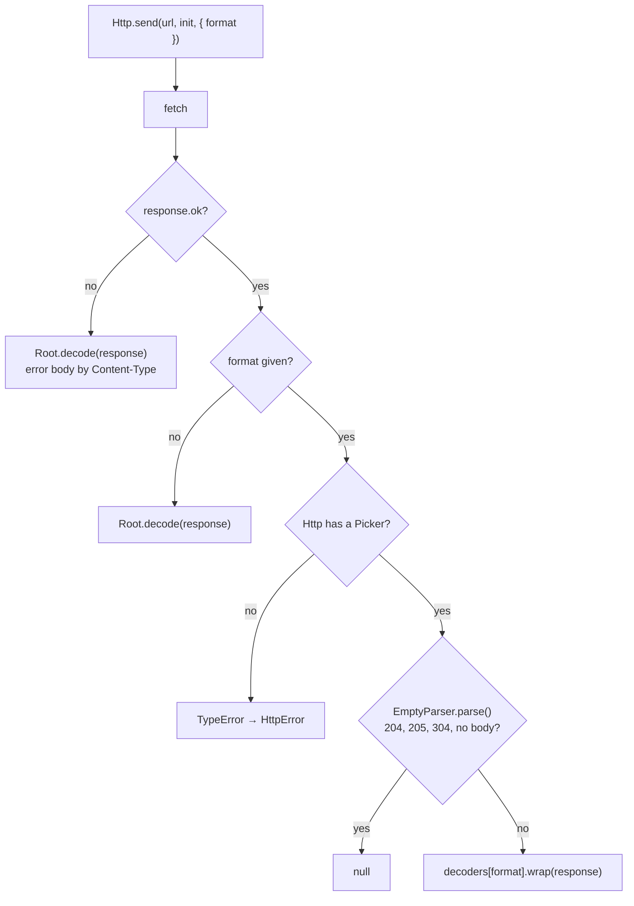

1. `Picker.decode()` builds `Data` exactly as `Root` does (lower-case Content-Type and Content-Disposition).
2. It asks the empty decoder first. A 204 has no body to decode, so `.as('json')` gives `{ data: null, error:
   null }`, the same as without `.as()`.
3. Otherwise it calls `wrap()` of the chosen decoder directly. `parse()` of that decoder is not called: the
   caller has already answered "is this response mine?".
4. A body that is not in that format makes `wrap()` reject (`SyntaxError` for HTML given to `json`). `Http`
   catches it like any decoding error: `{ data: null, error: HttpError('The response body could not be
   decoded', cause) }`.

### Step by step

The server answers `200`, `Content-Type: text/plain`, body `{"id":1,"name":"Alice"}`.

| Call | What happens | `data` |
| --- | --- | --- |
| `await http.get<User>(url)` | `Root` asks the chain, `TextParser` accepts `text/plain` | `'{"id":1,"name":"Alice"}'` (a string, not a `User`) |
| `await http.get<User>(url).as('json')` | `FluentRequest` sends `{ format: 'json' }`, `Http` calls `Picker`, `JsonParser.wrap()` | `{ id: 1, name: 'Alice' }` |
| `await http.get<User>(url).as('text')` | `TextParser.wrap()` | `'{"id":1,"name":"Alice"}'`, typed `string` |
| `await http.get<User>(url).as('blob')` | `MediaParser.wrap()` | `Blob` of 23 bytes, `type: 'text/plain'` |

The same request object can be reused for several formats, because `.as()` returns a new object:

```ts
const report = http.get('/api/report').query({ year: 2026 });

const { data: rows } = await report.as('csv'); // string[][]
const { data: raw } = await report.as('text'); // string: a second request
```

### What `.as()` does not change

- **Error responses.** A 4xx or 5xx body is decoded by `Root`, by Content-Type, as before: an API often answers
  errors in JSON even when the data is CSV. `error.data` keeps its own type `E`.
- **Requests.** `.as()` does not add an `Accept` header. Add it with `.headers({ Accept: 'text/csv' })` when the
  server needs it.
- **The chain.** `Root` and its order stay the same for every request without `.as()`.

### `Http` without a `Picker`

`new Http(chain)` without the second argument still works for requests without `.as()`. A request with `.as()`
on it returns `HttpError` with a `TypeError` in `cause` that says no decoders for formats were given. `Bootstrap`
always passes a `Picker`, so the exported `http` supports every format.

### Where it is tested

| What | Tests |
| --- | --- |
| `Picker` | `tests/Unit/Root/Picker/`: the chosen decoder wins over Content-Type, an empty body gives `null` without calling it, its error is passed on |
| `Http.send` with a format | `tests/Unit/Http/Http.send.format.*`: decoded, undecodable, no `Picker`, the error body is still detected |
| `FluentRequest.as` | `tests/Unit/Request/FluentRequest/FluentRequest.as.*`: what reaches `send()`, the original is unchanged, the last call wins, options = chain, the types (`@ts-expect-error`) |
| the real decoders | `tests/Feature/Bootstrap/Bootstrap.as.*`: json, csv, text, blob, arrayBuffer, 204, HTML given to `json` |
| over the wire | `tests/Integration/Http/Http.get.as.json` |

## Validating the data: `.schema()`

`http.get<User>()` is a promise of the developer: nothing checks it at runtime, and when the API changes the error
appears far from the request (`undefined is not a function` three components later). A schema describes the
shape of the data. The client checks the decoded data with it and returns the result of the schema, and
TypeScript infers the type of `data` from the same schema.

```ts
import { z } from 'zod'; // installed by the user, not by @metapraxis/jext-http

const User = z.object({ id: z.number(), name: z.string() });

const { data: user, error } = await http.get('/api/users/1').schema(User);
// user: { id: number; name: string } | null, no <User> needed

if (error instanceof ValidationError) {
    console.log(error.issues); // [{ message: 'Expected number, received string', path: ['id'] }]
}
```

### Standard Schema: why there is no dependency

Zod, Valibot, ArkType and other libraries implement one common interface,
[Standard Schema](https://standardschema.dev). Every schema object has a property `'~standard'`:

```ts
interface StandardSchema<Input, Output> {
    readonly '~standard': {
        readonly version: 1;
        readonly vendor: string; // 'zod', 'valibot'…
        readonly validate: (value: unknown) => StandardResult<Output> | Promise<StandardResult<Output>>;
        readonly types?: { readonly input: Input; readonly output: Output }; // for TypeScript only
    };
}

type StandardResult<Output> =
    | { readonly value: Output; readonly issues?: undefined } // valid
    | { readonly issues: ReadonlyArray<StandardIssue> }; // invalid

interface StandardIssue {
    readonly message: string;
    readonly path?: ReadonlyArray<PropertyKey | { readonly key: PropertyKey }>;
}
```

The specification is only these types, and its authors suggest copying them. They live in
`src/Contract/StandardSchema.ts`. The client never imports a schema library: it calls `validate()` on the object
the caller passed. Any object of this shape works, including one written by hand:

```ts
const Positive: StandardSchema<unknown, number> = {
    '~standard': {
        version: 1,
        vendor: 'my-app',
        validate: (value) =>
            typeof value === 'number' && value > 0 ? { value } : { issues: [{ message: 'Expected a positive number' }] },
    },
};

const { data: count } = await http.get('/api/count').schema(Positive); // count: number | null
```

### The files and what each one does

| File | Kind | What it does | Who uses it |
| --- | --- | --- | --- |
| `src/Contract/StandardSchema.ts` | interfaces, type | `StandardSchema`, `StandardProps`, `StandardResult`, `StandardIssue`, `StandardTypes`, and `InferOutput<S>`, the type a schema returns. | `.schema()`, `Http`, `ValidationError` |
| `src/Error/ValidationError.ts` | class | `HttpError` with `issues` (every problem) and `value` (the decoded data that failed). Its message names the first issue. | `Http.validate()` |
| `src/Http.ts` | class | `validate()`: calls the schema after decoding and turns its answer into `Result`. | `send()` |

### Classes

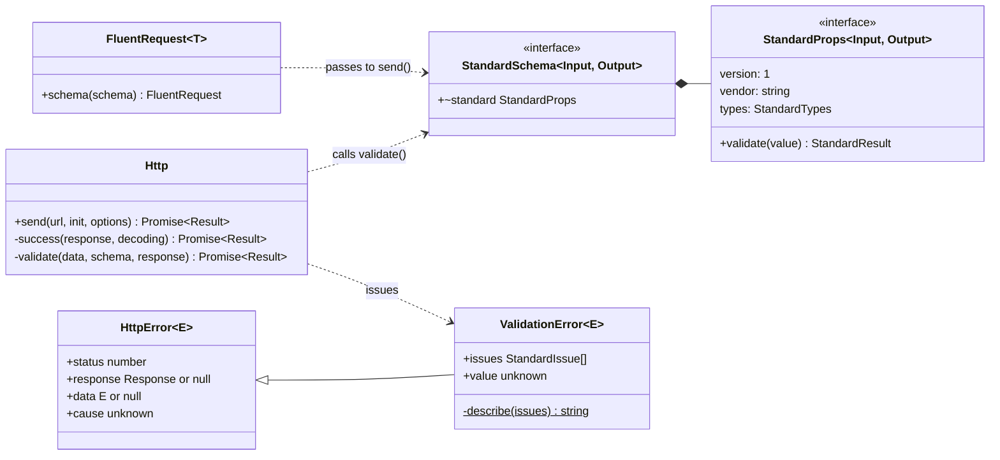

### The life of a validated response

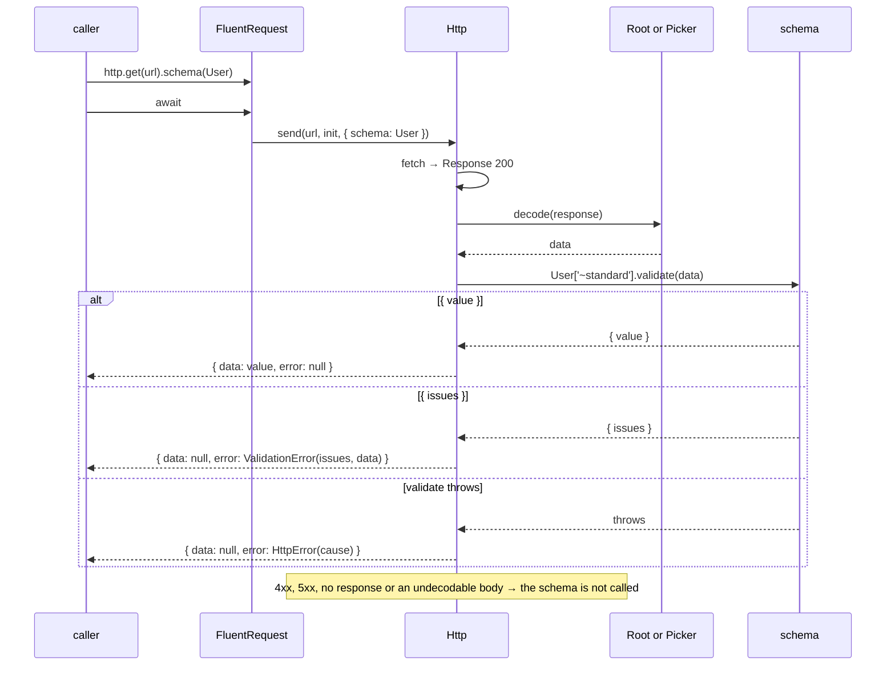

1. The response is decoded first: by `Root`, or by `Picker` when `.as()` is also given. So `.as('csv')` and
   `.schema(Rows)` combine, and the schema gets `string[][]`.
2. Only a decoded 2xx response reaches the schema. An error status, a missing response or a decoding error
   returns its `HttpError` before, and `validate()` is never called.
3. `Http` awaits `validate()`, so a schema with async checks works too.
4. `{ value }` becomes `data`. It is the value the schema returned, not the decoded one: a schema that drops
   unknown keys, converts strings to dates or sets defaults changes `data`.
5. `{ issues }` becomes a `ValidationError`. A `validate()` that throws becomes a plain `HttpError` with the error
   in `cause`, so a broken schema is not mistaken for broken data.

### `ValidationError`

| Field | Value |
| --- | --- |
| `name` | `'ValidationError'` |
| `message` | the first issue with its path: `users.0.name: Expected string (and 2 more)`; `The response did not match the schema` when the list is empty |
| `issues` | every `StandardIssue` the schema returned |
| `value` | the decoded data that did not pass |
| `status`, `response` | of the 2xx response |
| `data` | `null`: there is no error body |

The path joins its segments with dots; a segment given as `{ key }` uses the key. A message without a path is
the bare message.

### Types: `InferOutput`

`schema<S extends StandardSchema>(schema: S): HttpRequest<InferOutput<S>, E>`, where
`InferOutput<S> = NonNullable<S['~standard']['types']>['output']`. Zod, Valibot and ArkType fill `types`, so the
type of `data` comes from the schema and replaces the `T` of the request:

```ts
http.get<User>(url).schema(Admin); // HttpRequest<Admin['output']>: the schema wins
```

A hand-written schema gets the type from its annotation (`StandardSchema<unknown, number>` above). `schema` in the
options object validates the same way, but does not change the type (see [Options object = chain](#options-object--chain)).

### Step by step

The schema `User` checks `{ id: number, name: string }` and drops other keys.

| Body of the 200 response | `data` | `error` |
| --- | --- | --- |
| `{"id":1,"name":"Alice","extra":true}` | `{ id: 1, name: 'Alice' }` | `null` |
| `{"id":"1"}` | `null` | `ValidationError`, `value: { id: '1' }`, message `id: Expected number (and 1 more)` |
| `<html>` with `.as('json')` | `null` | `HttpError` 'The response body could not be decoded'; the schema is not called |
| 404 `{"message":"Not found"}` | `null` | `HttpError` 404 with `data: { message: 'Not found' }`; the schema is not called |

### Where it is tested

| What | Tests |
| --- | --- |
| `ValidationError` | `tests/Unit/Error/ValidationError/`: fields, the path in the message, `(and N more)`, no path, no issues |
| `Http.send` with a schema | `tests/Unit/Http/Http.send.schema.*`: valid (the value of the schema is returned), issues, async `validate`, a throwing schema, not called for an error status or an undecodable body |
| `FluentRequest.schema` | `tests/Unit/Request/FluentRequest/FluentRequest.schema.*`: what reaches `send()`, the inferred type (`@ts-expect-error`) |
| the real chain | `tests/Feature/Bootstrap/Bootstrap.schema.*`, `Bootstrap.as.schema` |
| over the wire | `tests/Integration/Http/Http.get.schema.issues` |

## Shared settings: `extend()`

An API is called with the same base URL and the same token every time. `http.extend(options)` returns a **new**
client whose every request carries these settings, and leaves the client it was called on unchanged
([ADR 0007](../../adr/0007-extend-timeout-retry.md)).

```ts
const api = http.extend({
    baseUrl: 'https://api.example.com/v2',
    headers: { Authorization: `Bearer ${token}` },
    timeout: 10_000,
    retry: 2,
});

await api.get<User[]>('/users'); // GET https://api.example.com/v2/users with the token, 10 s per attempt, 2 retries
await api.delete('/orders/7');

const admin = api.extend({ headers: { 'X-Role': 'admin' } }); // keeps baseUrl, the token, timeout and retry
```

### The files and what each one does

| File | Kind | What it does | Who uses it |
| --- | --- | --- | --- |
| `src/Http.ts` | class | `extend(options)` merges the options into the settings of this client and returns `new Http(parsers, picker, settings)`. `send()` applies the settings. | the caller |
| `src/Contract/ClientOptions.ts` | interface | `{ baseUrl?, headers?, timeout?, retry? }`: what `extend()` accepts. | `extend()`, `Http` |
| `src/Request/BaseUrl.ts` | class, static | `resolve(base, url)`: joins the base and a relative URL with one slash, leaves an absolute URL as it is. | `Http.send()` |

### Classes

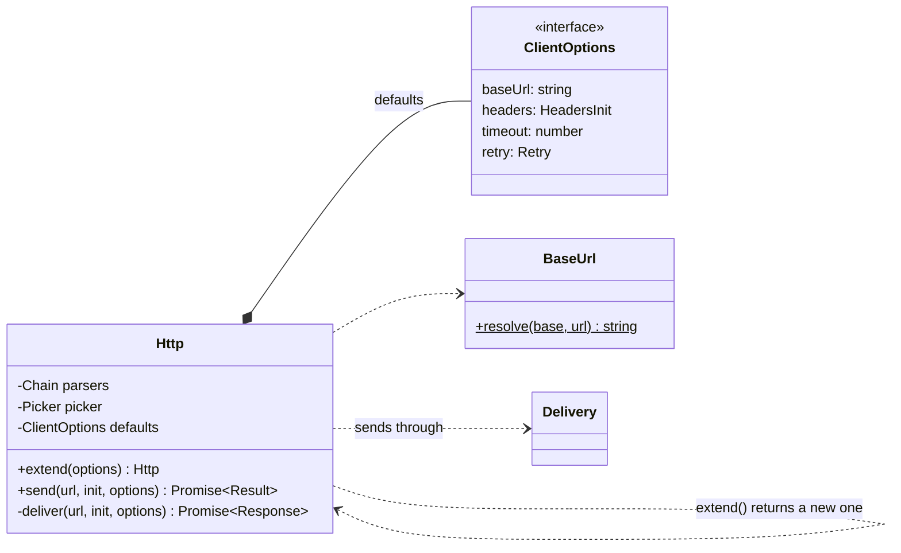

### How settings are merged

| Setting | `extend()` on a client that already has it | A request that sets it too |
| --- | --- | --- |
| `baseUrl` | replaced | — (an absolute URL skips it) |
| `headers` | merged; a header set again wins | merged; the header of the request wins |
| `timeout` | replaced | `.timeout(ms)` wins, `.timeout(0)` turns it off |
| `retry` | replaced | `.retry(n)` wins, `.retry(0)` turns it off |
| `dedupe` | replaced | `.dedupe()` wins, `.dedupe(false)` turns it off |
| `hooks` | appended: the hooks of the client first, then the new ones | — (hooks are set only on a client) |

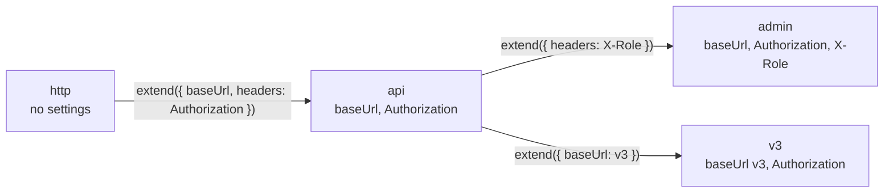

`http`, `api`, `admin` and `v3` are four clients. Each one keeps its own settings; none of them can change another.
They share the decoders (`Root` and `Picker`), which have no state. Each one has its own `Inflight`, so `dedupe`
never joins requests of two clients.

### Where the settings apply: `send()`

The settings are applied in `send()`, so the request object and the low-level `send()` behave the same:

1. `BaseUrl.resolve(baseUrl, url)` for a string or `URL`. A `Request` object is sent as it is, without `baseUrl`
   and the client headers (it already carries its own URL and headers); `timeout` and `retry` still apply.
2. The client headers are copied into a new `Headers`, and the headers of `init` are set on top.
3. `timeout`, `retry` and `dedupe` of `options` win; when they are not given, the values of the client are used.
4. The `beforeRequest` hooks get the result, the request goes out (shared when `dedupe` allows it), the
   `afterResponse` hooks get the response: see [Hooks and dedupe](#hooks-and-dedupe-hooks-dedupe).

When the client has no headers and no hooks, `init` reaches `fetch` unchanged. `http.sse()` uses steps 1, 2 and 4.

### `BaseUrl`: how the URL is joined

| `baseUrl` | URL of the request | Sent to |
| --- | --- | --- |
| `https://api.example.com/v2` | `/users` | `https://api.example.com/v2/users` |
| `https://api.example.com/v2/` | `/users` | `https://api.example.com/v2/users` |
| `https://api.example.com/v2/` | `users?page=2` | `https://api.example.com/v2/users?page=2` |
| `/api` | `/users` | `/api/users` |
| `https://api.example.com/v2` | `''` | `https://api.example.com/v2` |
| `https://api.example.com/v2` | `https://cdn.example.com/a.png` | `https://cdn.example.com/a.png` (absolute) |
| `https://api.example.com/v2` | `//cdn.example.com/a.png` | `//cdn.example.com/a.png` (absolute) |

Exactly one slash goes between the two parts. `new URL('/users', 'https://api.example.com/v2')` would give
`https://api.example.com/users` and lose `/v2`; `BaseUrl` does not do that. The query of the request is already in
the URL when it is joined.

### Where it is tested

| What | Tests |
| --- | --- |
| `BaseUrl` | `tests/Unit/Request/BaseUrl/`: relative (the table above), absolute, no base, an empty URL |
| `Http.extend` | `tests/Unit/Http/Http.extend.*`: base URL, absolute URL, headers merged with the request, nested, replaced base URL, the original unchanged, timeout and `timeout(0)`, retry and `retry(0)`; `Http.send.extend` for the low-level call |
| the real chain | `tests/Feature/Bootstrap/Bootstrap.extend` |
| over the wire | `tests/Integration/Http/Http.extend.base-url` (the server sees the path and the token) |

## Timeouts and retries: `.timeout()`, `.retry()`

`fetch` has no timeout: a hung server keeps the request open forever. A 503 or a dropped connection is usually gone
a moment later. `.timeout(ms)` ends an attempt that takes too long, `.retry()` repeats a failed one.

```ts
await http.get('/api/report').timeout(5000).retry(2);
await http.get('/api/report', { timeout: 5000, retry: 2 }); // the same request
await http.get('/api/report').retry({ limit: 3, statuses: [503], delay: 1000 }); // only 503, waits 1 s, 2 s, 4 s
```

### The files and what each one does

| File | Kind | What it does | Who uses it |
| --- | --- | --- | --- |
| `src/Delivery/Delivery.ts` | class, static | `send(url, init, { timeout, retry })`: sends each attempt through a transport (`fetch` or XHR, see [Transports and progress](#transports-and-progress-onuploadprogress-ondownloadprogress)) with a timeout and repeats failed attempts while the policy allows. Resolves with the last `Response`, rejects with the last error. | `Http.send()` |
| `src/Delivery/RetryPolicy.ts` | class | Built per request from `retry` and the method. `retries(attempt, response)` and `recovers(attempt, error)` say whether to repeat, `wait(attempt, response)` how long to wait. | `Delivery` |
| `src/Contract/RetryOptions.ts` | interface, type | `RetryOptions { limit, methods?, statuses?, delay? }` and `Retry = number \| RetryOptions`. | `.retry()`, `ClientOptions` |
| `src/Contract/DeliveryOptions.ts` | interface | `{ timeout?, retry? }`. | `SendOptions`, `ClientOptions` |
| `src/Contract/SendOptions.ts` | interface | `Decoding & DeliveryOptions`: the third argument of `send()`, `{ format, schema, timeout, retry }`. | `Sender`, `Http`, `FluentRequest` |

### Classes

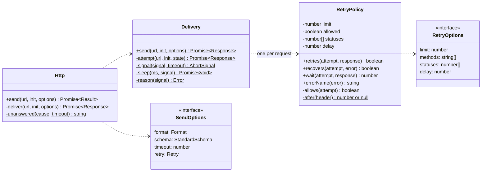

### The life of a repeated request

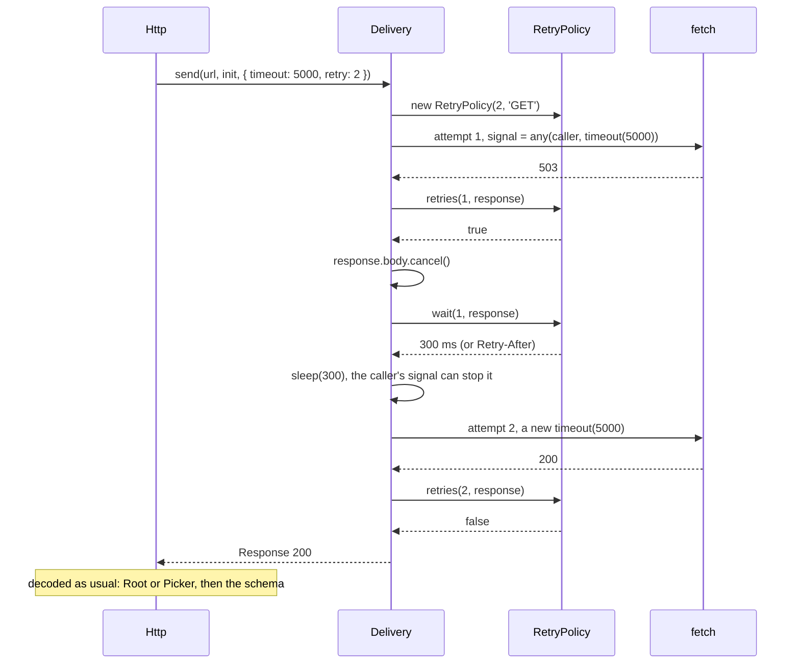

### How `RetryPolicy` decides

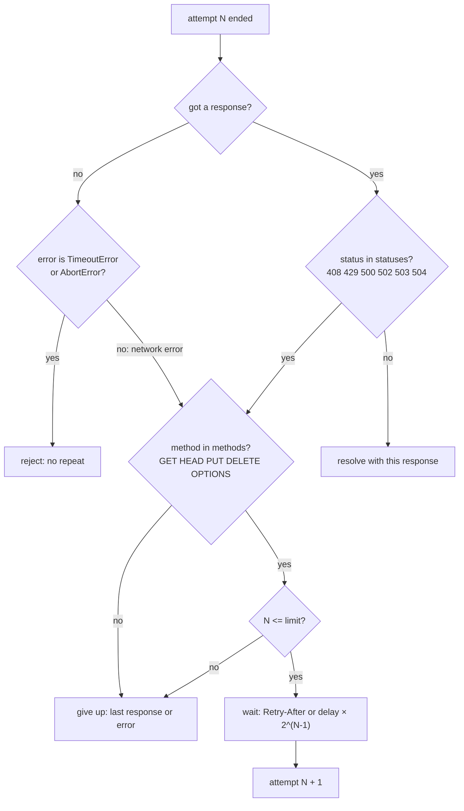

| Option | Default | Meaning |
| --- | --- | --- |
| `limit` | `0` (no retries) | how many times to repeat after the first attempt; `retry(2)` sends at most 3 requests |
| `methods` | `GET`, `HEAD`, `PUT`, `DELETE`, `OPTIONS` | the methods that may be repeated, in any case; POST and PATCH are not idempotent |
| `statuses` | `408`, `429`, `500`, `502`, `503`, `504` | the statuses that are repeated; a network error is always repeated, a timeout or an abort never |
| `delay` | `300` | the wait before the first repeat in ms, doubled before each next one |

### Waits: backoff and `Retry-After`

| Attempt that failed | `delay: 300` | `delay: 1000` | `Retry-After: 2` | `Retry-After: <date 5 s ahead>` |
| --- | --- | --- | --- | --- |
| 1 | 300 ms | 1000 ms | 2000 ms | 5000 ms |
| 2 | 600 ms | 2000 ms | 2000 ms | until that date |
| 3 | 1200 ms | 4000 ms | 2000 ms | until that date |

`Retry-After` is read from the response that is repeated, as a number of seconds or an HTTP date. A date in the
past or a negative number means no wait; a value that is neither is ignored, and the delay is used. A network
error has no response, so it always uses the delay.

### Timeout: one per attempt

```ts
signal = caller's signal ? AbortSignal.any([caller's signal, AbortSignal.timeout(ms)]) : AbortSignal.timeout(ms);
```

- Each attempt gets a new `AbortSignal.timeout(ms)`, so `timeout(5000).retry(2)` can take up to 15 s plus the
  waits. The waits are not part of the timeout.
- A timed out attempt is not repeated: a server that hung once will most likely hang again.
- The caller's `.signal()` still works: it stops the current attempt and the wait before the next one, and the
  result is an `HttpError` with an `AbortError` in `cause`.
- Without a timeout (`0` or none) `init` reaches `fetch` unchanged.

### What the caller gets

| What happened | `data` | `error.status` | `error.message` | `error.cause` |
| --- | --- | --- | --- | --- |
| a repeat succeeded | the data | no error | | |
| every attempt got 503 | `null` | `503` | `503 Service Unavailable` | — (`error.data` is the body of the last 503) |
| every attempt got a network error | `null` | `0` | `The request got no response` | the last `TypeError` |
| an attempt timed out | `null` | `0` | `The request timed out after 5000 ms` | `DOMException` `TimeoutError` |
| the caller aborted, during an attempt or a wait | `null` | `0` | `The request got no response` | `DOMException` `AbortError` |
| a POST got 503 | `null` | `503` | `503 Service Unavailable` | — (sent once) |

The body of a response that is repeated is cancelled, so its connection is released. Only the last response is
decoded.

### Step by step

`http.get<User>('/users/1').timeout(1000).retry(2)`, and the server answers 503, then nothing for 2 s.

| Step | What happens |
| --- | --- |
| 1 | `FluentRequest` sends `{ timeout: 1000, retry: 2 }` to `Http.send()` |
| 2 | `Delivery` builds `RetryPolicy(2, 'GET')`: `limit 2`, GET allowed |
| 3 | attempt 1 with `AbortSignal.timeout(1000)`: 503 |
| 4 | `retries(1, 503)` is true; the body is cancelled; `wait(1)` is 300 ms |
| 5 | attempt 2 with a new `AbortSignal.timeout(1000)`: no answer, after 1 s `fetch` rejects with `TimeoutError` |
| 6 | `recovers(2, TimeoutError)` is false: `Delivery` rejects |
| 7 | `Http` returns `{ data: null, error: HttpError('The request timed out after 1000 ms', status 0) }` |

### Where it is tested

| What | Tests |
| --- | --- |
| `RetryPolicy` | `tests/Unit/Delivery/RetryPolicy/`: each retried status, other statuses, the limit, POST and PATCH, idempotent methods, custom methods and statuses, disabled (`0`, none, negative), network errors, timeout and abort, a POST network error, backoff, `Retry-After` in seconds, as a date, in the past, invalid, no response |
| `Delivery` | `tests/Unit/Delivery/Delivery/`: one call without options, retried statuses, exhausted retries, network error, exhausted network errors, POST not repeated, the method of a `Request`, the 300 ms wait and `Retry-After` (fake timers), abort during the wait and before it, timeout, timeout not repeated, the caller's abort before the timeout, a new signal per attempt, the body of a repeated response released |
| `Http.send` | `tests/Unit/Http/Http.send.timeout`, `Http.send.retry`, `Http.send.retry.exhausted` |
| `FluentRequest` | `tests/Unit/Request/FluentRequest/FluentRequest.timeout.*`, `FluentRequest.retry`: what reaches `send()`, the original unchanged, options = chain, `body()` kept after them, the type of `retry()` |
| the real chain | `tests/Feature/Bootstrap/Bootstrap.retry`, `Bootstrap.retry.post`, `Bootstrap.timeout` |
| over the wire | `tests/Integration/Http/Http.get.timeout`, `Http.get.retry`, `Http.get.retry.retry-after` |

## Transports and progress: `.onUploadProgress()`, `.onDownloadProgress()`

A large upload or download needs a progress bar. `.onDownloadProgress(listener)` counts the response body while
it arrives. `.onUploadProgress(listener)`, available only on `post`, `put` and `patch`, reports the request body
while it is sent ([ADR 0008](../../adr/0008-transport-and-progress.md)).

```ts
const { data, error } = await http
    .post<Upload>('/api/files')
    .body(formData)
    .onUploadProgress(({ percent }) => (bar.value = percent ?? 0))
    .onDownloadProgress(({ loaded }) => (label.textContent = `${loaded} bytes`));

await http.post<Upload>('/api/files', { body: formData, onUploadProgress: render }); // the same request
http.get('/api/report').onUploadProgress(render); // does not compile: a GET has no body to upload
```

### Why two transports

`fetch` cannot report upload progress in Firefox and Safari. A streaming request body works only in Chromium and
only over HTTP/2. `XMLHttpRequest` has `upload.onprogress` in every browser. So the request goes through XHR only
when someone listens to its upload, and through `fetch` otherwise.

| The request has | Transport | Why |
| --- | --- | --- |
| no progress listener | `FetchTransport`: plain `fetch`, the response as it is | nothing changes for ordinary requests |
| only `onDownloadProgress` | `FetchTransport`: `fetch`, the body counted while it is read | `fetch` streams the response, so it can count it |
| `onUploadProgress` (and maybe `onDownloadProgress`) | `XhrTransport` | only XHR reports upload progress everywhere |
| `onUploadProgress`, but no `XMLHttpRequest` (Node) | `FetchTransport`; the upload listener is not called | there is no XHR to ask |
| `onUploadProgress` on a `Request` object given to `send()` | `FetchTransport`; the upload listener is not called | XHR cannot send a `Request` |

### The files and what each one does

| File | Kind | What it does | Who uses it |
| --- | --- | --- | --- |
| `src/Contract/Transport.ts` | interface | `send(url, init): Promise<Response>`: sends one attempt; resolves with any status, rejects only without a response. Internal. | `Delivery`, both transports |
| `src/Transport/FetchTransport.ts` | class | Calls `fetch`. With a download listener it wraps the body into a counting stream. | `Delivery` |
| `src/Transport/XhrTransport.ts` | class | Sends with `XMLHttpRequest`, reports `upload.onprogress` and `onprogress`, wraps the answer into a real `Response`. | `Delivery` |
| `src/Transport/Meter.ts` | class, static | `of(loaded, total)` builds `Progress`, `total(headers)` reads the size from `Content-Length`, `count(body, total, listener)` counts a stream. | both transports |
| `src/Contract/Progress.ts` | interfaces, type | `Progress { loaded, total?, percent? }`, `ProgressListener`, `ProgressOptions { onUploadProgress?, onDownloadProgress? }`. | `FluentRequest`, `SendOptions`, transports |
| `src/Delivery/Delivery.ts` | class, static | `transport(url, options)` picks the transport for the request; every attempt goes through it. | `Http.send()` |

### Classes

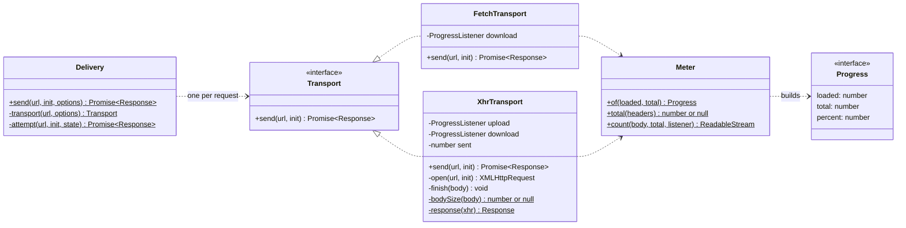

### `Progress`: what the listener gets

| Field | When it is there | Value |
| --- | --- | --- |
| `loaded` | always | bytes sent or received so far |
| `total` | when the size is known | the size of the whole body in bytes |
| `percent` | when `total` is there | `loaded / total` as a whole number from 0 to 100, rounded down, never above 100; `100` for an empty body |

Where the size comes from:

| Direction | Size known | Size unknown |
| --- | --- | --- |
| download | `Content-Length` of the response | no `Content-Length` (chunked), or `Content-Encoding` other than `identity`: the header then counts compressed bytes, but the stream gives decompressed ones |
| upload | the XHR knows it (`lengthComputable`), or the body is a string, `URLSearchParams`, `Blob` or a buffer | `FormData`, when the XHR does not tell it either |

Without a size the listener is still called: `{ loaded: 4096 }`, then `{ loaded: 8192 }`. A UI can show the bytes
or a spinner, while a listener that is never called would look like a hung request. `ProgressEvent` does the same
with `lengthComputable: false`. That is why the type is `percent?: number`.

```ts
.onDownloadProgress(({ loaded, percent }) => {
    label.textContent = percent === undefined ? `${(loaded / 1e6).toFixed(1)} MB` : `${percent}%`;
});
```

### Download through `fetch`: counting the stream

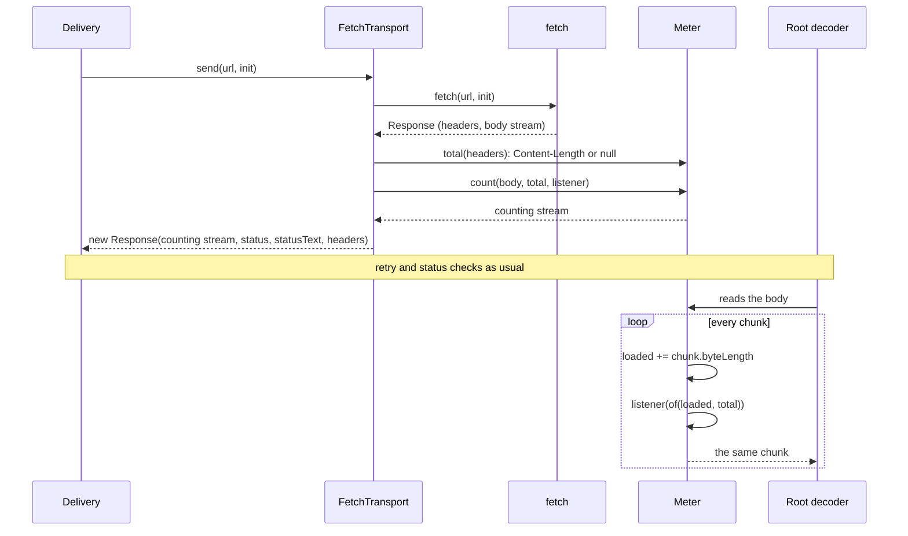

1. `FetchTransport` gets the `Response` from `fetch`. Without a download listener it returns it as it is.
2. A response without a body (204, HEAD) reports `{ loaded: 0, total: 0, percent: 100 }` once and is returned as it
   is.
3. Otherwise `Meter.count()` wraps the body into a new `ReadableStream`. On each read it takes a chunk from the
   original stream, adds its size to `loaded`, calls the listener and passes the chunk on unchanged. Cancelling the
   new stream cancels the original one.
4. The transport returns `new Response(counting stream, { status, statusText, headers })`. The decoders read it as
   usual, so the listener is called while the decoder reads, not before. A new `Response` has no `url` and
   `redirected`.

### Upload through `XMLHttpRequest`

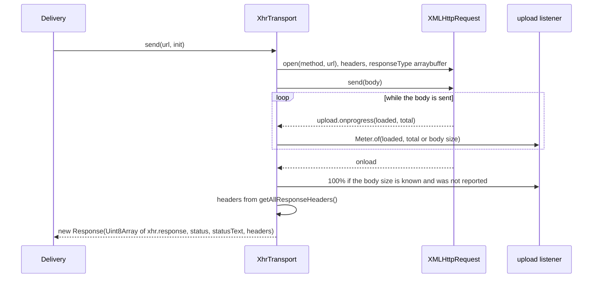

| `RequestInit` | What `XhrTransport` does with it |
| --- | --- |
| `method`, `url` | `xhr.open(method, url)` |
| `headers` | `setRequestHeader` for each, including the Content-Type set by `Encoder` |
| `body` | `xhr.send(body)`: a string, `FormData`, `URLSearchParams`, `Blob` or a buffer. A `ReadableStream` rejects with `TypeError`. |
| `credentials: 'include'` | `xhr.withCredentials = true` |
| `signal` | an abort calls `xhr.abort()`, and the promise rejects with the reason of the signal (`AbortError`, or `TimeoutError` from `.timeout()`) |
| `keepalive` | ignored: XHR has no such option |

| What XHR does | What the transport returns |
| --- | --- |
| `onload` | a real `Response`: status, status text, the headers parsed from `getAllResponseHeaders()`, the body from `xhr.response` (an `ArrayBuffer`); no body for 101, 204, 205, 304 |
| `onerror` | rejects with `TypeError('Network request failed')`, as `fetch` does |
| `onabort` | rejects with the reason of the signal |

The response is a real `Response`, so everything after the transport does not change: retries, the error status,
the chain of decoders, `.as()`, `.schema()`, `{ data, error }`. XHR reads the response whole, so a stream (SSE,
NDJSON) is decoded only after it ends. Some environments (jsdom, small bodies) fire no upload event with the full
size; when the response arrives the upload is over, so the transport then reports 100% itself if it knows the
size of the body.

### With timeouts and retries

`Delivery` builds one transport per request and sends every attempt through it, so `.timeout()` and `.retry()` work
with both:

- the timeout signal reaches XHR as `init.signal` and aborts it;
- every attempt reports its progress from zero: a repeated upload starts again at 0%;
- the body of a response that is repeated is cancelled before it is read, so it reports no download progress.

### Step by step

`http.post<Upload>('/api/files').body(file).onUploadProgress(render)` with a 1 000 000-byte `File`, in a browser:

| Step | What happens |
| --- | --- |
| 1 | `FluentRequest` sends `{ onUploadProgress: render }` with the other options to `Http.send()` |
| 2 | `Delivery.transport()`: there is an upload listener, `XMLHttpRequest` exists, the URL is a string: `XhrTransport` |
| 3 | `xhr.open('POST', '/api/files')`, no Content-Type is set (`Encoder` leaves a `Blob` to the browser), `xhr.send(file)` |
| 4 | the browser fires `upload.onprogress`: `render({ loaded: 65536, total: 1000000, percent: 6 })`, … |
| 5 | the last event: `render({ loaded: 1000000, total: 1000000, percent: 100 })` |
| 6 | `onload`: 100% was already reported, nothing more; the answer becomes a `Response` with status 201 |
| 7 | the chain decodes the JSON answer: `{ data: Upload, error: null }` |

### Where it is tested

| What | Tests |
| --- | --- |
| `Meter` | `tests/Unit/Transport/Meter/`: percent from a known total, unknown total, empty body, more bytes than the total, `Content-Length`, missing or invalid, compressed, counting chunks, lazy, cancel, an error of the source |
| `FetchTransport` | `tests/Unit/Transport/FetchTransport/`: no listener, download with and without `Content-Length`, nothing before the body is read, no body, status and headers kept, `fetch` rejected |
| `XhrTransport` | `tests/Unit/Transport/XhrTransport/` with a fake `XMLHttpRequest`: what is opened and sent, credentials, the `Response`, 204, upload with a known total, total from the body and the 100% at the end, unknown total, download, network error, abort, aborted before, a stream body |
| choosing the transport | `tests/Unit/Delivery/Delivery/Delivery.send.transport.*`: XHR for an upload listener, `fetch` for a download listener, no XHR (Node), a `Request` object, retries report each attempt |
| the request object | `FluentRequest.onUploadProgress.*`, `FluentRequest.onDownloadProgress`; `Http.get.upload-progress.forbidden` (the compile-time check); `Http.send.download-progress` |
| the real chain | `tests/Feature/Bootstrap/Bootstrap.download-progress`, `Bootstrap.upload-progress` |
| over the wire | `tests/Integration/Http/Http.get.download-progress`, `Http.get.download-progress.unknown`, `Http.post.upload-progress` (jsdom's XHR to a local server) |

## Server events: `http.sse()`

`http.sse(url)` returns a stream of server events (`text/event-stream`) that is read with `for await`. It goes
through `fetch`, not `EventSource`, so it can be a POST with a body and carry any header, which LLM APIs need
([ADR 0009](../../adr/0009-server-events.md)).

```ts
for await (const event of http.sse('/api/feed').reconnect()) {
    console.log(event.event, event.data, event.id); // data is a string
}

for await (const { data } of http
    .sse('/api/chat')
    .headers({ Authorization: `Bearer ${token}` })
    .body({ prompt }) // a body makes it a POST
    .json<{ delta: string }>()) {
    answer.textContent += data.delta;
}
```

### Why not `EventSource`, and why not `send()`

| | `EventSource` | `http.send()` + `SseParser` | `http.sse()` |
| --- | --- | --- | --- |
| method and body | GET only, no body | any | GET or POST, any body |
| headers (`Authorization`) | no | yes | yes |
| reconnect, `Last-Event-ID` | yes | no | `.reconnect()` |
| `data` as JSON | no | no | `.json<T>()` |
| client `baseUrl`, `headers`, `hooks` | no | yes | yes |

`send()` with an SSE response still works as before and gives `AsyncIterable<ServerEvent>` in `data`; `http.sse()`
adds the reconnects, the JSON and a shorter loop.

### The files and what each one does

| File | Kind | What it does | Who uses it |
| --- | --- | --- | --- |
| `src/Contract/StreamRequest.ts` | interface | The stream as the caller sees it: `method`, `headers`, `query`, `body`, `signal`, `reconnect`, `json`, and `AsyncIterable<ServerEvent<T>>` | `Http.sse()` returns it |
| `src/Contract/StreamOptions.ts` | interface | The options object of `http.sse(url, options)`, named like the chain | `EventStream` |
| `src/Contract/Reconnect.ts` | interface, type | `ReconnectOptions { retries?, delay? }` and `Reconnect = number \| ReconnectOptions` | `.reconnect()`, `Reconnection` |
| `src/Contract/Streamer.ts` | interface | `stream(url, init, settings)`: whatever opens the stream; `StreamSettings { reconnect?, json? }` | `EventStream` calls it, `Http` implements it |
| `src/Contract/ServerEvent.ts` | interface | `ServerEvent<T = string> { event, data: T, id, retry }` | `SseParser`, `Http`, the caller |
| `src/Request/EventStream.ts` | class | The stream object: lazy and immutable; `[Symbol.asyncIterator]()` builds the URL and `RequestInit` and asks the `Streamer` | `Http.sse()` |
| `src/Http.ts` | class | `sse()` creates the `EventStream`; `stream()` opens connections, checks the answer, parses `data`, reconnects | the caller, `EventStream` |
| `src/Delivery/Reconnection.ts` | class | The reconnect state of one loop: the last id, the wait, the count of reconnects in a row | `Http.stream()` |
| `src/Parsers/SseParser.ts` | class | Splits the body into events (unchanged) | `Http.stream()` |

### Classes

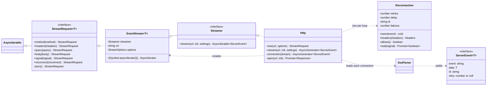

### The life of a stream

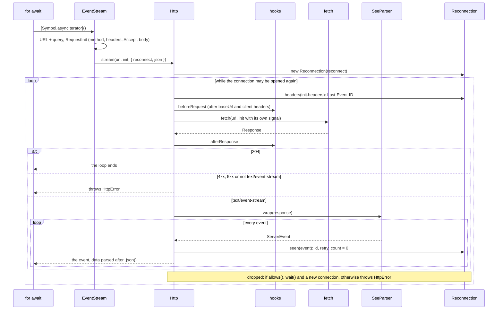

### Step by step: what `for await` does

1. `for await` calls `EventStream[Symbol.asyncIterator]()`. It joins the query to the URL and builds `RequestInit`:
   the method (`GET`, or `POST` when there is a body), the headers with `Accept: text/event-stream` unless the
   caller set `Accept`, the body encoded by `Encoder` as for `post()`, the signal. A body that cannot be encoded, or
   a GET with a body, throws `HttpError('The request could not be built')` from the first `next()`.
2. `EventStream` hands the URL, `RequestInit` and `{ reconnect, json }` to `Http.stream()` and returns its iterator.
3. `Http.stream()` creates one `Reconnection` for the loop and opens the first connection. Each connection gets its
   own `AbortController`, joined with the caller's signal, and `Last-Event-ID` once the server has sent an id.
4. The request goes through the client: `baseUrl`, the client headers, the `beforeRequest` hooks, then `fetch`, then
   the `afterResponse` hooks. `timeout`, `retry` and `dedupe` do not apply to a stream.
5. The answer is checked: 204 ends the loop without events; an error status throws `HttpError` with the error body
   decoded by the chain in `data`; a 2xx that is not `text/event-stream` throws
   `HttpError('The response is not an event stream')`.
6. `SseParser` reads the body while it arrives. For each event `Reconnection.seen()` keeps the id and the
   `retry:` wait and resets the count; with `.json()` the data is parsed, and data that is not JSON throws
   `HttpError('The event data could not be decoded')`.
7. The end of the body ends the loop. A drop (the body fails) or a connection that cannot be made goes to the
   reconnect rules below.
8. Whenever the loop ends, normally, by `break`, by an error or by the signal, the connection's `AbortController` is
   aborted, so the connection is closed.

### Reconnecting

| What happens | Without `.reconnect()` | With `.reconnect()` |
| --- | --- | --- |
| the server ends the stream | the loop ends | the loop ends: an LLM answer is done, a reconnect would POST the prompt again |
| 204 No Content | the loop ends | the loop ends (the server asks not to reconnect) |
| the connection drops in the middle | throws `HttpError('The event stream was interrupted')`, status of the response | waits and connects again |
| `fetch` rejects (network, server down) | throws `HttpError('The request got no response')`, status `0` | waits and connects again |
| 4xx, 5xx | throws `HttpError` with the status and the decoded body | the same, no reconnect |
| not `text/event-stream` | throws `HttpError('The response is not an event stream')` | the same, no reconnect |
| data that is not JSON after `.json()` | throws `HttpError('The event data could not be decoded')` | the same, no reconnect |
| a hook throws | throws the `HttpError` of the hook | the same, no reconnect |
| the caller's signal aborts, or `break` | the loop ends, no error | the same, no wait and no reconnect |

| `.reconnect(…)` | Reconnects in a row | Wait |
| --- | --- | --- |
| not called, or `0` | none | — |
| `.reconnect()` | no limit, like `EventSource` | 1000 ms |
| `.reconnect(3)` | 3 | 1000 ms |
| `.reconnect({ retries: 5, delay: 200 })` | 5 | 200 ms |

The count is "in a row": every event received resets it, so a stream that drops once an hour reconnects for
ever, and a server that is down gives up after `retries` failures and throws the last error. The last `retry:`
field from the server replaces the wait. `Last-Event-ID` carries the last id received, even when the new
connection's events come without an id. Reconnecting a POST sends the same body again, so a `ReadableStream` body
cannot be reconnected.

### Closing a stream

```ts
const controller = new AbortController();
const stream = http.sse('/api/feed').signal(controller.signal).reconnect();

for await (const event of stream) {
    if (event.event === 'done') {
        break; // closes the connection
    }
}

controller.abort(); // from anywhere: closes the connection and ends the loop without an error
```

`break`, `return` and an error thrown in the loop body call `return()` on the iterator; the `finally` in
`Http.connection()` aborts the connection. An abort through the signal also ends the wait before a reconnect.

### Step by step

`http.sse('/api/chat').body({ prompt: 'Hi' }).json<{ delta: string }>().reconnect(2)` with
`extend({ baseUrl: 'https://api.example.com', hooks: { beforeRequest: [sign] } })`:

| Step | What happens |
| --- | --- |
| 1 | `for await` starts: `EventStream` builds `POST`, `Content-Type: application/json`, `Accept: text/event-stream`, body `{"prompt":"Hi"}` |
| 2 | `Http.stream()`: `Reconnection` with 2 reconnects in a row, delay 1000 ms |
| 3 | `prepare()`: `https://api.example.com/api/chat`; `sign` adds `Authorization`; `fetch` |
| 4 | 200 `text/event-stream`: `SseParser` yields `{ data: '{"delta":"Hel"}', id: '1' }`, `Http` parses it into `{ delta: 'Hel' }` |
| 5 | the connection drops: `allows()` is true, `wait()` sleeps 1000 ms |
| 6 | the second connection carries `Last-Event-ID: 1`; `sign` runs again with a fresh token |
| 7 | the server ends the stream: the loop ends |

### Where it is tested

| What | Tests |
| --- | --- |
| the stream object | `tests/Unit/Request/EventStream/`: lazy, every loop connects, GET by default with `Accept`, POST, a body makes a POST, GET with a body, a body that cannot be serialized, headers, `Accept` kept, query, signal, reconnect with and without a limit, json, immutable, options = chain |
| reconnect state | `tests/Unit/Delivery/Reconnection/`: off, the limit, no limit, reset by an event, `Last-Event-ID` kept and missing, the default and the given wait, `retry:`, aborted during and before the wait |
| the facade | `tests/Unit/Http/Http.sse.*`: events, json, data that is not JSON, error status, not an event stream, 204, network error, interrupted, reconnect after a drop and after a network error, reconnects run out, no reconnect at the end, `break`, abort, `extend()` with hooks, hooks per connection, a hook that throws, the types |
| the real chain | `tests/Feature/Bootstrap/Bootstrap.sse.stream`, `Bootstrap.sse.json` |
| over the wire | `tests/Integration/Http/Http.sse` (small chunks), `Http.sse.post` (body and token), `Http.sse.reconnect` (the server drops, `Last-Event-ID`), `Http.sse.break` (the server sees the close) |

## Hooks and dedupe: `hooks`, `.dedupe()`

A client can run functions around every request, and can let identical requests sent at the same moment share
one response ([ADR 0010](../../adr/0010-hooks-and-dedupe.md)).

```ts
const api = http.extend({
    baseUrl: 'https://api.example.com',
    dedupe: true, // identical GET and HEAD requests in flight share one
    hooks: {
        beforeRequest: [
            async ({ url, init }) => {
                const headers = new Headers(init.headers);
                headers.set('Authorization', `Bearer ${await auth.token()}`);
                return { url, init: { ...init, headers } };
            },
        ],
        afterResponse: [(response) => void metrics.count(response.status)], // nothing returned: kept
    },
});

await Promise.all([api.get('/me'), api.get('/me')]); // one request to the network
await http.get('/api/users').dedupe(); // or per request
```

### The files and what each one does

| File | Kind | What it does | Who uses it |
| --- | --- | --- | --- |
| `src/Contract/Hooks.ts` | interfaces, types | `Outgoing { url, init }`, `BeforeRequest`, `AfterResponse`, `Hooks { beforeRequest?, afterResponse? }` | `ClientOptions`, `HookRunner` |
| `src/Delivery/HookRunner.ts` | class | Runs the hooks in order; `concat()` joins the hooks of two clients; a failed hook becomes an `HttpError` | `Http` |
| `src/Delivery/Inflight.ts` | class | The requests in flight by key; joins a caller, gives each a `clone()`, aborts when every caller left | `Http` |
| `src/Contract/DeliveryOptions.ts` | interface | gets `dedupe?: boolean`, so `ClientOptions`, `SendOptions` and `RequestOptions` have it | `Http.send()` |
| `src/Contract/ClientOptions.ts` | interface | gets `hooks?: Hooks` | `Http.extend()` |
| `src/Request/FluentRequest.ts` | class | `.dedupe(enabled = true)` | the caller |

### Classes

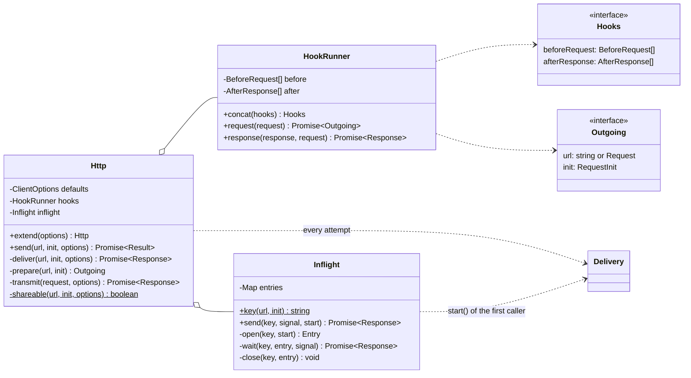

### Where hooks and dedupe sit in `send()`

```mermaid
flowchart LR
    A["send(url, init, options)"] --> P["prepare()<br/>baseUrl, client headers"]
    P --> B["HookRunner.request()<br/>beforeRequest hooks"]
    B --> S{"shareable()?<br/>dedupe, GET or HEAD,<br/>string URL, no progress"}
    S -->|yes| I["Inflight.send()<br/>join or start"]
    S -->|no| D["Delivery.send()<br/>transport, timeout, retry"]
    I --> D
    D --> R["HookRunner.response()<br/>afterResponse hooks"]
    R --> C["status check, chain or .as(),<br/>.schema()"]
    C --> Res["{ data, error }"]
```

### Hooks

| | `beforeRequest` | `afterResponse` |
| --- | --- | --- |
| gets | `Outgoing { url, init }` after `baseUrl` and the client headers | the response and the `Outgoing` that was sent |
| returns | a new `Outgoing`, or nothing to keep it | another `Response`, or nothing to keep it |
| async | yes | yes |
| runs | once per request (not per retry), once per connection of `http.sse()` | once, with the last response after retries; for each caller of a shared request, on its copy |
| order | the order of the array; the hooks of the parent client first | the same |
| throws | `send()` returns `HttpError('A beforeRequest hook failed')`, status `0`, `cause` = the error; nothing is sent | `send()` returns `HttpError('An afterResponse hook failed')` with the status and the response |

Hooks are set only on a client: `extend({ hooks })`. `extend()` appends, so a client made from `api` runs the hooks
of `api` and then its own. A `Request` object given to `send()` reaches the hooks as `url`, with the `init` given
next to it.

Refreshing an expired token is an `afterResponse` hook that sends the request again:

```ts
const api = http.extend({
    hooks: {
        afterResponse: [
            async (response, { url, init }) => {
                if (response.status !== 401) {
                    return response;
                }

                const headers = new Headers(init.headers);
                headers.set('Authorization', `Bearer ${await auth.refresh()}`);
                return fetch(url, { ...init, headers }); // the new response is decoded as usual
            },
        ],
    },
});
```

### Dedupe: how it works

```mermaid
sequenceDiagram
    participant A as caller A
    participant B as caller B
    participant I as Inflight
    participant D as Delivery

    A->>I: send(key, signalA, start)
    I->>I: no entry: new AbortController, waiting = 1
    I->>D: start(entry signal)
    B->>I: send(key, signalB, start)
    I->>I: entry found: waiting = 2
    D-->>I: Response
    I->>I: the entry is removed
    I-->>A: response.clone()
    I-->>B: response.clone()
    Note over A,B: each decodes its own copy: .as('text'), .schema(User), afterResponse
```

1. `Http.shareable()` lets a request in only with `dedupe` on (the request's own value, or the client's), method
   GET or HEAD, a string URL and no progress listener.
2. `Inflight.key()` is the method, the URL and the headers. `Headers` lowercases and sorts the names, so the order
   and the case do not matter. The key is taken after the `beforeRequest` hooks, so it sees the final headers.
3. With no entry for the key, `open()` creates an `AbortController` and calls `start(signal)`, which is
   `Delivery.send()` with that signal instead of the caller's. With an entry, the caller joins it.
4. Every caller waits for the same promise and gets `response.clone()`: a body can be read only once, and the
   original response is never read.
5. When the response arrives or fails, the entry is removed. The next request goes to the network again: this is
   not a cache.

### What is shared and what is not

| Case | Result |
| --- | --- |
| two identical GETs with `.dedupe()` at the same moment | one network request, two results |
| the same GET after the first one has been answered | a new request |
| different headers or query | separate requests |
| POST, PUT, PATCH, DELETE | never shared |
| a request with `onDownloadProgress` or `onUploadProgress` | never shared: its listener needs its own transfer |
| a `Request` object given to `send()` | never shared |
| one caller aborts with its signal | only that caller gets `HttpError` with status `0`; the request goes on for the others |
| every caller aborts | the shared request is aborted and removed; the next caller starts a new one |
| the shared request fails | every caller gets the same error |
| callers with different `.timeout()` or `.retry()` | the first caller's settings drive the shared request |
| `extend({ dedupe: true })` and `.dedupe(false)` | that one request is not shared |
| two clients made by `extend()` | each has its own `Inflight`: no sharing between them |

### Step by step

Two components ask for `/me` with `extend({ dedupe: true, hooks: { beforeRequest: [sign] } })`:

| Step | What happens |
| --- | --- |
| 1 | A: `prepare()`, `sign` adds `Authorization`, `shareable()` is true, key `GET https://…/me [["authorization","Bearer t"]]` |
| 2 | A: no entry, `Delivery.send()` starts with the entry's signal |
| 3 | B: the same steps, the same key: B joins, `waiting = 2` |
| 4 | the response arrives: the entry is removed, A and B each get a `clone()` |
| 5 | each runs `afterResponse` on its copy, then the chain: two `{ data, error: null }` |

### Where it is tested

| What | Tests |
| --- | --- |
| `HookRunner` | `tests/Unit/Delivery/HookRunner/`: no hooks, order, nothing returned, async, throws, rejects and stops the next hooks, a new response, the arguments, an `afterResponse` that throws, `concat` |
| `Inflight` | `tests/Unit/Delivery/Inflight/`: the key ignores order and case, differs by method, header and URL; shared, other keys, one after another, a failed request, one caller aborts, every caller aborts, a new request after that, aborted before |
| the facade | `tests/Unit/Http/Http.get.dedupe.*`, `Http.post.dedupe`, `Http.extend.dedupe.*`, `Http.send.hooks.*`, `Http.extend.hooks.*`: shared, off, different headers, POST, progress, one caller aborted, the client setting and `.dedupe(false)`, hooks change the request and the response, failed hooks, hooks once with retries, the order of parent and child, the parent unchanged |
| the request object | `FluentRequest.dedupe`, `.off`, `.immutable`, `.options` |
| the real chain | `tests/Feature/Bootstrap/Bootstrap.dedupe` (`.as('text')` and `.schema()` on one response), `Bootstrap.hooks.refresh` (401, a new token, the request sent again) |
| over the wire | `tests/Integration/Http/Http.get.dedupe` (three requests, one hit), `Http.get.hooks` (the token reaches the server) |

## Errors

`send<T, E>()` returns `Result<T, E>`: `{ data: T, error: null }` or `{ data: null, error: HttpError<E> }`. It never
throws, so one `if (error)` handles every failure, and after it TypeScript (with `strictNullChecks`) knows `data`
is `T`.

| What happened | `error.status` | `error.data` | `error.response` | `error.cause` |
| --- | --- | --- | --- | --- |
| 2xx, decoded | no error | | | |
| 4xx, 5xx | the status | the error body decoded by the same chain, `null` if it cannot be decoded | the `Response` | — |
| no response: network, CORS, abort | `0` | `null` | `null` | the rejection of `fetch` (the last one after retries) |
| an attempt took longer than `.timeout()` | `0`, message `The request timed out after N ms` | `null` | `null` | `TimeoutError` |
| 2xx, but the body cannot be read or decoded (also in the format chosen by `.as()`) | the status | `null` | the `Response` | the error (`SyntaxError`, `TypeError`) |
| `.as()` on an `Http` built without a `Picker` | the status | `null` | the `Response` | `TypeError` |
| 2xx, the data does not pass `.schema()`: a `ValidationError` | the status | `null` | the `Response` | — (`issues` and `value` instead) |
| 2xx, `validate()` of the schema throws | the status | `null` | the `Response` | the thrown error |
| a `beforeRequest` hook throws, message `A beforeRequest hook failed` | `0` | `null` | `null` | the error of the hook |
| an `afterResponse` hook throws, message `An afterResponse hook failed` | the status | `null` | the `Response` | the error of the hook |
| a shared request (`.dedupe()`) aborted by this caller's signal | `0` | `null` | `null` | `AbortError` |

`http.sse()` throws the same `HttpError` from its `for await`, because a stream has no result to return: see
[Reconnecting](#reconnecting) for each case.

```ts
const { data, error } = await http.send<User, { message: string }>('/api/users/42');

if (error) {
    return error.status === 404 ? showNotFound(error.data?.message) : showOffline();
}

render(data.name);
```

`HttpError` extends `Error` with `name` `HttpError`, so it can be thrown or logged as usual. The body of
`error.response` has already been read. `ValidationError` extends `HttpError`, so `if (error)` still catches it,
and `error instanceof ValidationError` tells it apart.

## The order of the chain

The first match wins, so the order is behaviour. Reasons for each position: [ADR 0002](../../adr/0002-built-in-parsers.md).

```mermaid
flowchart TD
    R([Response]) --> E[EmptyParser]
    E -->|no| J[JsonParser]
    J -->|no| X[XmlParser]
    X -->|no| U[UrlEncodedParser]
    U -->|no| M[FormDataParser]
    M -->|no| H[DomParser]
    H -->|no| B[BinaryParser]
    B -->|no| A[BlobParser]
    A -->|no| N[NdjsonParser]
    N -->|no| C[CsvParser]
    C -->|no| S[SseParser]
    S -->|no| MD[MediaParser]
    MD -->|no| T[TextParser]
    T -->|no| F([ArrayBuffer])
```

Each decoder that says yes ends the chain and returns its value (table below); the arrows show only the "no" path.

| # | Decoder | Accepts | Returns |
| --- | --- | --- | --- |
| 1 | `EmptyParser` | status 204, 205, 304, `Content-Length: 0`, no body (HEAD) | `null` |
| 2 | `JsonParser` | `application/json`, `*+json`; a body that parses as JSON when Content-Type is missing | parsed JSON |
| 3 | `XmlParser` | `application/xml`, `text/xml`, `*+xml` (SVG, Atom, SOAP…) | plain object (`fast-xml-parser`, attributes dropped) |
| 4 | `UrlEncodedParser` | `application/x-www-form-urlencoded` | `URLSearchParams` |
| 5 | `FormDataParser` | `multipart/form-data` | `FormData` |
| 6 | `DomParser` | `text/html` | `Document` (needs `DOMParser`: a browser or jsdom) |
| 7 | `BinaryParser` | `application/octet-stream`, `application/binary` | `ArrayBuffer` |
| 8 | `BlobParser` | `Content-Disposition: attachment` with any type not matched above | `Blob` |
| 9 | `NdjsonParser` | `application/x-ndjson`, `application/ndjson`, `application/jsonlines`, `application/jsonl` | array, one item per line |
| 10 | `CsvParser` | `text/csv`, `application/csv`, `text/tab-separated-values` | `string[][]` (RFC 4180 quoting) |
| 11 | `SseParser` | `text/event-stream` | `AsyncIterable<ServerEvent>` |
| 12 | `MediaParser` | `image/*`, `audio/*`, `video/*`, `font/*`, `application/pdf` | `Blob` |
| 13 | `TextParser` | `text/*`, `application/javascript`, `application/sql` | `string` |
| — | fallback | anything else | `ArrayBuffer` |

Server-Sent Events are read while they arrive:

```ts
import { http, type ServerEvent } from '@metapraxis/jext-http';

const { data: events, error } = await http.send<AsyncIterable<ServerEvent>>('/api/events');

if (error) {
    throw error;
}

for await (const { event, data, id } of events) {
    console.log(event, data, id);
}
```

`ServerEvent` is `{ event, data, id, retry }`: `event` is `message` when the server sent no `event:` field,
`data` joins every `data:` line with `\n`, `id` is the last id seen in the stream, `retry` is a number or `null`.
To reconnect, POST a body or parse JSON, use `http.sse()`: see [Server events](#server-events-httpsse).

## Adding a parser

1. Create `src/Parsers/<Name>Parser.ts` implementing `Decoder<T>`, following an existing parser. Keep `parse()`
   synchronous unless it has to read the body.
2. Register it in `Bootstrap` at a deliberate position: before every decoder that would also accept its responses,
   after `BlobParser` if an attachment should stay a file.
3. Unit test `parse()` and `wrap()` on a real `Response`, without `fetch`: `tests/Unit/Parsers/<Name>Parser.test.ts`.
4. Feature test of the chain: `tests/Feature/Bootstrap.<case>.test.ts`.
5. Integration test: a fixture in `tests/Integration/__fixtures__/` and `tests/Integration/Http.<case>.test.ts` with
   its own local server.
6. Update the table and diagram above (both languages), the CHANGELOG, and write a package ADR if the parser changes
   what an existing type returns.

## Lessons: `examples/`

Every lesson solves one task six times: with jext, `fetch`, `XMLHttpRequest`, axios, ky and ofetch. The variants
talk to one lesson server, and a feature test checks that all six return the same value, so the comparison on the
site cannot quietly go wrong ([ADR 0011](../../adr/0011-lessons-compare-tools.md)).

### The files and what each one does

```text
examples/
├── README.md, RUADME.md      # the list of lessons by group, in English and Russian; the site builds its menu from them
├── package.json              # { "type": "module" }, so Node runs serve.mjs and server.ts as ES modules
├── api.ts                    # API = 'http://localhost:4000', the address every variant builds its URLs from
├── server.ts                 # createLessonServer(fixtures): the node:http server of the lessons
├── serve.mjs                 # npm run examples:serve -w @metapraxis/jext-http: starts that server on port 4000
├── __fixtures__/             # users.json, robots.txt, about.html, broken.json, report.csv, books.xml, events.ndjson,
│                             # logo.png, settings.json
└── NN.<subject>.<case>/      # one lesson
    ├── en.md, ru.md          # the explanation; the line <!-- @variants --> becomes the six tabs
    └── jext.ts, fetch.ts, xhr.ts, axios.ts, ky.ts, ofetch.ts   # export default async function run()
```

The folder name follows the rule of test files: every dot is a scope. `NN` orders the lessons and groups them by
tens: `0x` basics, `1x` request body, `2x` errors, `3x` formats, `4x` schemas, `5x` clients, `6x` reliability
(retries, cancelling, sharing requests), `7x` progress, `8x` Server-Sent Events. A variant is self-contained: it
declares its own types and helpers and imports only its tool, the schema library of the lesson (zod, valibot) and
`API`, so the tab on the site shows everything the reader needs.

### The lesson server

`createLessonServer(fixtures)` returns a `node:http` server that is not listening yet. It changes nothing: a write
answers as if it changed the users, and the next request sees the fixture again. Its only state are the attempt
counters of the reliability lessons, one per path and `key` query parameter (`count(exchange)`): a variant sends a
new random key, so six variants and repeated runs never share a count. Every answer allows any origin,
method and header (CORS), so the variants also work from a page on another port.

| Route | Answer | Lessons |
| --- | --- | --- |
| `GET /users?role=&limit=` | the users from `users.json`, filtered | 01, 02 |
| `GET /users/:id`, `HEAD /users/:id` | one user, or 404 `{ message }` | 06, 20, 40–42, 50 |
| `POST /users` | 201, the JSON body with the next id | 10 |
| `PUT /users/:id`, `PATCH /users/:id` | the body (merged into the user for `PATCH`) | 14, 15 |
| `DELETE /users/:id` | 204 without a body | 16 |
| `GET /me` | the first user with `Authorization: Bearer secret-token`, 401 otherwise | 03, 51, 52 |
| `POST /login` | `{ token }` for `alice` / `wonderland` in a URL-encoded form, 401 otherwise | 12, 52 |
| `POST /feedback`, `POST /files` | the fields of a multipart or URL-encoded form; a file as `{ name, size, type }` | 11, 13 |
| `GET /robots.txt`, `/about.html`, `/broken.json` | the fixture with its `Content-Type` | 04, 05, 24 |
| `GET /reports/daily` | 500 with a text body | 21 |
| `GET /drop` | closes the connection without an answer | 22 |
| `GET /slow` | answers after one second | 23 |
| `GET /report.csv`, `/books.xml`, `/events.ndjson`, `/logo.png` | the fixture with its `Content-Type` | 30–33 |
| `GET /export` | `report.csv` with `Content-Disposition: attachment` | 34 |
| `GET /settings` | `settings.json` sent as `text/plain` | 35 |
| `GET /echo/headers` | `{ app, authorization }`: the `X-App` and `Authorization` headers that arrived | 51, 53 |
| `GET /flaky?key=` | 503 `{ message }` for the first two attempts of a key, then `{ attempt }` | 60 |
| `GET /busy?key=` | 429 with `Retry-After: 1` for the first attempt of a key, then `{ attempt }` | 61 |
| `GET /counter?key=` | `{ hits }`, the number of requests for the key so far, after 100 ms | 62, 63 |
| `POST /upload` | `{ received }`, the number of bytes in the body | 70 |
| `GET /download` | 256 KiB of `application/octet-stream` with `Content-Length` | 71 |
| `GET /events` | three events, then the end of the stream | 80 |
| `GET /ticker` | event `1`, then a broken connection; with `Last-Event-ID: 1` events `2`, `3` and the end | 81 |
| `POST /chat` | `{ prompt }` → events with pieces of the reply as `{ text }` | 82 |
| `OPTIONS *` | the CORS preflight | 03, 10, 14–16 |

### How a lesson is checked

```mermaid
sequenceDiagram
    participant T as Examples.get.json.test.ts
    participant S as createLessonServer
    participant V as jext.ts … ofetch.ts
    T->>S: listen(0) in beforeAll
    T->>T: vi.mock('examples/api'): API → http://127.0.0.1:port
    loop it.each over six variants
        T->>V: run()
        V->>S: the request of the lesson
        S-->>V: the answer from __fixtures__
        V-->>T: the value
        T->>T: expect(actual).toEqual(expected)
    end
    T->>S: close() in afterAll
```

1. The test starts the server on a free port, so lesson tests run in parallel and never collide with a server
   started by hand on port 4000.
2. `vi.mock` replaces `examples/api` with a getter that returns the address of that server. The variants read
   `API` when they build a URL, after `beforeAll` has set it.
3. `it.each` runs the six variants with one expected value written in the test. One failing tab fails the lesson.
4. Lesson tests start with `// @vitest-environment jsdom-with-fetch`, so they run in jsdom
   (`tests/support/jsdom-with-fetch.ts`), where `XMLHttpRequest` exists and `fetch` is Node's.
   jsdom's `XMLHttpRequest` accepts only jsdom's own `FormData`, `Blob` and `URLSearchParams`, so the form lessons
   (11, 13) give the XMLHttpRequest and axios variants the jsdom classes the environment keeps in `jsdomBodies`.
   A browser has one of each and needs nothing of the kind.
5. ky and ofetch are published as ES modules only; Vitest loads them as they are. `@metapraxis/jext-http` resolves
   to `packages/http/index.ts` through the aliases of `vitest.config.ts` and `tsconfig.json`.
6. A client lesson (5x) creates its client when the module loads (`axios.create({ baseURL: API })`), before
   `beforeAll` has set `API`. Its test imports each variant inside the `it`, after the server listens:
   `` await import(`../../../examples/50.client.base-url/${file}`) ``.
7. A tool that cannot do the task at all returns `null`, and a comment in its file says why and what to use instead.
   The test marks it in a third column, `[label, run, supported]`, and expects `supported ? value : null`. Only lesson
   70 has such tabs: fetch, ky and ofetch report no upload.
8. jsdom differs from a browser in three places the lessons meet. It logs a dropped or aborted `XMLHttpRequest` to
   `console.error`, so the tests of 22, 62 and 81 silence it. It fires no event when a connection breaks in the
   middle of a response, so `/ticker` breaks its stream with a malformed chunk, which every client, a browser
   included, treats as a network error. And its upload events carry no size, so lesson 70 checks that the progress
   listener ran, not the percent. The environment also copies `TransformStream` from Node, which ky needs for its
   download progress.

### On the site

`website/scripts/collect.mjs` turns `examples/README.md` into `/api/http/guide/`, `RUADME.md` into
`/ru/api/http/guide/`, and each `en.md` / `ru.md` into `/api/http/guide/NN-subject-case` (dots become hyphens: a
dot in a URL would look like a file extension). It replaces the `<!-- @variants -->` line with a `code-group` of
the six files, in the order jext, fetch, XMLHttpRequest, axios, ky, ofetch, and builds the Lessons menu from the
groups of the two indexes. `npm run docs:check` fails when a lesson misses a variant, a text, the marker, its test or
its line in `README.md` / `RUADME.md`.

### Adding a lesson

1. Pick the next number in its group and a name by the dot rule: `25.error.forbidden`.
2. Add a route to `server.ts` and, if it serves a file, the file to `__fixtures__`.
3. Write the six variants. Each returns the same value; when a tool needs a non-default option for it (`retry: 0`
   for ky and ofetch, `responseType` for axios), set it in the variant and say why in the text. A tool without the
   feature does it by hand when it can (retries, a stream parser); only when it cannot does its variant return
   `null` with a comment, as described above. A lesson that counts requests sends a new `key` on every run.
   Every variant handles a failure explicitly: an error status becomes `new Error('<status> <statusText>')`, an
   error without a response is thrown as it is. jext throws `error` (its message is already the status line), fetch
   and XMLHttpRequest check the status, axios, ky and ofetch wrap `run()` in `try` and convert `AxiosError`,
   `HTTPError` or `FetchError` in `catch`. No tab may look shorter because its error handling is hidden.
4. Write `en.md` and `ru.md`: what the server answers, the `<!-- @variants -->` line, then "What differs", one point
   per tool, checked against the tool's documentation or source.
5. Add the lesson to `README.md` and `RUADME.md` under its group.
6. Add `tests/Feature/Examples/Examples.<subject>.<case>.test.ts` with the expected value, run
   `npm run tests:feature` and `npm run docs:build`.

## Tests

| Type | Files | What they check |
| --- | --- | --- |
| Unit | `tests/Unit/Parsers/<Name>Parser/<Name>Parser.<method>.<case>.test.ts`, `Unit/Root/Root.<method>.<case>.test.ts`, `Unit/Root/Picker/…`, `Unit/Http/Http.<method>.<case>.test.ts`, `Unit/Request/<Class>/…`, `Unit/Error/<Class>/…`, `Unit/Delivery/<Class>/…`, `Unit/Transport/<Class>/…` | one decoder, the chain, `Picker`, the facade, the request object (with a stub `Sender`), `Encoder`, `QueryString`, the errors; no `fetch` except a `vi.spyOn` in `Unit/Http` |
| Feature | `tests/Feature/Bootstrap/Bootstrap.<case>.test.ts` | the real chain from `Bootstrap` with `fetch` mocked in `beforeEach` |
| Feature | `tests/Feature/Examples/Examples.<subject>.<case>.test.ts` | each lesson in `examples/`: its six variants against the lesson server return the same value |
| Integration | `tests/Integration/Http/Http.<method>.<case>.test.ts` | real requests to a `node:http` server started by the file in `beforeAll` ([ADR 0003](../../adr/0003-local-test-server.md)); fixtures stay in `tests/Integration/__fixtures__` |

Every file is one scenario. Negative cases sit next to the positive ones: a parser rejects a foreign type,
`wrap` rejects a broken body (invalid JSON or NDJSON, a multipart boundary mismatch), an SSE stream fails in the
middle, a parser in the chain throws, `fetch` rejects or is aborted, the server drops the connection, sends less
than `Content-Length` or is not listening, the body is not in the format chosen by `.as()`, the data does not
pass the schema or the schema throws, XHR fails or is aborted, a stream body is given to XHR, an attempt times out, retries run out, the caller aborts during the wait
before a repeat, `http.sse()` gets an error status, a response that is not an event stream or data that is not
JSON, a stream drops without reconnects or runs out of them, a hook throws, a caller of a shared request aborts.
`EventStream` tests use a stub `Streamer`. `npm run tests:http` runs them all from the root.
