# Архитектура @metapraxis/jext-http

[English version](../en/ARCHITECTURE.md)

Как `http.send()` превращает `Response` в значение, почему это устроено именно так и как это расширять. Решения:
[`adr/`](../../adr/README.md).

## Коротко

`http.send(url, init)` вызывает `fetch` и передаёт `Response` цепочке декодеров. Каждый декодер отвечает на один
вопрос: «это мой ответ?». Первый, кто ответил «да», декодирует ответ. Если не ответил никто, результатом будет
`ArrayBuffer`. Вызывающий код формат не указывает: он берётся из самого ответа (Content-Type,
Content-Disposition, статус и тело, если Content-Type нет), если только вызывающий код не выбрал его сам через
`.as(format)`. Схема, переданная в `.schema()`, проверяет разобранные данные в рантайме. `.timeout()` ограничивает каждую
попытку, `.retry()` повторяет неудачную, а `extend()` создаёт клиент с общим базовым URL, заголовками, таймаутом и повторами.
`.onUploadProgress()` и `.onDownloadProgress()` сообщают прогресс тел. `http.sse()` читает Server-Sent Events
через `for await` и переподключается после обрыва. Хуки клиента вызываются вокруг каждого запроса, а `.dedupe()`
позволяет одинаковым запросам в полёте получить один общий ответ. `send()` ничего не бросает, а возвращает
`{ data, error }` ([ADR 0004](../../adr/0004-result-instead-of-exceptions.md)).

## Паттерн: Chain of Responsibility

Цепочка это [Chain of Responsibility](https://refactoring.guru/ru/design-patterns/chain-of-responsibility) в
варианте со списком: `Root` хранит декодеры по порядку и опрашивает их по одному, а не каждый декодер держит ссылку
на следующий. Почему выбран этот паттерн и что отвергли: [ADR 0001](../../adr/0001-parser-chain.md).

- **Обработчик** это `Decoder<T>`: `parse(data)` решает, `wrap(response)` декодирует.
- **Цепочка** это `Chain<T>`, её реализует `Root`: он один раз собирает `Data` и останавливается на первом `true`.
- **Фасад** это `Http`: `send()` и методы `get`, `post` и т.д. прячут `fetch` и цепочку.
- **Фабрика** это `Bootstrap`: собирает цепочку в порядке приоритета.

Это не Composite: `Root` не реализует `Decoder`, цепочки не вкладываются друг в друга, и ответ обрабатывает только
один декодер.

## Классы

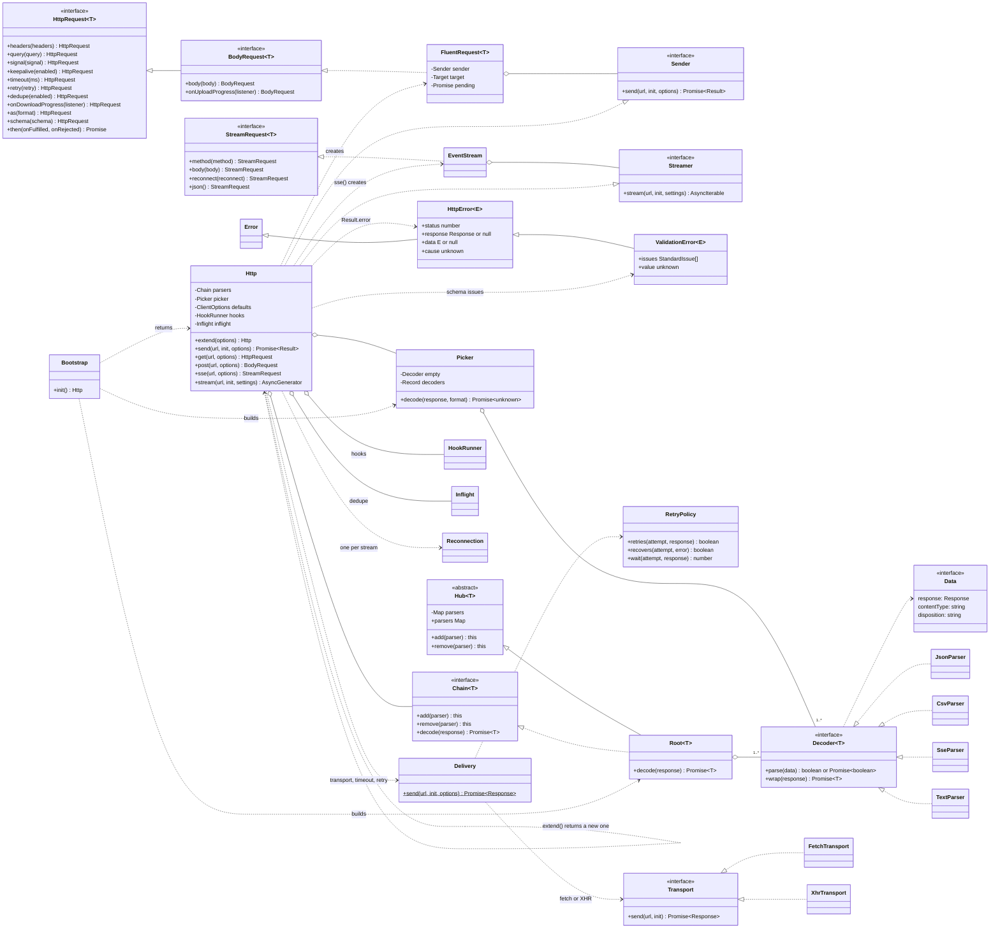

На схеме нарисованы четыре декодера из тринадцати, остальные реализуют `Decoder` так же.

| Файл | Что в нём |
| --- | --- |
| `index.ts` | готовый клиент `http`, `HttpError`, `ValidationError`, типы `Result`, `ServerEvent`, `Format`, `Formats`, `StandardSchema`, `InferOutput`, `StreamRequest`, `StreamOptions`, `Reconnect`, `Hooks` и другие |
| `src/Bootstrap.ts` | порядок цепочки и декодер каждого формата |
| `src/Http.ts` | `send()`: настройки клиента, хуки, `Inflight` или `Delivery`, потом `chain.decode()` или `picker.decode()`, потом схема, результат заворачивается в `Result`; `extend()`; `sse()` и `stream()` |
| `src/Error/HttpError.ts` | ошибка запроса, который не дал данных |
| `src/Error/ValidationError.ts` | ошибка данных, которые не прошли схему |
| `src/Request/FluentRequest.ts` | объект запроса, который возвращают `get`, `post` и остальные |
| `src/Request/EventStream.ts` | объект потока, который возвращает `sse()` |
| `src/Request/Encoder.ts`, `QueryString.ts` | как кодируются `body()` и `query()` |
| `src/Root/Hub.ts` | реестр: декодеры по имени класса, в порядке добавления |
| `src/Root/Root.ts` | цепочка: опрашивает декодеры по порядку, в конце `arrayBuffer()` |
| `src/Root/Picker.ts` | `.as(format)`: разбирает декодером выбранного формата |
| `src/Request/BaseUrl.ts` | склеивает `baseUrl` клиента и относительный URL |
| `src/Delivery/Delivery.ts`, `RetryPolicy.ts` | каждая попытка через транспорт с таймаутом, и когда и сколько ждать перед повтором |
| `src/Delivery/HookRunner.ts`, `Inflight.ts`, `Reconnection.ts` | хуки клиента, одинаковые запросы в полёте, состояние переподключений потока |
| `src/Transport/` | `FetchTransport`, `XhrTransport` (для прогресса отправки) и `Meter` (числа прогресса) |
| `src/Contract/` | `Chain`, `Decoder`, `Data`, `ServerEvent`, `Result`, `Failure`, `Sender`, `HttpRequest`, `BodyRequest`, `RequestOptions`, `Query`, `Payload`, `Format`, `Formats`, `Decoding`, `StandardSchema`, `SendOptions`, `DeliveryOptions`, `RetryOptions`, `ClientOptions`, `Progress`, `Transport`, `Hooks`, `StreamRequest`, `StreamOptions`, `Streamer`, `Reconnect` |
| `src/Parsers/` | по декодеру на формат |

## Один запрос

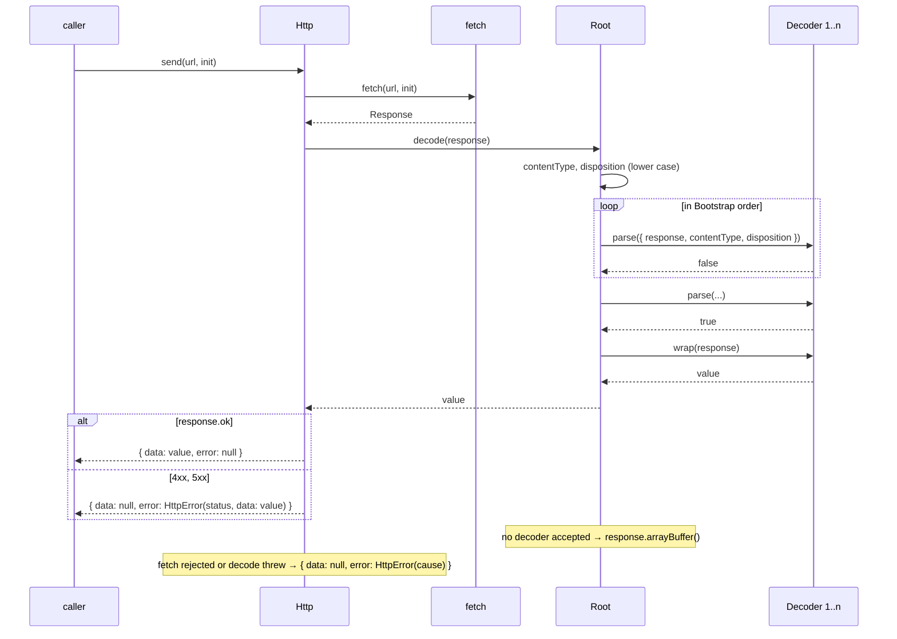

Это путь по умолчанию. `.as(format)` для ответа 2xx заменяет `Root` на `Picker`, а `.schema()` добавляет проверку
после разбора: см. [Выбор формата](#выбор-формата-as) и [Проверка данных](#проверка-данных-schema). `fetch` вызывается через `Delivery`, который
добавляет таймаут и повторы: см. [Таймауты и повторы](#таймауты-и-повторы-timeout-retry).

## Объект запроса

`http.get()`, `http.post()` и остальные методы ничего не отправляют. Они возвращают **объект запроса**: описание
запроса (метод, URL, опции), которое можно уточнять звено за звеном. Отправляется он, когда его дожидаются через
`await` ([ADR 0005](../../adr/0005-request-object.md)).

```ts
const { data, error } = await http
    .post<User, ApiError>('/api/users')
    .headers({ Authorization: `Bearer ${token}` })
    .query({ invite: true })
    .body({ name: 'Alice' });

await http.post<User>('/api/users', { headers: { Authorization: `Bearer ${token}` }, query: { invite: true }, body: { name: 'Alice' } }); // тот же запрос
```

### Файлы и что делает каждый

| Файл | Что это | Что делает | Кто использует |
| --- | --- | --- | --- |
| `src/Request/FluentRequest.ts` | класс | Хранит один запрос (`Target`: метод, URL, опции). Методы цепочки возвращают новый `FluentRequest`; `then()` собирает URL и `RequestInit` и отправляет их один раз. | его создают `Http.get/post/…` |
| `src/Request/Encoder.ts` | класс, статический | Превращает значение из `.body()` в то, что отправит `fetch`, и говорит, какой нужен Content-Type. | `FluentRequest.init()` |
| `src/Request/QueryString.ts` | класс, статический | Добавляет параметры запроса к строке URL. | `FluentRequest.url()` |
| `src/Contract/HttpRequest.ts` | интерфейсы | `HttpRequest<T, E>` (headers, query, signal, keepalive, timeout, retry, onDownloadProgress, as, schema, then) и `BodyRequest<T, E>` (+ body, onUploadProgress): что разрешено видеть вызывающему коду. | возвращаемые типы `Http.get/post/…` |
| `src/Contract/RequestOptions.ts` | интерфейсы | `RequestOptions` и `BodyRequestOptions`: объект опций с теми же именами, что у методов цепочки. | второй аргумент `Http.get/post/…` |
| `src/Contract/Query.ts` | типы | `QueryValue` и `Query`: что принимает `.query()`. | `query()`, `QueryString` |
| `src/Contract/Payload.ts` | тип | Что принимает `.body()`. | `body()`, `Encoder` |
| `src/Contract/Sender.ts` | интерфейс | `send(url, init, options): Promise<Result>`: единственное, что `FluentRequest` знает о клиенте. | его реализует `Http` |
| `src/Contract/SendOptions.ts` | интерфейс | `{ format?, schema?, timeout?, retry? }`: то, что `.as()`, `.schema()`, `.timeout()` и `.retry()` передают в `send()`. | `FluentRequest.dispatch()`, `Http.send()` |

### Классы

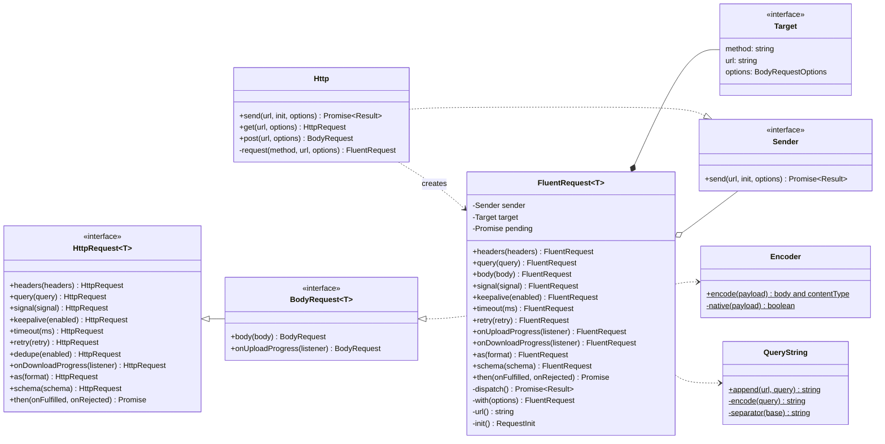

### Жизнь запроса

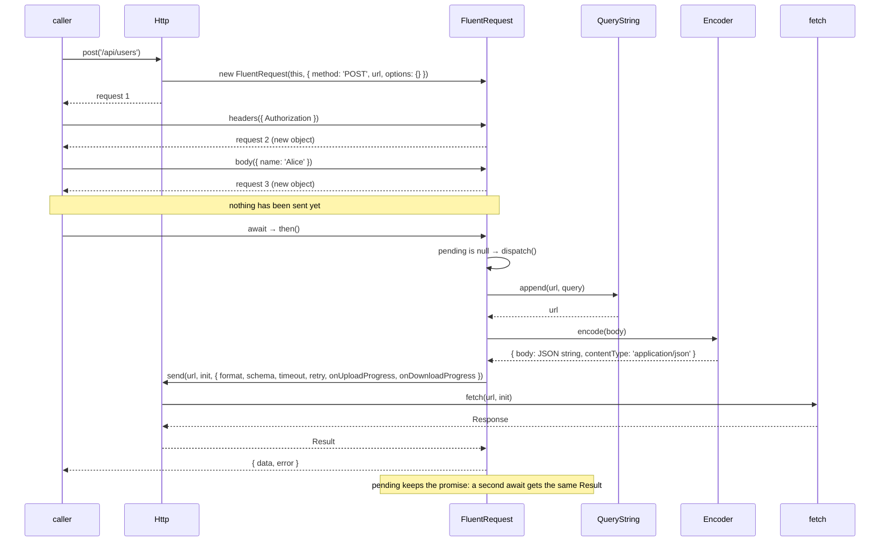

### По шагам

Что хранит каждое звено для запроса из примера в начале раздела. Имена заголовков получаются в нижнем регистре,
потому что хранятся в объекте `Headers`.

| Вызов | Новый объект? | `target.options` после вызова |
| --- | --- | --- |
| `http.post('/api/users')` | №1 | `{}` |
| `.headers({ Authorization: 'Bearer t' })` | №2 | `{ headers: Headers { authorization: 'Bearer t' } }` |
| `.query({ invite: true })` | №3 | `{ headers: …, query: { invite: true } }` |
| `.body({ name: 'Alice' })` | №4 | `{ headers: …, query: …, body: { name: 'Alice' } }` |

`await` на №4 вызывает `then()`, и тот собирает аргументы для `send()`:

```ts
url  = '/api/users?invite=true'                  // url(): QueryString.append(target.url, options.query)
init = {                                         // init()
    method: 'POST',
    headers: Headers { authorization: 'Bearer t', 'content-type': 'application/json' },
    body: '{"name":"Alice"}',                    // Encoder.encode(options.body)
    signal: null,                                // options.signal ?? null
    keepalive: false,                            // options.keepalive ?? false
}
options = { format: undefined, schema: undefined, timeout: undefined, retry: undefined } // nothing chosen: Content-Type, no limits
```

### Иммутабельные звенья и переиспользование

Каждый метод цепочки вызывает приватный `with(options)`. Он копирует `target.options`, вливает в копию новое
значение и возвращает новый `FluentRequest` с тем же `sender`, методом и URL. Объект, на котором его вызвали, не
меняется.

- `headers()` копирует существующие заголовки в новый `Headers` и ставит новые поверх: заголовок, заданный ещё раз,
  заменяет старое значение, остальные остаются.
- `query()` объединяет старый и новый объект: ключ, заданный ещё раз, заменяет старое значение.
- `body()`, `signal()`, `keepalive()`, `timeout()`, `retry()`, `onUploadProgress()`, `onDownloadProgress()`, `as()`
  и `schema()` заменяют старое значение: `.as('text').as('json')`
  разберёт JSON.

Поэтому подготовленный запрос можно смело использовать как заготовку:

```ts
const users = http.get<User[]>('/api/users').headers({ Authorization: `Bearer ${token}` });

const [first, second] = await Promise.all([users.query({ page: 1 }), users.query({ page: 2 })]);
// два запроса, в обоих токен; сам users не отправлялся и не изменился
```

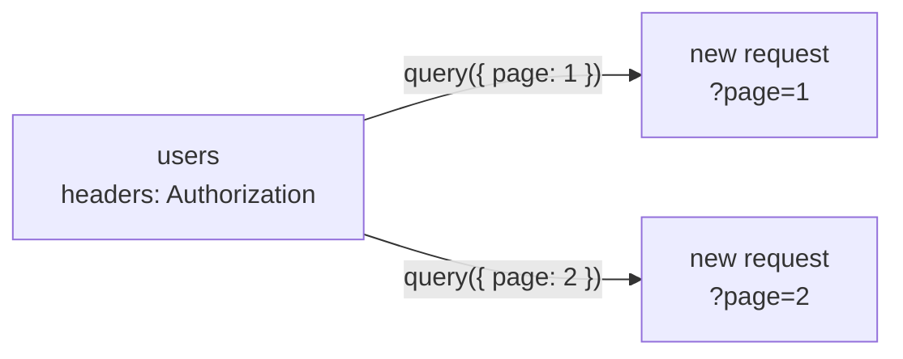

Меняется только приватное поле `pending`: это кэш промиса одного конкретного объекта. Новый объект начинает с
`pending = null`, поэтому отправляет свой запрос.

### Отправка на `await` и только один раз

`FluentRequest` это *thenable*: у него есть метод `then()`, и `await` вызывает именно его. Поэтому ничего не
происходит, пока запрос не дождались. `Promise` начал бы работать сразу при создании, ещё до того, как цепочка
добавит заголовки или тело.

```ts
public then(onFulfilled, onRejected) {
    this.pending = this.pending ?? this.dispatch();   // первый вызов: собрать и отправить; дальше: взять готовый
    return this.pending.then(onFulfilled, onRejected);
}
```

- Два `await request` или `Promise.all([request, request])` отправят один запрос и вернут один и тот же `Result`.
- Объект запроса подходит везде, где ждут `PromiseLike`. У него нет `catch()` и `finally()`; если они нужны,
  оберните его в `Promise.resolve(request)`. Нужно это редко, потому что результат никогда не отклоняется.
- `dispatch()` ловит ошибки, брошенные при сборке запроса (сейчас это только тело, которое не может
  сериализовать `JSON.stringify`, например объект со ссылкой на самого себя). Он превращает их в
  `{ data: null, error: HttpError }` со `status: 0` и ошибкой в `cause` и ничего не отправляет. Так объект
  запроса держит обещание `send()`: он никогда не бросает исключений.

### `HttpRequest` и `BodyRequest`: у кого есть `body()`

Оба интерфейса реализует один класс `FluentRequest`. Что можно вызвать, зависит от типа, который вернул метод:

| Метод | Возвращает | `body()` |
| --- | --- | --- |
| `get`, `head`, `delete` | `HttpRequest<T, E>` | нет, поэтому `http.get(url).body()` не скомпилируется |
| `post`, `put`, `patch` | `BodyRequest<T, E>` | есть |

С `onUploadProgress()` то же правило: отправлять есть что только у запроса с телом.

Каждый метод `BodyRequest` снова возвращает `BodyRequest`, поэтому после `.headers()` у POST-запроса по-прежнему
есть `body()`. Интерфейсы называют свой тип явно, а не `this`, потому что `FluentRequest` возвращает новый объект,
а не тот же самый. Во время выполнения метод у GET-запроса всё равно есть: проверку делает только компилятор.
У `head<T = null>` тип по умолчанию `null`, потому что у ответа на HEAD нет тела.

### Объект опций = цепочка

У второго аргумента каждого метода те же имена, что у методов цепочки:

| Опция | То же, что | Тип |
| --- | --- | --- |
| `headers` | `.headers()` | `HeadersInit` |
| `query` | `.query()` | `Query` |
| `signal` | `.signal()` | `AbortSignal` |
| `keepalive` | `.keepalive()` | `boolean` |
| `as` | `.as()` | `Format` |
| `schema` | `.schema()` | `StandardSchema` |
| `timeout` | `.timeout()` | `number` |
| `retry` | `.retry()` | `Retry` (`number \| RetryOptions`) |
| `onDownloadProgress` | `.onDownloadProgress()` | `ProgressListener` |
| `onUploadProgress` (post, put, patch only) | `.onUploadProgress()` | `ProgressListener` |
| `body` (только post, put, patch) | `.body()` | `Payload` |

`Http.request()` кладёт объект опций в `target.options` первого `FluentRequest`. Методы цепочки, вызванные потом,
вливаются в него по правилам выше, так что оба стиля можно смешивать: `http.get(url, { headers }).query({ page: 2 })`.

Одно отличие: `as` и `schema` в объекте опций в рантайме работают так же, но тип `data` не меняют. TypeScript
выводит тип только из вызова: если тип важен, пишите `.as('csv')` или `.schema(User)` в цепочке.

### `Encoder`: как отправляется `body()`

`Encoder.encode(payload)` возвращает `{ body, contentType }`. `FluentRequest.init()` кладёт `body` в `RequestInit`
и ставит `Content-Type` равным `contentType`, только если тот не `null` и вызывающий код не задал Content-Type сам.

| Что передали в `body()` | Что отправит `fetch` | Content-Type |
| --- | --- | --- |
| `null` или `body()` не вызывали | без тела | не ставится |
| строку | строку | `text/plain;charset=UTF-8`, ставит `fetch` |
| `FormData` | multipart | `multipart/form-data; boundary=…`, ставит `fetch` |
| `URLSearchParams` | `a=1&b=2` | `application/x-www-form-urlencoded;charset=UTF-8`, ставит `fetch` |
| `Blob` / `File` | байты | `type` у Blob, ставит `fetch` |
| `ArrayBuffer`, типизированный массив, `DataView` | байты | не ставится |
| `ReadableStream` | поток | не ставится |
| любой другой объект, массив, число, boolean | `JSON.stringify(value)` | `application/json` |
| объект, который `JSON.stringify` не осилит | ничего не отправляется | результат это `HttpError`, см. выше |

Нативные тела передаются как есть специально. Для `FormData` boundary знает только `fetch`, поэтому Content-Type,
поставленный руками, сломал бы запрос.

### `QueryString`: как `query()` попадает в URL

`QueryString.append(url, query)` работает со строкой URL, поэтому относительные URL (`/api/users`) тоже работают.

| URL | `query` | Результат |
| --- | --- | --- |
| `/api/users` | `{ page: 2 }` | `/api/users?page=2` |
| `/api/users?sort=name` | `{ page: 2 }` | `/api/users?sort=name&page=2` |
| `/api/users` | `{ tags: ['a', 'b'] }` | `/api/users?tags=a&tags=b` |
| `/api/users` | `{ a: null, b: undefined, c: 1 }` | `/api/users?c=1` |
| `/api/users` | `{ n: 0, active: false, q: '' }` | `/api/users?n=0&active=false&q=` |
| `/search` | `{ q: 'a&b' }` | `/search?q=a%26b` |
| `/page#top` | `{ x: 1 }` | `/page?x=1#top` |
| `/api/users?` | `{ page: 1 }` | `/api/users?page=1` |
| `/api/users` | `{ a: null }` | `/api/users` (без изменений) |

Выбрасываются только `null` и `undefined`. `0`, `false` и `''` это настоящие значения, и они остаются. Значения
кодирует `URLSearchParams`, поэтому пробел становится `+`.

### Зачем `Sender`

`FluentRequest` не импортирует `Http` и не вызывает `fetch`. Он получает `Sender`, интерфейс с одним методом
`send(url, init, options)`, который реализует `Http`. Так зависимость идёт в одну сторону (`Http` → `FluentRequest`), а в
unit-тестах вместо отправителя можно передать `vi.fn()` и посмотреть ровно те `url`, `init` и `options`, которые собрал
запрос. На этапе с транспортом (XHR для прогресса отправки) он подключится за этим же интерфейсом.

### Где это протестировано

| Что | Тесты |
| --- | --- |
| `FluentRequest` | `tests/Unit/Request/FluentRequest/`, с заглушкой `Sender`: ленивость, одна отправка, слияние, кодирование, иммутабельность, переиспользование, опции = цепочка, тело, которое нельзя собрать, `as` и `schema` (что доходит до `send()` и выведенные типы) |
| `Encoder` | `tests/Unit/Request/Encoder/` |
| `QueryString` | `tests/Unit/Request/QueryString/` (таблица выше) |
| методы `Http` | `tests/Unit/Http/Http.request.method`, `Http.get.*`, `Http.post.*`, `Http.get.body.forbidden` (проверка на этапе компиляции) |
| по сети | `tests/Integration/Http/Http.post.json`, `Http.get.query`, `Http.put.form-data`, `Http.patch.urlencoded`, `Http.delete`, `Http.get.aborted` (локальный сервер возвращает то, что получил) |

## Выбор формата: `.as()`

По умолчанию формат берётся из ответа. Серверы ошибаются с Content-Type достаточно часто: JSON приходит как
`text/plain`, CSV как `application/octet-stream`, JSON-файл нужно сохранить именно файлом. `.as(format)` говорит
клиенту, что лежит в теле, и тип `data` следует за форматом
([ADR 0006](../../adr/0006-format-and-schema.md)).

```ts
const { data: rows } = await http.get('/report').as('csv'); // rows: string[][] | null, что бы ни говорил Content-Type
const { data: user } = await http.get<User>('/api/users/1').as('json'); // user: User, даже если пришло как text/plain
const { data: file } = await http.get('/api/users/1').as('blob'); // сырой JSON как Blob, для скачивания
```

### Файлы и что делает каждый

| Файл | Что это | Что делает | Кто использует |
| --- | --- | --- | --- |
| `src/Contract/Format.ts` | интерфейс, тип | `Formats<T>`: по ключу на формат, значение это тип `data`. `Format` это объединение ключей: `'json' \| 'csv' \| …`. | `.as()`, `Picker`, `Decoding` |
| `src/Root/Picker.ts` | класс | Хранит по декодеру на формат и пустой декодер. `decode(response, format)` возвращает `null` для ответа без тела, иначе значение выбранного декодера. | `Http.send()` |
| `src/Contract/Decoding.ts` | интерфейс | `{ format?, schema? }`, часть `SendOptions` про разбор, третий аргумент `send()`. | `FluentRequest`, `Http` |
| `src/Bootstrap.ts` | класс | Собирает `Picker` из тех же экземпляров декодеров, что и цепочку. | `index.ts` |

### Классы

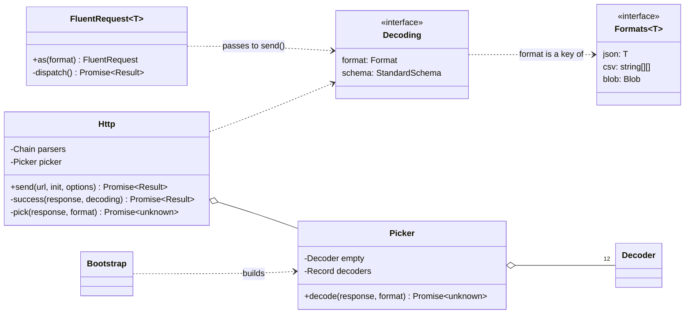

На схеме три ключа `Formats` из одиннадцати, полный список в таблице ниже.

### Формат, его декодер и его тип

| `.as(…)` | Декодер | Тип `data` |
| --- | --- | --- |
| `'json'` | `JsonParser` | `T` запроса |
| `'ndjson'` | `NdjsonParser` | `T` запроса (это массив: пишите `get<Event[]>`) |
| `'xml'` | `XmlParser` | `T` запроса |
| `'html'` | `DomParser` | `Document` |
| `'text'` | `TextParser` | `string` |
| `'csv'` | `CsvParser` | `string[][]` (по табуляции, только если Content-Type `text/tab-separated-values`, иначе по запятым) |
| `'formData'` | `FormDataParser` | `FormData` |
| `'urlencoded'` | `UrlEncodedParser` | `URLSearchParams` |
| `'blob'` | `MediaParser` | `Blob` |
| `'arrayBuffer'` | `BinaryParser` | `ArrayBuffer` |
| `'sse'` | `SseParser` | `AsyncIterable<ServerEvent>` |

`json`, `ndjson` и `xml` сохраняют `T`, потому что что внутри, знает только вызывающий код. Остальные всегда
разбираются в один и тот же тип, поэтому `T` заменяется. Именно это и написано в возвращаемом типе
`HttpRequest<Formats<T>[F], E>`: взять карту `Formats` для этого `T` и прочитать ключ `F`.

```ts
http.get<User>(url).as('json'); // HttpRequest<User>
http.get<User>(url).as('csv'); // HttpRequest<string[][]>: User пропал
http.get<User>(url).as('yaml'); // не скомпилируется: 'yaml' это не Format
```

### Как решает `Picker`

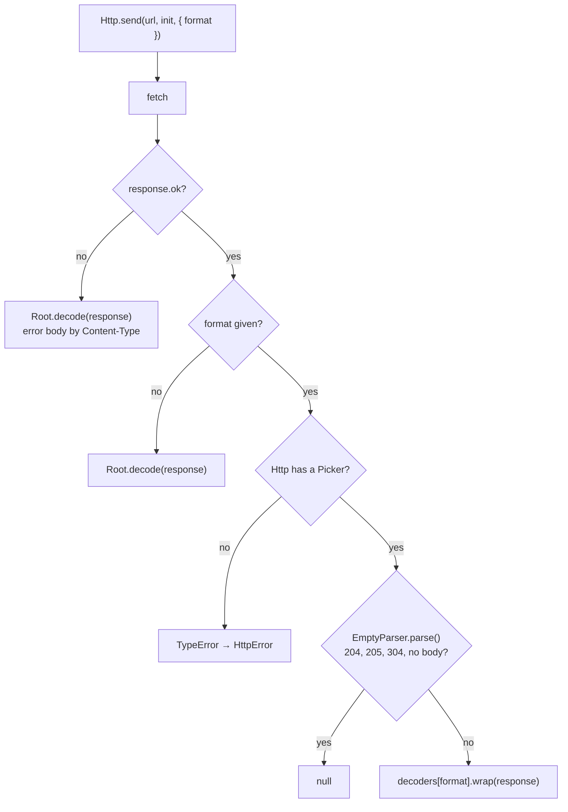

1. `Picker.decode()` собирает `Data` точно так же, как `Root` (Content-Type и Content-Disposition в нижнем
   регистре).
2. Сначала он спрашивает пустой декодер. У 204 нечего разбирать, поэтому `.as('json')` даёт `{ data: null,
   error: null }`, как и без `.as()`.
3. Иначе он сразу вызывает `wrap()` выбранного декодера. `parse()` этого декодера не вызывается: на вопрос «это
   мой ответ?» уже ответил вызывающий код.
4. Если тело не в этом формате, `wrap()` отклоняется (`SyntaxError` для HTML, отданного в `json`). `Http`
   ловит это как любую ошибку разбора: `{ data: null, error: HttpError('The response body could not be
   decoded', cause) }`.

### По шагам

Сервер отвечает `200`, `Content-Type: text/plain`, тело `{"id":1,"name":"Alice"}`.

| Вызов | Что происходит | `data` |
| --- | --- | --- |
| `await http.get<User>(url)` | `Root` опрашивает цепочку, `text/plain` берёт `TextParser` | `'{"id":1,"name":"Alice"}'` (строка, а не `User`) |
| `await http.get<User>(url).as('json')` | `FluentRequest` передаёт `{ format: 'json' }`, `Http` вызывает `Picker`, тот `JsonParser.wrap()` | `{ id: 1, name: 'Alice' }` |
| `await http.get<User>(url).as('text')` | `TextParser.wrap()` | `'{"id":1,"name":"Alice"}'`, тип `string` |
| `await http.get<User>(url).as('blob')` | `MediaParser.wrap()` | `Blob` на 23 байта, `type: 'text/plain'` |

Один объект запроса можно использовать для нескольких форматов, потому что `.as()` возвращает новый объект:

```ts
const report = http.get('/api/report').query({ year: 2026 });

const { data: rows } = await report.as('csv'); // string[][]
const { data: raw } = await report.as('text'); // string: второй запрос
```

### Что `.as()` не меняет

- **Ответы с ошибкой.** Тело 4xx или 5xx разбирает `Root` по Content-Type, как и раньше: API часто отвечает
  ошибками в JSON, даже когда данные в CSV. `error.data` сохраняет свой тип `E`.
- **Запрос.** `.as()` не добавляет заголовок `Accept`. Если серверу он нужен, добавьте его через
  `.headers({ Accept: 'text/csv' })`.
- **Цепочку.** `Root` и его порядок для запросов без `.as()` остаются прежними.

### `Http` без `Picker`

`new Http(chain)` без второго аргумента по-прежнему работает для запросов без `.as()`. Запрос с `.as()` вернёт
`HttpError` с `TypeError` в `cause`, где сказано, что декодеры для форматов не переданы. `Bootstrap` всегда
передаёт `Picker`, поэтому экспортированный `http` поддерживает все форматы.

### Где это протестировано

| Что | Тесты |
| --- | --- |
| `Picker` | `tests/Unit/Root/Picker/`: выбранный декодер важнее Content-Type, пустое тело даёт `null` без его вызова, его ошибка передаётся дальше |
| `Http.send` с форматом | `tests/Unit/Http/Http.send.format.*`: разобрано, не разбирается, нет `Picker`, тело ошибки по-прежнему определяется само |
| `FluentRequest.as` | `tests/Unit/Request/FluentRequest/FluentRequest.as.*`: что доходит до `send()`, исходный объект не меняется, побеждает последний вызов, опции = цепочка, типы (`@ts-expect-error`) |
| настоящие декодеры | `tests/Feature/Bootstrap/Bootstrap.as.*`: json, csv, text, blob, arrayBuffer, 204, HTML в `json` |
| по сети | `tests/Integration/Http/Http.get.as.json` |

## Проверка данных: `.schema()`

`http.get<User>()` это обещание разработчика: в рантайме его никто не проверяет, и когда API меняется, ошибка
вылезает далеко от запроса (`undefined is not a function` тремя компонентами ниже). Схема описывает форму данных.
Клиент проверяет по ней разобранные данные и возвращает результат схемы, а TypeScript выводит тип `data` из той
же схемы.

```ts
import { z } from 'zod'; // ставит пользователь, а не @metapraxis/jext-http

const User = z.object({ id: z.number(), name: z.string() });

const { data: user, error } = await http.get('/api/users/1').schema(User);
// user: { id: number; name: string } | null, <User> не нужен

if (error instanceof ValidationError) {
    console.log(error.issues); // [{ message: 'Expected number, received string', path: ['id'] }]
}
```

### Standard Schema: почему нет зависимости

Zod, Valibot, ArkType и другие библиотеки реализуют один общий интерфейс,
[Standard Schema](https://standardschema.dev). У любого объекта схемы есть свойство `'~standard'`:

```ts
interface StandardSchema<Input, Output> {
    readonly '~standard': {
        readonly version: 1;
        readonly vendor: string; // 'zod', 'valibot'…
        readonly validate: (value: unknown) => StandardResult<Output> | Promise<StandardResult<Output>>;
        readonly types?: { readonly input: Input; readonly output: Output }; // только для TypeScript
    };
}

type StandardResult<Output> =
    | { readonly value: Output; readonly issues?: undefined } // данные подходят
    | { readonly issues: ReadonlyArray<StandardIssue> }; // не подходят

interface StandardIssue {
    readonly message: string;
    readonly path?: ReadonlyArray<PropertyKey | { readonly key: PropertyKey }>;
}
```

Сама спецификация это только эти типы, и её авторы предлагают их копировать. Они лежат в
`src/Contract/StandardSchema.ts`. Клиент не импортирует ни одну библиотеку схем: он вызывает `validate()` у
объекта, который передал вызывающий код. Подходит любой объект такой формы, в том числе написанный руками:

```ts
const Positive: StandardSchema<unknown, number> = {
    '~standard': {
        version: 1,
        vendor: 'my-app',
        validate: (value) =>
            typeof value === 'number' && value > 0 ? { value } : { issues: [{ message: 'Expected a positive number' }] },
    },
};

const { data: count } = await http.get('/api/count').schema(Positive); // count: number | null
```

### Файлы и что делает каждый

| Файл | Что это | Что делает | Кто использует |
| --- | --- | --- | --- |
| `src/Contract/StandardSchema.ts` | интерфейсы, тип | `StandardSchema`, `StandardProps`, `StandardResult`, `StandardIssue`, `StandardTypes` и `InferOutput<S>`, тип, который возвращает схема. | `.schema()`, `Http`, `ValidationError` |
| `src/Error/ValidationError.ts` | класс | `HttpError` с `issues` (все найденные проблемы) и `value` (разобранные данные, которые не прошли). В сообщении первая проблема. | `Http.validate()` |
| `src/Http.ts` | класс | `validate()`: вызывает схему после разбора и превращает её ответ в `Result`. | `send()` |

### Классы

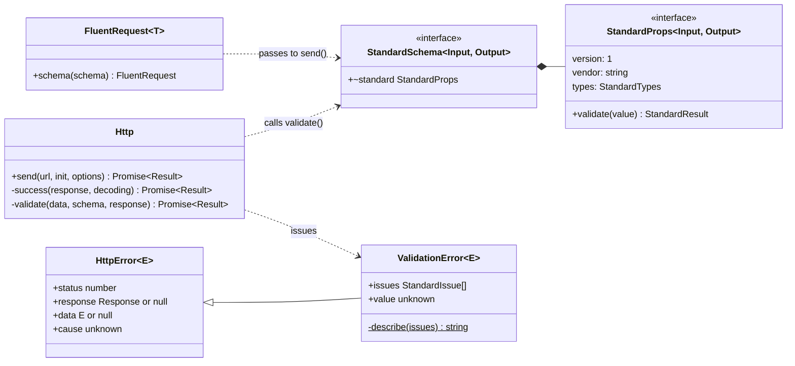

### Жизнь проверенного ответа

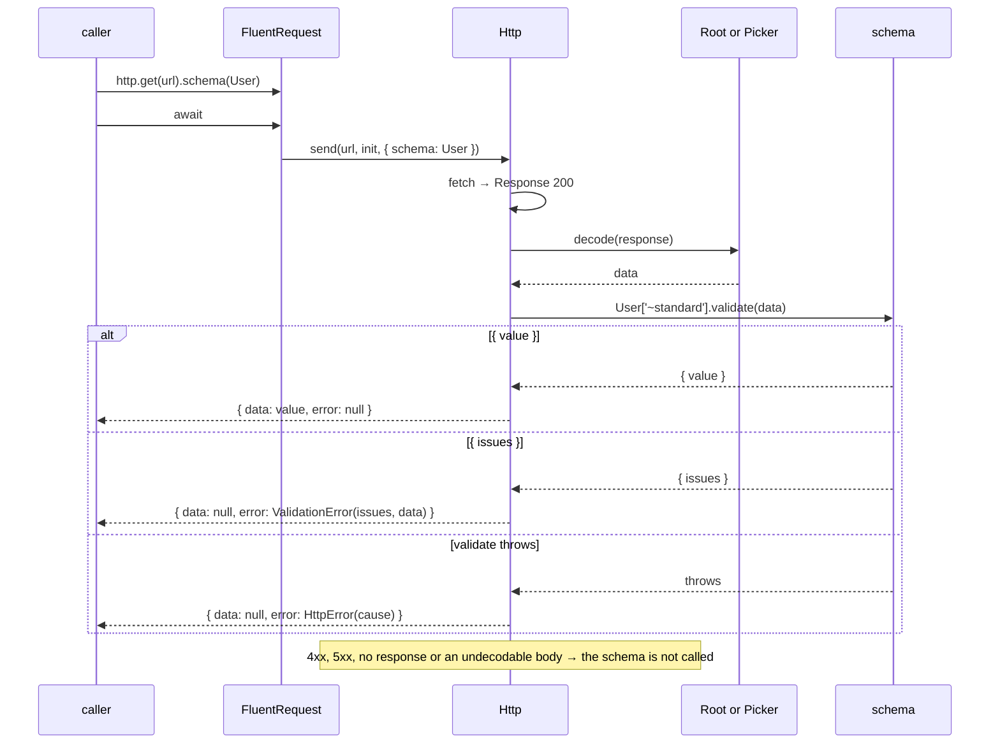

1. Сначала ответ разбирается: через `Root` или через `Picker`, если задан и `.as()`. Поэтому `.as('csv')` и
   `.schema(Rows)` сочетаются, и схема получает `string[][]`.
2. До схемы доходит только разобранный ответ 2xx. Статус ошибки, отсутствие ответа или ошибка разбора
   возвращают свой `HttpError` раньше, и `validate()` не вызывается.
3. `Http` ждёт `validate()` через `await`, поэтому схемы с асинхронными проверками тоже работают.
4. `{ value }` становится `data`. Это значение, которое вернула схема, а не разобранное: схема, которая
   выкидывает лишние ключи, превращает строки в даты или ставит значения по умолчанию, меняет `data`.
5. `{ issues }` становится `ValidationError`. Если `validate()` бросает, это обычный `HttpError` с ошибкой в
   `cause`, чтобы сломанную схему не приняли за сломанные данные.

### `ValidationError`

| Поле | Значение |
| --- | --- |
| `name` | `'ValidationError'` |
| `message` | первая проблема с путём: `users.0.name: Expected string (and 2 more)`; `The response did not match the schema`, если список пуст |
| `issues` | все `StandardIssue`, которые вернула схема |
| `value` | разобранные данные, которые не прошли |
| `status`, `response` | ответа 2xx |
| `data` | `null`: тела ошибки нет |

Путь соединяет сегменты точками; для сегмента вида `{ key }` берётся ключ. Проблема без пути даёт просто
сообщение.

### Типы: `InferOutput`

`schema<S extends StandardSchema>(schema: S): HttpRequest<InferOutput<S>, E>`, где
`InferOutput<S> = NonNullable<S['~standard']['types']>['output']`. Zod, Valibot и ArkType заполняют `types`,
поэтому тип `data` берётся из схемы и заменяет `T` запроса:

```ts
http.get<User>(url).schema(Admin); // HttpRequest<Admin['output']>: побеждает схема
```

Схема, написанная руками, получает тип из своей аннотации (`StandardSchema<unknown, number>` выше). `schema` в
объекте опций проверяет так же, но тип не меняет (см. [Объект опций = цепочка](#объект-опций--цепочка)).

### По шагам

Схема `User` проверяет `{ id: number, name: string }` и выкидывает остальные ключи.

| Тело ответа 200 | `data` | `error` |
| --- | --- | --- |
| `{"id":1,"name":"Alice","extra":true}` | `{ id: 1, name: 'Alice' }` | `null` |
| `{"id":"1"}` | `null` | `ValidationError`, `value: { id: '1' }`, сообщение `id: Expected number (and 1 more)` |
| `<html>` с `.as('json')` | `null` | `HttpError` 'The response body could not be decoded'; схема не вызывается |
| 404 `{"message":"Not found"}` | `null` | `HttpError` 404 с `data: { message: 'Not found' }`; схема не вызывается |

### Где это протестировано

| Что | Тесты |
| --- | --- |
| `ValidationError` | `tests/Unit/Error/ValidationError/`: поля, путь в сообщении, `(and N more)`, без пути, без проблем |
| `Http.send` со схемой | `tests/Unit/Http/Http.send.schema.*`: данные подходят (возвращается значение схемы), проблемы, асинхронный `validate`, схема бросает, не вызывается для статуса ошибки и для тела, которое не разбирается |
| `FluentRequest.schema` | `tests/Unit/Request/FluentRequest/FluentRequest.schema.*`: что доходит до `send()`, выведенный тип (`@ts-expect-error`) |
| настоящая цепочка | `tests/Feature/Bootstrap/Bootstrap.schema.*`, `Bootstrap.as.schema` |
| по сети | `tests/Integration/Http/Http.get.schema.issues` |

## Общие настройки: `extend()`

API вызывают с одним и тем же базовым URL и одним и тем же токеном. `http.extend(options)` возвращает **новый**
клиент, каждый запрос которого несёт эти настройки, а клиент, на котором его вызвали, не меняется
([ADR 0007](../../adr/0007-extend-timeout-retry.md)).

```ts
const api = http.extend({
    baseUrl: 'https://api.example.com/v2',
    headers: { Authorization: `Bearer ${token}` },
    timeout: 10_000,
    retry: 2,
});

await api.get<User[]>('/users'); // GET https://api.example.com/v2/users с токеном, 10 с на попытку, 2 повтора
await api.delete('/orders/7');

const admin = api.extend({ headers: { 'X-Role': 'admin' } }); // сохраняет baseUrl, токен, timeout и retry
```

### Файлы и что делает каждый

| Файл | Что это | Что делает | Кто использует |
| --- | --- | --- | --- |
| `src/Http.ts` | класс | `extend(options)` вливает опции в настройки этого клиента и возвращает `new Http(parsers, picker, settings)`. `send()` применяет настройки. | вызывающий код |
| `src/Contract/ClientOptions.ts` | интерфейс | `{ baseUrl?, headers?, timeout?, retry? }`: что принимает `extend()`. | `extend()`, `Http` |
| `src/Request/BaseUrl.ts` | класс, статический | `resolve(base, url)`: склеивает базу и относительный URL через один слеш, абсолютный URL оставляет как есть. | `Http.send()` |

### Классы

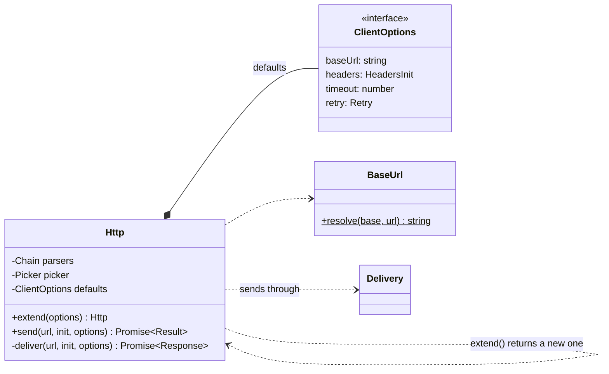

### Как сливаются настройки

| Настройка | `extend()` у клиента, где она уже есть | Запрос, который тоже её задаёт |
| --- | --- | --- |
| `baseUrl` | заменяется | — (абсолютный URL её пропускает) |
| `headers` | сливаются; заданный ещё раз заголовок побеждает | сливаются; побеждает заголовок запроса |
| `timeout` | заменяется | побеждает `.timeout(ms)`, `.timeout(0)` выключает |
| `retry` | заменяется | побеждает `.retry(n)`, `.retry(0)` выключает |
| `dedupe` | заменяется | побеждает `.dedupe()`, `.dedupe(false)` выключает |
| `hooks` | добавляются в конец: сначала хуки клиента, потом новые | — (хуки задаются только у клиента) |

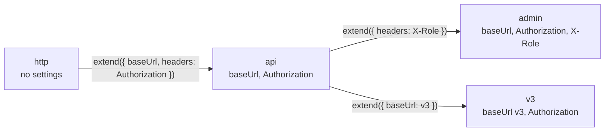

`http`, `api`, `admin` и `v3` это четыре клиента. У каждого свои настройки, и ни один не может изменить другой.
Общие у них только декодеры (`Root` и `Picker`), а у них нет состояния. У каждого свой `Inflight`, поэтому
`dedupe` никогда не объединяет запросы двух клиентов.

### Где применяются настройки: `send()`

Настройки применяются в `send()`, поэтому объект запроса и низкоуровневый `send()` ведут себя одинаково:

1. `BaseUrl.resolve(baseUrl, url)` для строки или `URL`. Объект `Request` отправляется как есть, без `baseUrl` и
   заголовков клиента (у него уже свои URL и заголовки); `timeout` и `retry` к нему всё равно применяются.
2. Заголовки клиента копируются в новый `Headers`, а заголовки `init` ставятся поверх.
3. Побеждают `timeout`, `retry` и `dedupe` из `options`; если их нет, берутся значения клиента.
4. Результат получают хуки `beforeRequest`, запрос уходит (общий, если это позволяет `dedupe`), ответ получают хуки
   `afterResponse`: см. [Хуки и dedupe](#хуки-и-dedupe-hooks-dedupe).

Если у клиента нет заголовков и хуков, `init` доходит до `fetch` без изменений. `http.sse()` проходит шаги 1, 2 и 4.

### `BaseUrl`: как склеивается URL

| `baseUrl` | URL запроса | Куда уйдёт |
| --- | --- | --- |
| `https://api.example.com/v2` | `/users` | `https://api.example.com/v2/users` |
| `https://api.example.com/v2/` | `/users` | `https://api.example.com/v2/users` |
| `https://api.example.com/v2/` | `users?page=2` | `https://api.example.com/v2/users?page=2` |
| `/api` | `/users` | `/api/users` |
| `https://api.example.com/v2` | `''` | `https://api.example.com/v2` |
| `https://api.example.com/v2` | `https://cdn.example.com/a.png` | `https://cdn.example.com/a.png` (абсолютный) |
| `https://api.example.com/v2` | `//cdn.example.com/a.png` | `//cdn.example.com/a.png` (абсолютный) |

Между частями ставится ровно один слеш. `new URL('/users', 'https://api.example.com/v2')` дал бы
`https://api.example.com/users` и потерял бы `/v2`; `BaseUrl` так не делает. Query запроса к моменту склейки уже
стоит в URL.

### Где это протестировано

| Что | Тесты |
| --- | --- |
| `BaseUrl` | `tests/Unit/Request/BaseUrl/`: относительный (таблица выше), абсолютный, без базы, пустой URL |
| `Http.extend` | `tests/Unit/Http/Http.extend.*`: базовый URL, абсолютный URL, заголовки вместе с заголовками запроса, вложенный клиент, замена базового URL, исходный клиент не меняется, timeout и `timeout(0)`, retry и `retry(0)`; `Http.send.extend` для низкоуровневого вызова |
| настоящая цепочка | `tests/Feature/Bootstrap/Bootstrap.extend` |
| по сети | `tests/Integration/Http/Http.extend.base-url` (сервер видит путь и токен) |

## Таймауты и повторы: `.timeout()`, `.retry()`

У `fetch` нет таймаута: зависший сервер держит запрос открытым вечно. А 503 или оборванное соединение обычно
проходят через мгновение. `.timeout(ms)` завершает слишком долгую попытку, `.retry()` повторяет неудачную.

```ts
await http.get('/api/report').timeout(5000).retry(2);
await http.get('/api/report', { timeout: 5000, retry: 2 }); // тот же запрос
await http.get('/api/report').retry({ limit: 3, statuses: [503], delay: 1000 }); // только 503, ждёт 1 с, 2 с, 4 с
```

### Файлы и что делает каждый

| Файл | Что это | Что делает | Кто использует |
| --- | --- | --- | --- |
| `src/Delivery/Delivery.ts` | класс, статический | `send(url, init, { timeout, retry })`: отправляет каждую попытку через транспорт (`fetch` или XHR, см. [Транспорты и прогресс](#транспорты-и-прогресс-onuploadprogress-ondownloadprogress)) с таймаутом и повторяет неудачные, пока разрешает политика. Отдаёт последний `Response` или отклоняется последней ошибкой. | `Http.send()` |
| `src/Delivery/RetryPolicy.ts` | класс | Создаётся на каждый запрос из `retry` и метода. `retries(attempt, response)` и `recovers(attempt, error)` говорят, повторять ли, `wait(attempt, response)` сколько ждать. | `Delivery` |
| `src/Contract/RetryOptions.ts` | интерфейс, тип | `RetryOptions { limit, methods?, statuses?, delay? }` и `Retry = number \| RetryOptions`. | `.retry()`, `ClientOptions` |
| `src/Contract/DeliveryOptions.ts` | интерфейс | `{ timeout?, retry? }`. | `SendOptions`, `ClientOptions` |
| `src/Contract/SendOptions.ts` | интерфейс | `Decoding & DeliveryOptions`: третий аргумент `send()`, `{ format, schema, timeout, retry }`. | `Sender`, `Http`, `FluentRequest` |

### Классы

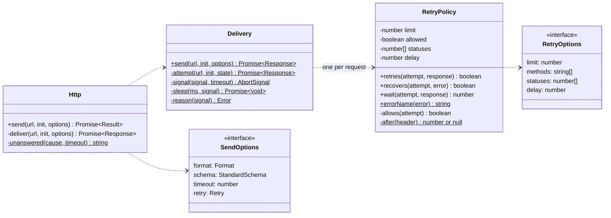

### Жизнь повторённого запроса

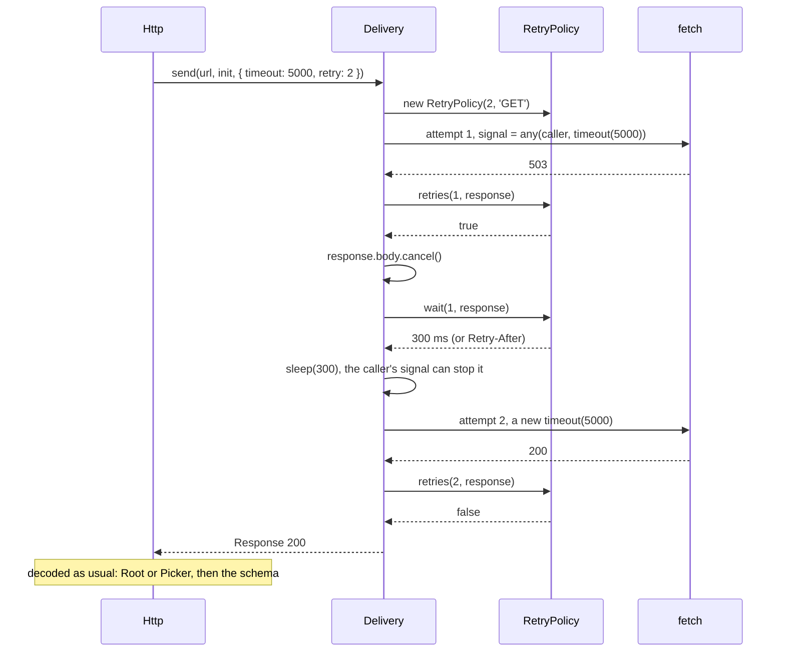

### Как решает `RetryPolicy`

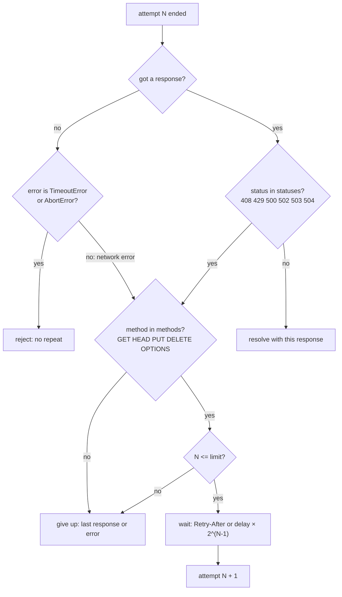

| Опция | По умолчанию | Что значит |
| --- | --- | --- |
| `limit` | `0` (повторов нет) | сколько раз повторить после первой попытки; `retry(2)` отправит не больше 3 запросов |
| `methods` | `GET`, `HEAD`, `PUT`, `DELETE`, `OPTIONS` | методы, которые можно повторять, в любом регистре; POST и PATCH не идемпотентны |
| `statuses` | `408`, `429`, `500`, `502`, `503`, `504` | статусы, которые повторяются; сетевая ошибка повторяется всегда, таймаут и отмена никогда |
| `delay` | `300` | пауза перед первым повтором в мс, перед каждым следующим удваивается |

### Паузы: backoff и `Retry-After`

| Неудачная попытка | `delay: 300` | `delay: 1000` | `Retry-After: 2` | `Retry-After: <дата через 5 с>` |
| --- | --- | --- | --- | --- |
| 1 | 300 мс | 1000 мс | 2000 мс | 5000 мс |
| 2 | 600 мс | 2000 мс | 2000 мс | до этой даты |
| 3 | 1200 мс | 4000 мс | 2000 мс | до этой даты |

`Retry-After` берётся из ответа, который повторяется, как число секунд или HTTP-дата. Дата в прошлом или
отрицательное число означают «без паузы»; значение, которое не является ни тем, ни другим, игнорируется, и
берётся `delay`. У сетевой ошибки ответа нет, поэтому для неё всегда берётся `delay`.

### Таймаут: свой на каждую попытку

```ts
signal = caller's signal ? AbortSignal.any([caller's signal, AbortSignal.timeout(ms)]) : AbortSignal.timeout(ms);
```

- Каждая попытка получает новый `AbortSignal.timeout(ms)`, поэтому `timeout(5000).retry(2)` может занять до 15 с
  плюс паузы. Паузы в таймаут не входят.
- Попытка, которая упала по таймауту, не повторяется: сервер, который завис один раз, скорее всего зависнет снова.
- `.signal()` вызывающего кода по-прежнему работает: он останавливает текущую попытку и паузу перед следующей, а
  результатом будет `HttpError` с `AbortError` в `cause`.
- Без таймаута (`0` или не задан) `init` доходит до `fetch` без изменений.

### Что получит вызывающий код

| Что случилось | `data` | `error.status` | `error.message` | `error.cause` |
| --- | --- | --- | --- | --- |
| повтор удался | данные | ошибки нет | | |
| все попытки получили 503 | `null` | `503` | `503 Service Unavailable` | — (`error.data` это тело последнего 503) |
| все попытки упали с сетевой ошибкой | `null` | `0` | `The request got no response` | последний `TypeError` |
| попытка упала по таймауту | `null` | `0` | `The request timed out after 5000 ms` | `DOMException` `TimeoutError` |
| вызывающий код отменил запрос, во время попытки или паузы | `null` | `0` | `The request got no response` | `DOMException` `AbortError` |
| POST получил 503 | `null` | `503` | `503 Service Unavailable` | — (отправлен один раз) |

Тело ответа, который повторяется, отменяется, чтобы освободить соединение. Разбирается только последний ответ.

### По шагам

`http.get<User>('/users/1').timeout(1000).retry(2)`, а сервер отвечает 503, потом молчит 2 с.

| Шаг | Что происходит |
| --- | --- |
| 1 | `FluentRequest` передаёт `{ timeout: 1000, retry: 2 }` в `Http.send()` |
| 2 | `Delivery` создаёт `RetryPolicy(2, 'GET')`: `limit 2`, GET разрешён |
| 3 | попытка 1 с `AbortSignal.timeout(1000)`: 503 |
| 4 | `retries(1, 503)` даёт true; тело отменяется; `wait(1)` это 300 мс |
| 5 | попытка 2 с новым `AbortSignal.timeout(1000)`: ответа нет, через 1 с `fetch` отклоняется с `TimeoutError` |
| 6 | `recovers(2, TimeoutError)` даёт false: `Delivery` отклоняется |
| 7 | `Http` возвращает `{ data: null, error: HttpError('The request timed out after 1000 ms', status 0) }` |

### Где это протестировано

| Что | Тесты |
| --- | --- |
| `RetryPolicy` | `tests/Unit/Delivery/RetryPolicy/`: каждый повторяемый статус, другие статусы, лимит, POST и PATCH, идемпотентные методы, свои методы и статусы, выключено (`0`, не задано, отрицательное), сетевые ошибки, таймаут и отмена, сетевая ошибка у POST, backoff, `Retry-After` в секундах, датой, в прошлом, невалидный, без ответа |
| `Delivery` | `tests/Unit/Delivery/Delivery/`: один вызов без опций, повторяемые статусы, исчерпанные повторы, сетевая ошибка, исчерпанные сетевые ошибки, POST не повторяется, метод из `Request`, пауза 300 мс и `Retry-After` (фейковые таймеры), отмена во время паузы и до неё, таймаут, таймаут не повторяется, отмена вызывающим кодом до таймаута, новый сигнал на каждую попытку, тело повторённого ответа освобождается |
| `Http.send` | `tests/Unit/Http/Http.send.timeout`, `Http.send.retry`, `Http.send.retry.exhausted` |
| `FluentRequest` | `tests/Unit/Request/FluentRequest/FluentRequest.timeout.*`, `FluentRequest.retry`: что доходит до `send()`, исходный объект не меняется, опции = цепочка, `body()` остаётся после них, тип `retry()` |
| настоящая цепочка | `tests/Feature/Bootstrap/Bootstrap.retry`, `Bootstrap.retry.post`, `Bootstrap.timeout` |
| по сети | `tests/Integration/Http/Http.get.timeout`, `Http.get.retry`, `Http.get.retry.retry-after` |

## Транспорты и прогресс: `.onUploadProgress()`, `.onDownloadProgress()`

Для большой отправки или загрузки нужен индикатор прогресса. `.onDownloadProgress(listener)` считает тело ответа,
пока оно приходит. `.onUploadProgress(listener)`, который есть только у `post`, `put` и `patch`, сообщает, сколько
тела запроса уже отправлено ([ADR 0008](../../adr/0008-transport-and-progress.md)).

```ts
const { data, error } = await http
    .post<Upload>('/api/files')
    .body(formData)
    .onUploadProgress(({ percent }) => (bar.value = percent ?? 0))
    .onDownloadProgress(({ loaded }) => (label.textContent = `${loaded} bytes`));

await http.post<Upload>('/api/files', { body: formData, onUploadProgress: render }); // тот же запрос
http.get('/api/report').onUploadProgress(render); // не скомпилируется: у GET нет тела для отправки
```

### Зачем два транспорта

`fetch` не умеет сообщать прогресс отправки в Firefox и Safari. Потоковое тело запроса работает только в Chromium и
только по HTTP/2. У `XMLHttpRequest` `upload.onprogress` есть во всех браузерах. Поэтому запрос идёт через XHR,
только когда кто-то слушает его отправку, а в остальных случаях через `fetch`.

| У запроса есть | Транспорт | Почему |
| --- | --- | --- |
| нет слушателей прогресса | `FetchTransport`: обычный `fetch`, ответ как есть | для обычных запросов ничего не меняется |
| только `onDownloadProgress` | `FetchTransport`: `fetch`, тело считается, пока читается | `fetch` отдаёт ответ потоком, его можно посчитать |
| `onUploadProgress` (и, может быть, `onDownloadProgress`) | `XhrTransport` | только XHR везде сообщает прогресс отправки |
| `onUploadProgress`, но нет `XMLHttpRequest` (Node) | `FetchTransport`; слушатель отправки не вызывается | XHR, у которого можно спросить, нет |
| `onUploadProgress` у объекта `Request`, переданного в `send()` | `FetchTransport`; слушатель отправки не вызывается | XHR не умеет отправлять `Request` |

### Файлы и что делает каждый

| Файл | Что это | Что делает | Кто использует |
| --- | --- | --- | --- |
| `src/Contract/Transport.ts` | интерфейс | `send(url, init): Promise<Response>`: отправляет одну попытку; отдаёт ответ с любым статусом, отклоняется, только если ответа нет. Внутренний. | `Delivery`, оба транспорта |
| `src/Transport/FetchTransport.ts` | класс | Вызывает `fetch`. Со слушателем загрузки заворачивает тело в считающий поток. | `Delivery` |
| `src/Transport/XhrTransport.ts` | класс | Отправляет через `XMLHttpRequest`, передаёт `upload.onprogress` и `onprogress`, заворачивает ответ в настоящий `Response`. | `Delivery` |
| `src/Transport/Meter.ts` | класс, статический | `of(loaded, total)` собирает `Progress`, `total(headers)` берёт размер из `Content-Length`, `count(body, total, listener)` считает поток. | оба транспорта |
| `src/Contract/Progress.ts` | интерфейсы, тип | `Progress { loaded, total?, percent? }`, `ProgressListener`, `ProgressOptions { onUploadProgress?, onDownloadProgress? }`. | `FluentRequest`, `SendOptions`, транспорты |
| `src/Delivery/Delivery.ts` | класс, статический | `transport(url, options)` выбирает транспорт для запроса; через него идёт каждая попытка. | `Http.send()` |

### Классы

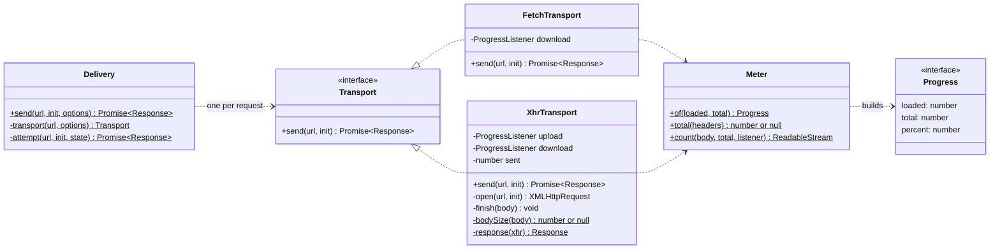

### `Progress`: что получает слушатель

| Поле | Когда есть | Значение |
| --- | --- | --- |
| `loaded` | всегда | сколько байт уже отправлено или получено |
| `total` | когда размер известен | размер всего тела в байтах |
| `percent` | когда есть `total` | `loaded / total` целым числом от 0 до 100, с округлением вниз, не больше 100; `100` для пустого тела |

Откуда берётся размер:

| Направление | Размер известен | Размер неизвестен |
| --- | --- | --- |
| загрузка | `Content-Length` ответа | нет `Content-Length` (chunked) или `Content-Encoding` не `identity`: тогда заголовок считает сжатые байты, а поток отдаёт распакованные |
| отправка | его знает XHR (`lengthComputable`), или тело это строка, `URLSearchParams`, `Blob` или буфер | `FormData`, если XHR тоже не сообщает размер |

Без размера слушатель всё равно вызывается: `{ loaded: 4096 }`, потом `{ loaded: 8192 }`. Интерфейс может показать
байты или спиннер, а слушатель, который ни разу не вызвался, выглядел бы как зависший запрос. `ProgressEvent`
делает так же с `lengthComputable: false`. Поэтому тип `percent?: number`.

```ts
.onDownloadProgress(({ loaded, percent }) => {
    label.textContent = percent === undefined ? `${(loaded / 1e6).toFixed(1)} MB` : `${percent}%`;
});
```

### Загрузка через `fetch`: подсчёт потока

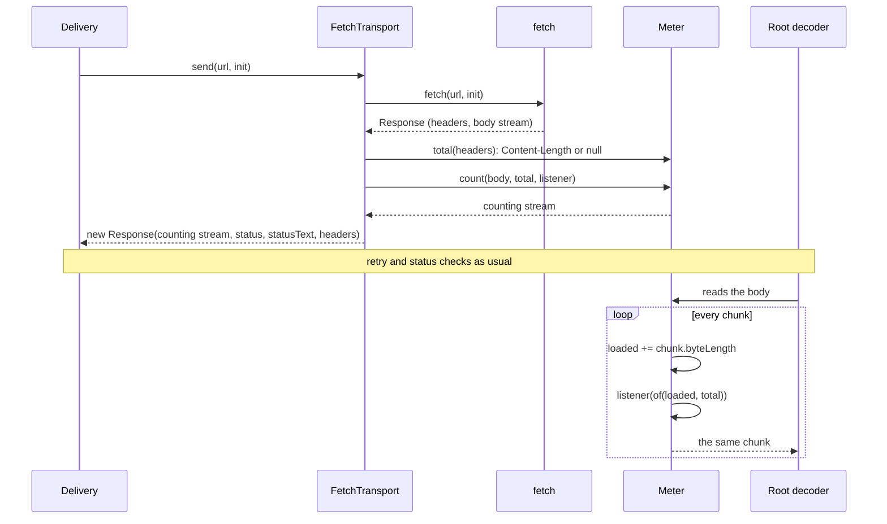

1. `FetchTransport` получает `Response` от `fetch`. Без слушателя загрузки он отдаёт его как есть.
2. Ответ без тела (204, HEAD) один раз сообщает `{ loaded: 0, total: 0, percent: 100 }` и отдаётся как есть.
3. Иначе `Meter.count()` заворачивает тело в новый `ReadableStream`. При каждом чтении он берёт кусок из исходного
   потока, прибавляет его размер к `loaded`, вызывает слушателя и передаёт кусок дальше без изменений. Отмена нового
   потока отменяет исходный.
4. Транспорт отдаёт `new Response(считающий поток, { status, statusText, headers })`. Декодеры читают его как
   обычно, поэтому слушатель вызывается, пока декодер читает, а не раньше. У нового `Response` нет `url` и
   `redirected`.

### Отправка через `XMLHttpRequest`

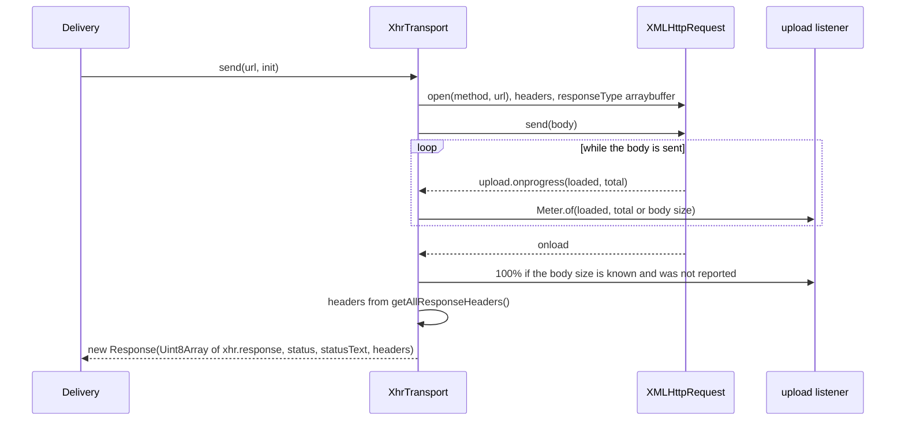

| `RequestInit` | Что с ним делает `XhrTransport` |
| --- | --- |
| `method`, `url` | `xhr.open(method, url)` |
| `headers` | `setRequestHeader` для каждого, включая Content-Type, который поставил `Encoder` |
| `body` | `xhr.send(body)`: строка, `FormData`, `URLSearchParams`, `Blob` или буфер. `ReadableStream` отклоняется с `TypeError`. |
| `credentials: 'include'` | `xhr.withCredentials = true` |
| `signal` | отмена вызывает `xhr.abort()`, а промис отклоняется с причиной сигнала (`AbortError` или `TimeoutError` от `.timeout()`) |
| `keepalive` | игнорируется: у XHR такой опции нет |

| Что делает XHR | Что отдаёт транспорт |
| --- | --- |
| `onload` | настоящий `Response`: статус, текст статуса, заголовки из `getAllResponseHeaders()`, тело из `xhr.response` (`ArrayBuffer`); без тела для 101, 204, 205, 304 |
| `onerror` | отклоняется с `TypeError('Network request failed')`, как `fetch` |
| `onabort` | отклоняется с причиной сигнала |

Ответ это настоящий `Response`, поэтому всё, что идёт после транспорта, не меняется: повторы, статус ошибки, цепочка
декодеров, `.as()`, `.schema()`, `{ data, error }`. XHR читает ответ целиком, поэтому поток (SSE, NDJSON)
разбирается только после того, как он закончится. Некоторые среды (jsdom, маленькие тела) не присылают событие
отправки с полным размером; когда пришёл ответ, отправка уже закончена, поэтому транспорт сам сообщает 100%, если
знает размер тела.

### Вместе с таймаутами и повторами

`Delivery` создаёт один транспорт на запрос и отправляет через него каждую попытку, поэтому `.timeout()` и
`.retry()` работают с обоими:

- сигнал таймаута доходит до XHR как `init.signal` и отменяет его;
- каждая попытка сообщает прогресс с нуля: повторная отправка снова начинается с 0%;
- тело ответа, который повторяется, отменяется до чтения, поэтому прогресса загрузки он не даёт.

### По шагам

`http.post<Upload>('/api/files').body(file).onUploadProgress(render)` с `File` на 1 000 000 байт в браузере:

| Шаг | Что происходит |
| --- | --- |
| 1 | `FluentRequest` передаёт `{ onUploadProgress: render }` вместе с остальными опциями в `Http.send()` |
| 2 | `Delivery.transport()`: есть слушатель отправки, `XMLHttpRequest` существует, URL это строка: `XhrTransport` |
| 3 | `xhr.open('POST', '/api/files')`, Content-Type не ставится (`Encoder` оставляет `Blob` браузеру), `xhr.send(file)` |
| 4 | браузер присылает `upload.onprogress`: `render({ loaded: 65536, total: 1000000, percent: 6 })`, … |
| 5 | последнее событие: `render({ loaded: 1000000, total: 1000000, percent: 100 })` |
| 6 | `onload`: 100% уже сообщены, больше ничего; ответ становится `Response` со статусом 201 |
| 7 | цепочка разбирает JSON-ответ: `{ data: Upload, error: null }` |

### Где это протестировано

| Что | Тесты |
| --- | --- |
| `Meter` | `tests/Unit/Transport/Meter/`: процент от известного размера, неизвестный размер, пустое тело, байт больше размера, `Content-Length`, его нет или он невалидный, сжатое тело, подсчёт кусков, ленивость, отмена, ошибка источника |
| `FetchTransport` | `tests/Unit/Transport/FetchTransport/`: без слушателя, загрузка с `Content-Length` и без, ничего до чтения тела, нет тела, статус и заголовки сохраняются, `fetch` отклонён |
| `XhrTransport` | `tests/Unit/Transport/XhrTransport/` с фейковым `XMLHttpRequest`: что открывается и отправляется, credentials, `Response`, 204, отправка с известным размером, размер из тела и 100% в конце, неизвестный размер, загрузка, сетевая ошибка, отмена, отменён заранее, потоковое тело |
| выбор транспорта | `tests/Unit/Delivery/Delivery/Delivery.send.transport.*`: XHR для слушателя отправки, `fetch` для слушателя загрузки, нет XHR (Node), объект `Request`, повторы сообщают каждую попытку |
| объект запроса | `FluentRequest.onUploadProgress.*`, `FluentRequest.onDownloadProgress`; `Http.get.upload-progress.forbidden` (проверка на этапе компиляции); `Http.send.download-progress` |
| настоящая цепочка | `tests/Feature/Bootstrap/Bootstrap.download-progress`, `Bootstrap.upload-progress` |
| по сети | `tests/Integration/Http/Http.get.download-progress`, `Http.get.download-progress.unknown`, `Http.post.upload-progress` (XHR из jsdom к локальному серверу) |

## События сервера: `http.sse()`

`http.sse(url)` возвращает поток событий сервера (`text/event-stream`), который читают через `for await`. Запрос идёт
через `fetch`, а не через `EventSource`, поэтому это может быть POST с телом и любыми заголовками, что нужно для
LLM API ([ADR 0009](../../adr/0009-server-events.md)).

```ts
for await (const event of http.sse('/api/feed').reconnect()) {
    console.log(event.event, event.data, event.id); // data это строка
}

for await (const { data } of http
    .sse('/api/chat')
    .headers({ Authorization: `Bearer ${token}` })
    .body({ prompt }) // с телом это POST
    .json<{ delta: string }>()) {
    answer.textContent += data.delta;
}
```

### Почему не `EventSource` и почему не `send()`

| | `EventSource` | `http.send()` + `SseParser` | `http.sse()` |
| --- | --- | --- | --- |
| метод и тело | только GET, без тела | любые | GET или POST, любое тело |
| заголовки (`Authorization`) | нет | да | да |
| переподключение, `Last-Event-ID` | да | нет | `.reconnect()` |
| `data` как JSON | нет | нет | `.json<T>()` |
| `baseUrl`, `headers`, `hooks` клиента | нет | да | да |

`send()` с SSE-ответом работает как раньше и отдаёт `AsyncIterable<ServerEvent>` в `data`; `http.sse()` добавляет
переподключения, JSON и более короткий цикл.

### Файлы и что делает каждый

| Файл | Что это | Что делает | Кто использует |
| --- | --- | --- | --- |
| `src/Contract/StreamRequest.ts` | интерфейс | Поток глазами вызывающего кода: `method`, `headers`, `query`, `body`, `signal`, `reconnect`, `json` и `AsyncIterable<ServerEvent<T>>` | его возвращает `Http.sse()` |
| `src/Contract/StreamOptions.ts` | интерфейс | Объект опций `http.sse(url, options)`, имена как у цепочки | `EventStream` |
| `src/Contract/Reconnect.ts` | интерфейс, тип | `ReconnectOptions { retries?, delay? }` и `Reconnect = number \| ReconnectOptions` | `.reconnect()`, `Reconnection` |
| `src/Contract/Streamer.ts` | интерфейс | `stream(url, init, settings)`: то, что открывает поток; `StreamSettings { reconnect?, json? }` | его вызывает `EventStream`, реализует `Http` |
| `src/Contract/ServerEvent.ts` | интерфейс | `ServerEvent<T = string> { event, data: T, id, retry }` | `SseParser`, `Http`, вызывающий код |
| `src/Request/EventStream.ts` | класс | Объект потока: ленивый и иммутабельный; `[Symbol.asyncIterator]()` собирает URL и `RequestInit` и обращается к `Streamer` | `Http.sse()` |
| `src/Http.ts` | класс | `sse()` создаёт `EventStream`; `stream()` открывает соединения, проверяет ответ, разбирает `data`, переподключается | вызывающий код, `EventStream` |
| `src/Delivery/Reconnection.ts` | класс | Состояние переподключений одного цикла: последний id, пауза, число переподключений подряд | `Http.stream()` |
| `src/Parsers/SseParser.ts` | класс | Делит тело на события (не изменился) | `Http.stream()` |

### Классы

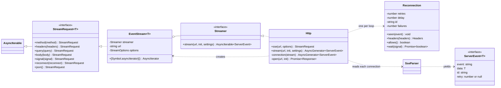

### Жизнь потока

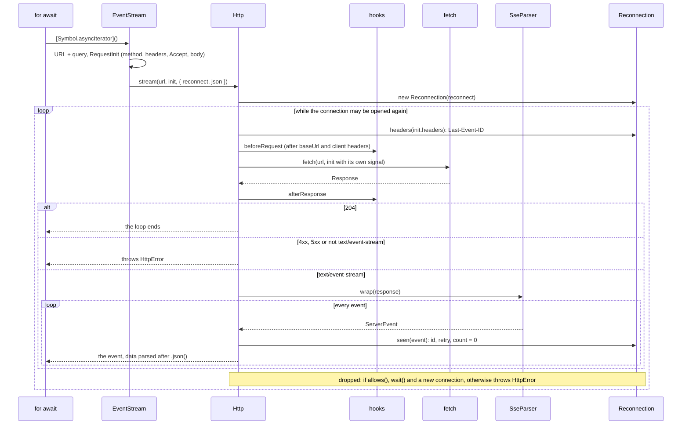

### По шагам: что делает `for await`

1. `for await` вызывает `EventStream[Symbol.asyncIterator]()`. Тот добавляет query к URL и собирает `RequestInit`:
   метод (`GET`, или `POST`, если есть тело), заголовки с `Accept: text/event-stream`, если вызывающий код не задал
   `Accept` сам, тело, закодированное `Encoder` так же, как для `post()`, и сигнал. Тело, которое нельзя
   закодировать, или GET с телом бросают `HttpError('The request could not be built')` из первого `next()`.
2. `EventStream` передаёт URL, `RequestInit` и `{ reconnect, json }` в `Http.stream()` и возвращает его итератор.
3. `Http.stream()` создаёт один `Reconnection` на весь цикл и открывает первое соединение. У каждого соединения свой
   `AbortController`, объединённый с сигналом вызывающего кода, и `Last-Event-ID`, как только сервер прислал id.
4. Запрос проходит через клиент: `baseUrl`, заголовки клиента, хуки `beforeRequest`, затем `fetch`, затем хуки
   `afterResponse`. `timeout`, `retry` и `dedupe` к потоку не применяются.
5. Ответ проверяется: 204 завершает цикл без событий; статус ошибки бросает `HttpError`, в `data` которого тело
   ошибки, разобранное цепочкой; 2xx, который не `text/event-stream`, бросает
   `HttpError('The response is not an event stream')`.
6. `SseParser` читает тело по мере поступления. На каждое событие `Reconnection.seen()` запоминает id и паузу из
   `retry:` и сбрасывает счётчик; после `.json()` данные разбираются, а данные не в JSON бросают
   `HttpError('The event data could not be decoded')`.
7. Конец тела завершает цикл. Обрыв (тело падает с ошибкой) или соединение, которое не удалось открыть, решаются по
   правилам переподключения ниже.
8. Как бы ни закончился цикл (сам, через `break`, ошибкой или сигналом), `AbortController` соединения отменяется, и
   соединение закрывается.

### Переподключение

| Что произошло | Без `.reconnect()` | С `.reconnect()` |
| --- | --- | --- |
| сервер завершил поток | цикл заканчивается | цикл заканчивается: ответ LLM готов, а переподключение отправило бы промпт ещё раз |
| 204 No Content | цикл заканчивается | цикл заканчивается (сервер просит не переподключаться) |
| соединение оборвалось посередине | бросает `HttpError('The event stream was interrupted')` со статусом ответа | пауза и новое соединение |
| `fetch` отклонён (сеть, сервер лежит) | бросает `HttpError('The request got no response')`, статус `0` | пауза и новое соединение |
| 4xx, 5xx | бросает `HttpError` со статусом и разобранным телом | так же, без переподключения |
| не `text/event-stream` | бросает `HttpError('The response is not an event stream')` | так же, без переподключения |
| данные не в JSON после `.json()` | бросает `HttpError('The event data could not be decoded')` | так же, без переподключения |
| хук бросил ошибку | бросает `HttpError` хука | так же, без переподключения |
| сигнал вызывающего кода отменён или `break` | цикл заканчивается без ошибки | так же, без паузы и без переподключения |

| `.reconnect(…)` | Переподключений подряд | Пауза |
| --- | --- | --- |
| не вызван или `0` | нет | — |
| `.reconnect()` | без ограничения, как в `EventSource` | 1000 мс |
| `.reconnect(3)` | 3 | 1000 мс |
| `.reconnect({ retries: 5, delay: 200 })` | 5 | 200 мс |

Счётчик считает «подряд»: каждое полученное событие его сбрасывает, поэтому поток, который рвётся раз в час,
переподключается бесконечно, а при лежащем сервере после `retries` неудач бросается последняя ошибка. Последнее поле
`retry:` от сервера заменяет паузу. `Last-Event-ID` несёт последний полученный id, даже если события нового
соединения приходят без id. Переподключение POST отправляет то же тело ещё раз, поэтому поток с телом
`ReadableStream` переподключить нельзя.

### Как закрыть поток

```ts
const controller = new AbortController();
const stream = http.sse('/api/feed').signal(controller.signal).reconnect();

for await (const event of stream) {
    if (event.event === 'done') {
        break; // закрывает соединение
    }
}

controller.abort(); // откуда угодно: закрывает соединение и завершает цикл без ошибки
```

`break`, `return` и ошибка, брошенная в теле цикла, вызывают `return()` у итератора; `finally` в
`Http.connection()` отменяет соединение. Отмена через сигнал прерывает и паузу перед переподключением.

### По шагам

`http.sse('/api/chat').body({ prompt: 'Hi' }).json<{ delta: string }>().reconnect(2)` с
`extend({ baseUrl: 'https://api.example.com', hooks: { beforeRequest: [sign] } })`:

| Шаг | Что происходит |
| --- | --- |
| 1 | `for await` стартует: `EventStream` собирает `POST`, `Content-Type: application/json`, `Accept: text/event-stream`, тело `{"prompt":"Hi"}` |
| 2 | `Http.stream()`: `Reconnection` на 2 переподключения подряд, пауза 1000 мс |
| 3 | `prepare()`: `https://api.example.com/api/chat`; `sign` добавляет `Authorization`; `fetch` |
| 4 | 200 `text/event-stream`: `SseParser` отдаёт `{ data: '{"delta":"Hel"}', id: '1' }`, `Http` разбирает его в `{ delta: 'Hel' }` |
| 5 | соединение обрывается: `allows()` даёт true, `wait()` ждёт 1000 мс |
| 6 | второе соединение несёт `Last-Event-ID: 1`; `sign` снова работает и берёт свежий токен |
| 7 | сервер завершает поток: цикл заканчивается |

### Где это протестировано

| Что | Тесты |
| --- | --- |
| объект потока | `tests/Unit/Request/EventStream/`: ленивость, каждый цикл подключается заново, GET по умолчанию с `Accept`, POST, тело делает POST, GET с телом, тело, которое нельзя сериализовать, заголовки, свой `Accept`, query, сигнал, reconnect с ограничением и без, json, иммутабельность, опции = цепочка |
| состояние переподключений | `tests/Unit/Delivery/Reconnection/`: выключено, лимит, без лимита, сброс событием, `Last-Event-ID` сохраняется и отсутствует, пауза по умолчанию и заданная, `retry:`, отмена во время паузы и до неё |
| фасад | `tests/Unit/Http/Http.sse.*`: события, json, данные не в JSON, статус ошибки, не поток событий, 204, сетевая ошибка, обрыв, переподключение после обрыва и после сетевой ошибки, переподключения кончились, без переподключения в конце потока, `break`, отмена, `extend()` с хуками, хуки на каждое соединение, хук с ошибкой, типы |
| настоящая цепочка | `tests/Feature/Bootstrap/Bootstrap.sse.stream`, `Bootstrap.sse.json` |
| по сети | `tests/Integration/Http/Http.sse` (мелкие куски), `Http.sse.post` (тело и токен), `Http.sse.reconnect` (сервер рвёт соединение, `Last-Event-ID`), `Http.sse.break` (сервер видит закрытие) |

## Хуки и dedupe: `hooks`, `.dedupe()`

Клиент может вызывать функции вокруг каждого запроса и может позволить одинаковым запросам, отправленным в один
момент, получить один общий ответ ([ADR 0010](../../adr/0010-hooks-and-dedupe.md)).

```ts
const api = http.extend({
    baseUrl: 'https://api.example.com',
    dedupe: true, // одинаковые GET и HEAD в полёте делят один запрос
    hooks: {
        beforeRequest: [
            async ({ url, init }) => {
                const headers = new Headers(init.headers);
                headers.set('Authorization', `Bearer ${await auth.token()}`);
                return { url, init: { ...init, headers } };
            },
        ],
        afterResponse: [(response) => void metrics.count(response.status)], // ничего не вернул: ответ тот же
    },
});

await Promise.all([api.get('/me'), api.get('/me')]); // в сеть уходит один запрос
await http.get('/api/users').dedupe(); // или для одного запроса
```

### Файлы и что делает каждый

| Файл | Что это | Что делает | Кто использует |
| --- | --- | --- | --- |
| `src/Contract/Hooks.ts` | интерфейсы, типы | `Outgoing { url, init }`, `BeforeRequest`, `AfterResponse`, `Hooks { beforeRequest?, afterResponse? }` | `ClientOptions`, `HookRunner` |
| `src/Delivery/HookRunner.ts` | класс | Вызывает хуки по порядку; `concat()` объединяет хуки двух клиентов; упавший хук превращается в `HttpError` | `Http` |
| `src/Delivery/Inflight.ts` | класс | Запросы в полёте по ключу; присоединяет вызывающий код, каждому отдаёт `clone()`, отменяет, когда ушли все | `Http` |
| `src/Contract/DeliveryOptions.ts` | интерфейс | получил `dedupe?: boolean`, поэтому он есть в `ClientOptions`, `SendOptions` и `RequestOptions` | `Http.send()` |
| `src/Contract/ClientOptions.ts` | интерфейс | получил `hooks?: Hooks` | `Http.extend()` |
| `src/Request/FluentRequest.ts` | класс | `.dedupe(enabled = true)` | вызывающий код |

### Классы

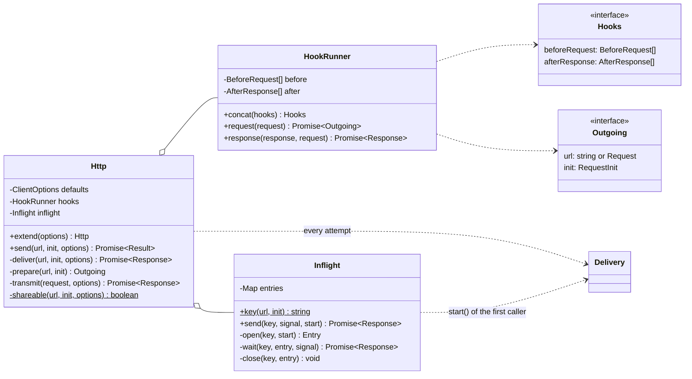

### Где хуки и dedupe стоят в `send()`

```mermaid
flowchart LR
    A["send(url, init, options)"] --> P["prepare()<br/>baseUrl, client headers"]
    P --> B["HookRunner.request()<br/>beforeRequest hooks"]
    B --> S{"shareable()?<br/>dedupe, GET or HEAD,<br/>string URL, no progress"}
    S -->|yes| I["Inflight.send()<br/>join or start"]
    S -->|no| D["Delivery.send()<br/>transport, timeout, retry"]
    I --> D
    D --> R["HookRunner.response()<br/>afterResponse hooks"]
    R --> C["status check, chain or .as(),<br/>.schema()"]
    C --> Res["{ data, error }"]
```

### Хуки

| | `beforeRequest` | `afterResponse` |
| --- | --- | --- |
| получает | `Outgoing { url, init }` после `baseUrl` и заголовков клиента | ответ и отправленный `Outgoing` |
| возвращает | новый `Outgoing` или ничего, чтобы оставить как есть | другой `Response` или ничего, чтобы оставить как есть |
| асинхронный | да | да |
| когда | один раз на запрос (не на каждый повтор), один раз на каждое соединение `http.sse()` | один раз, с последним ответом после повторов; у общего запроса для каждого вызывающего кода, на его копии |
| порядок | порядок массива; хуки родительского клиента первыми | так же |
| ошибка | `send()` возвращает `HttpError('A beforeRequest hook failed')`, статус `0`, `cause` = ошибка; ничего не отправляется | `send()` возвращает `HttpError('An afterResponse hook failed')` со статусом и ответом |

Хуки задаются только у клиента: `extend({ hooks })`. `extend()` добавляет их в конец, поэтому клиент, созданный из
`api`, вызывает хуки `api`, а потом свои. Объект `Request`, переданный в `send()`, попадает в хуки как `url`, вместе с
`init`, переданным рядом.

Обновление истёкшего токена это хук `afterResponse`, который отправляет запрос ещё раз:

```ts
const api = http.extend({
    hooks: {
        afterResponse: [
            async (response, { url, init }) => {
                if (response.status !== 401) {
                    return response;
                }

                const headers = new Headers(init.headers);
                headers.set('Authorization', `Bearer ${await auth.refresh()}`);
                return fetch(url, { ...init, headers }); // новый ответ разбирается как обычно
            },
        ],
    },
});
```

### Dedupe: как это работает

```mermaid
sequenceDiagram
    participant A as caller A
    participant B as caller B
    participant I as Inflight
    participant D as Delivery

    A->>I: send(key, signalA, start)
    I->>I: no entry: new AbortController, waiting = 1
    I->>D: start(entry signal)
    B->>I: send(key, signalB, start)
    I->>I: entry found: waiting = 2
    D-->>I: Response
    I->>I: the entry is removed
    I-->>A: response.clone()
    I-->>B: response.clone()
    Note over A,B: each decodes its own copy: .as('text'), .schema(User), afterResponse
```

1. `Http.shareable()` пропускает запрос, только если `dedupe` включён (у самого запроса или у клиента), метод GET
   или HEAD, URL это строка и нет слушателя прогресса.
2. `Inflight.key()` это метод, URL и заголовки. `Headers` приводит имена к нижнему регистру и сортирует их, поэтому
   порядок и регистр не важны. Ключ берётся после хуков `beforeRequest`, поэтому видит итоговые заголовки.
3. Если записи по ключу нет, `open()` создаёт `AbortController` и вызывает `start(signal)`, то есть `Delivery.send()`
   с этим сигналом вместо сигнала вызывающего кода. Если запись есть, вызывающий код присоединяется к ней.
4. Все ждут один и тот же промис и получают `response.clone()`: тело можно прочитать только один раз, а исходный
   ответ никто не читает.
5. Когда ответ пришёл или запрос упал, запись удаляется. Следующий запрос снова идёт в сеть: это не кэш.

### Что делится, а что нет

| Случай | Результат |
| --- | --- |
| два одинаковых GET с `.dedupe()` в один момент | один запрос в сеть, два результата |
| тот же GET после того, как первый уже получил ответ | новый запрос |
| разные заголовки или query | отдельные запросы |
| POST, PUT, PATCH, DELETE | никогда не делятся |
| запрос с `onDownloadProgress` или `onUploadProgress` | никогда не делится: его слушателю нужна своя передача |
| объект `Request`, переданный в `send()` | никогда не делится |
| один вызывающий код отменил свой сигнал | только он получает `HttpError` со статусом `0`; для остальных запрос продолжается |
| отменили все | общий запрос отменяется и удаляется; следующий вызывающий код начинает новый |
| общий запрос упал | все получают одну и ту же ошибку |
| разные `.timeout()` или `.retry()` | общим запросом управляют настройки первого |
| `extend({ dedupe: true })` и `.dedupe(false)` | этот один запрос не делится |
| два клиента, созданные `extend()` | у каждого свой `Inflight`: между ними ничего не делится |

### По шагам

Два компонента запрашивают `/me` у клиента `extend({ dedupe: true, hooks: { beforeRequest: [sign] } })`:

| Шаг | Что происходит |
| --- | --- |
| 1 | A: `prepare()`, `sign` добавляет `Authorization`, `shareable()` даёт true, ключ `GET https://…/me [["authorization","Bearer t"]]` |
| 2 | A: записи нет, `Delivery.send()` стартует с сигналом записи |
| 3 | B: те же шаги, тот же ключ: B присоединяется, `waiting = 2` |
| 4 | приходит ответ: запись удаляется, A и B получают каждый свой `clone()` |
| 5 | каждый вызывает `afterResponse` на своей копии, потом цепочку: два `{ data, error: null }` |

### Где это протестировано

| Что | Тесты |
| --- | --- |
| `HookRunner` | `tests/Unit/Delivery/HookRunner/`: без хуков, порядок, хук ничего не вернул, асинхронный, ошибка, отклонённый промис и остановка следующих хуков, новый ответ, аргументы, `afterResponse` с ошибкой, `concat` |
| `Inflight` | `tests/Unit/Delivery/Inflight/`: ключ не зависит от порядка и регистра, различается по методу, заголовку и URL; общий запрос, другие ключи, один за другим, упавший запрос, отменил один, отменили все, новый запрос после этого, отменён заранее |
| фасад | `tests/Unit/Http/Http.get.dedupe.*`, `Http.post.dedupe`, `Http.extend.dedupe.*`, `Http.send.hooks.*`, `Http.extend.hooks.*`: общий запрос, выключено, разные заголовки, POST, прогресс, отмена одного, настройка клиента и `.dedupe(false)`, хуки меняют запрос и ответ, упавшие хуки, хуки один раз при повторах, порядок родителя и потомка, родитель не меняется |
| объект запроса | `FluentRequest.dedupe`, `.off`, `.immutable`, `.options` |
| настоящая цепочка | `tests/Feature/Bootstrap/Bootstrap.dedupe` (`.as('text')` и `.schema()` на одном ответе), `Bootstrap.hooks.refresh` (401, новый токен, повторная отправка) |
| по сети | `tests/Integration/Http/Http.get.dedupe` (три запроса, одно обращение), `Http.get.hooks` (токен доходит до сервера) |

## Ошибки

`send<T, E>()` возвращает `Result<T, E>`: `{ data: T, error: null }` или `{ data: null, error: HttpError<E> }`.
Исключений нет, поэтому один `if (error)` обрабатывает любой сбой, а после него TypeScript (со `strictNullChecks`)
знает, что `data` это `T`.

| Что случилось | `error.status` | `error.data` | `error.response` | `error.cause` |
| --- | --- | --- | --- | --- |
| 2xx, тело разобрано | ошибки нет | | | |
| 4xx, 5xx | статус | тело ошибки, разобранное той же цепочкой, `null`, если разобрать нельзя | `Response` | — |
| ответа нет: сеть, CORS, отмена | `0` | `null` | `null` | отказ `fetch` (последний после повторов) |
| попытка дольше `.timeout()` | `0`, сообщение `The request timed out after N ms` | `null` | `null` | `TimeoutError` |
| 2xx, но тело не читается или не разбирается (в том числе в формате из `.as()`) | статус | `null` | `Response` | ошибка (`SyntaxError`, `TypeError`) |
| `.as()` у `Http`, собранного без `Picker` | статус | `null` | `Response` | `TypeError` |
| 2xx, данные не прошли `.schema()`: `ValidationError` | статус | `null` | `Response` | — (вместо него `issues` и `value`) |
| 2xx, `validate()` схемы бросает | статус | `null` | `Response` | брошенная ошибка |
| хук `beforeRequest` бросил ошибку, сообщение `A beforeRequest hook failed` | `0` | `null` | `null` | ошибка хука |
| хук `afterResponse` бросил ошибку, сообщение `An afterResponse hook failed` | статус | `null` | `Response` | ошибка хука |
| общий запрос (`.dedupe()`) отменён сигналом этого вызывающего кода | `0` | `null` | `null` | `AbortError` |

`http.sse()` бросает такой же `HttpError` из своего `for await`, потому что у потока нет результата, который можно
вернуть: каждый случай описан в разделе [Переподключение](#переподключение).

```ts
const { data, error } = await http.send<User, { message: string }>('/api/users/42');

if (error) {
    return error.status === 404 ? showNotFound(error.data?.message) : showOffline();
}

render(data.name);
```

`HttpError` наследует `Error`, его `name` это `HttpError`, так что его можно бросить или залогировать как обычно.
Тело `error.response` к этому моменту уже прочитано. `ValidationError` наследует `HttpError`, поэтому
`if (error)` ловит и его, а `error instanceof ValidationError` позволяет его отличить.

## Порядок цепочки

Побеждает первое совпадение, поэтому порядок это часть поведения. Причины для каждой позиции:
[ADR 0002](../../adr/0002-built-in-parsers.md).

```mermaid
flowchart TD
    R([Response]) --> E[EmptyParser]
    E -->|no| J[JsonParser]
    J -->|no| X[XmlParser]
    X -->|no| U[UrlEncodedParser]
    U -->|no| M[FormDataParser]
    M -->|no| H[DomParser]
    H -->|no| B[BinaryParser]
    B -->|no| A[BlobParser]
    A -->|no| N[NdjsonParser]
    N -->|no| C[CsvParser]
    C -->|no| S[SseParser]
    S -->|no| MD[MediaParser]
    MD -->|no| T[TextParser]
    T -->|no| F([ArrayBuffer])
```

Декодер, который ответил «да», завершает цепочку и возвращает своё значение (таблица ниже); стрелки показывают только
путь «нет».

| # | Декодер | Принимает | Возвращает |
| --- | --- | --- | --- |
| 1 | `EmptyParser` | статус 204, 205, 304, `Content-Length: 0`, ответ без тела (HEAD) | `null` |
| 2 | `JsonParser` | `application/json`, `*+json`; тело, которое парсится как JSON, если Content-Type нет | разобранный JSON |
| 3 | `XmlParser` | `application/xml`, `text/xml`, `*+xml` (SVG, Atom, SOAP…) | обычный объект (`fast-xml-parser`, атрибуты отбрасываются) |
| 4 | `UrlEncodedParser` | `application/x-www-form-urlencoded` | `URLSearchParams` |
| 5 | `FormDataParser` | `multipart/form-data` | `FormData` |
| 6 | `DomParser` | `text/html` | `Document` (нужен `DOMParser`: браузер или jsdom) |
| 7 | `BinaryParser` | `application/octet-stream`, `application/binary` | `ArrayBuffer` |
| 8 | `BlobParser` | `Content-Disposition: attachment` с любым типом, не пойманным выше | `Blob` |
| 9 | `NdjsonParser` | `application/x-ndjson`, `application/ndjson`, `application/jsonlines`, `application/jsonl` | массив, по элементу на строку |
| 10 | `CsvParser` | `text/csv`, `application/csv`, `text/tab-separated-values` | `string[][]` (кавычки по RFC 4180) |
| 11 | `SseParser` | `text/event-stream` | `AsyncIterable<ServerEvent>` |
| 12 | `MediaParser` | `image/*`, `audio/*`, `video/*`, `font/*`, `application/pdf` | `Blob` |
| 13 | `TextParser` | `text/*`, `application/javascript`, `application/sql` | `string` |
| — | запасной вариант | всё остальное | `ArrayBuffer` |

Server-Sent Events читаются по мере поступления:

```ts
import { http, type ServerEvent } from '@metapraxis/jext-http';

const { data: events, error } = await http.send<AsyncIterable<ServerEvent>>('/api/events');

if (error) {
    throw error;
}

for await (const { event, data, id } of events) {
    console.log(event, data, id);
}
```

`ServerEvent` это `{ event, data, id, retry }`: `event` равен `message`, если сервер не прислал поле `event:`,
`data` склеивает все строки `data:` через `\n`, `id` это последний id в потоке, `retry` это число или `null`.
Чтобы переподключаться, отправлять POST с телом или разбирать JSON, используйте `http.sse()`: см.
[События сервера](#события-сервера-httpsse).

## Как добавить парсер

1. Создать `src/Parsers/<Name>Parser.ts`, реализующий `Decoder<T>`, по образцу существующего. `parse()` оставить
   синхронным, если ему не нужно читать тело.
2. Зарегистрировать его в `Bootstrap` на осознанной позиции: раньше всех декодеров, которые тоже приняли бы его
   ответы, и после `BlobParser`, если вложение должно остаться файлом.
3. Unit-тест `parse()` и `wrap()` на настоящем `Response`, без `fetch`: `tests/Unit/Parsers/<Name>Parser.test.ts`.
4. Feature-тест цепочки: `tests/Feature/Bootstrap.<case>.test.ts`.
5. Интеграционный тест: фикстура в `tests/Integration/__fixtures__/` и `tests/Integration/Http.<case>.test.ts` со
   своим локальным сервером.
6. Обновить таблицу и схему выше (на обоих языках), CHANGELOG и написать ADR пакета, если парсер меняет то, что
   возвращается для уже существующего типа.

## Уроки: `examples/`

Каждый урок решает одну задачу шесть раз: через jext, `fetch`, `XMLHttpRequest`, axios, ky и ofetch. Варианты
обращаются к одному серверу уроков, а feature-тест проверяет, что все шесть вернули одно и то же значение, поэтому
сравнение на сайте не может незаметно стать неправдой ([ADR 0011](../../adr/0011-lessons-compare-tools.md)).

### Файлы и что делает каждый

```text
examples/
├── README.md, RUADME.md      # список уроков по группам на английском и русском; из них сайт строит меню
├── package.json              # { "type": "module" }, чтобы Node запускал serve.mjs и server.ts как ES-модули
├── api.ts                    # API = 'http://localhost:4000', адрес, из которого каждый вариант собирает URL
├── server.ts                 # createLessonServer(fixtures): сервер node:http для уроков
├── serve.mjs                 # npm run examples:serve -w @metapraxis/jext-http: поднимает этот сервер на порту 4000
├── __fixtures__/             # users.json, robots.txt, about.html, broken.json, report.csv, books.xml, events.ndjson,
│                             # logo.png, settings.json
└── NN.<subject>.<case>/      # один урок
    ├── en.md, ru.md          # объяснение; строка <!-- @variants --> превращается в шесть вкладок
    └── jext.ts, fetch.ts, xhr.ts, axios.ts, ky.ts, ofetch.ts   # export default async function run()
```

Имя папки следует правилу файлов тестов: каждая точка это уровень. `NN` задаёт порядок и группирует уроки по
десяткам: `0x` основы, `1x` тело запроса, `2x` ошибки, `3x` форматы, `4x` схемы, `5x` клиенты, `6x` надёжность
(повторы, отмена, объединение запросов), `7x` прогресс, `8x` Server-Sent Events. Вариант самодостаточен: он объявляет
свои типы и вспомогательные функции и импортирует только свой инструмент, библиотеку схем урока (zod, valibot) и
`API`, так что вкладка на сайте показывает всё, что нужно читателю.

### Сервер уроков

`createLessonServer(fixtures)` возвращает сервер `node:http`, который ещё не слушает порт. Он ничего не меняет:
запись отвечает так, будто изменила пользователей, а следующий запрос снова видит фикстуру. Его единственное
состояние это счётчики попыток для уроков о надёжности, по одному на путь и параметр запроса `key`
(`count(exchange)`): вариант отправляет новый случайный ключ, поэтому шесть вариантов и повторные запуски никогда не
делят счётчик. Каждый ответ разрешает
любой источник, метод и заголовок (CORS), так что варианты работают и со страницы на другом порту.

| Маршрут | Ответ | Уроки |
| --- | --- | --- |
| `GET /users?role=&limit=` | пользователи из `users.json` с фильтром | 01, 02 |
| `GET /users/:id`, `HEAD /users/:id` | один пользователь или 404 `{ message }` | 06, 20, 40–42, 50 |
| `POST /users` | 201, JSON-тело со следующим id | 10 |
| `PUT /users/:id`, `PATCH /users/:id` | тело (для `PATCH` слитое с пользователем) | 14, 15 |
| `DELETE /users/:id` | 204 без тела | 16 |
| `GET /me` | первый пользователь при `Authorization: Bearer secret-token`, иначе 401 | 03, 51, 52 |
| `POST /login` | `{ token }` для `alice` / `wonderland` в URL-encoded форме, иначе 401 | 12, 52 |
| `POST /feedback`, `POST /files` | поля multipart или URL-encoded формы; файл как `{ name, size, type }` | 11, 13 |
| `GET /robots.txt`, `/about.html`, `/broken.json` | фикстура со своим `Content-Type` | 04, 05, 24 |
| `GET /reports/daily` | 500 с текстовым телом | 21 |
| `GET /drop` | закрывает соединение без ответа | 22 |
| `GET /slow` | отвечает через секунду | 23 |
| `GET /report.csv`, `/books.xml`, `/events.ndjson`, `/logo.png` | фикстура со своим `Content-Type` | 30–33 |
| `GET /export` | `report.csv` с `Content-Disposition: attachment` | 34 |
| `GET /settings` | `settings.json`, отправленный как `text/plain` | 35 |
| `GET /echo/headers` | `{ app, authorization }`: пришедшие заголовки `X-App` и `Authorization` | 51, 53 |
| `GET /flaky?key=` | 503 `{ message }` на первые две попытки ключа, затем `{ attempt }` | 60 |
| `GET /busy?key=` | 429 с `Retry-After: 1` на первую попытку ключа, затем `{ attempt }` | 61 |
| `GET /counter?key=` | `{ hits }`, число запросов с этим ключом, через 100 мс | 62, 63 |
| `POST /upload` | `{ received }`, число байтов в теле | 70 |
| `GET /download` | 256 КиБ `application/octet-stream` с `Content-Length` | 71 |
| `GET /events` | три события, затем конец потока | 80 |
| `GET /ticker` | событие `1`, затем обрыв соединения; с `Last-Event-ID: 1` события `2`, `3` и конец | 81 |
| `POST /chat` | `{ prompt }` → события с частями ответа в виде `{ text }` | 82 |
| `OPTIONS *` | CORS-preflight | 03, 10, 14–16 |

### Как проверяется урок

```mermaid
sequenceDiagram
    participant T as Examples.get.json.test.ts
    participant S as createLessonServer
    participant V as jext.ts … ofetch.ts
    T->>S: listen(0) in beforeAll
    T->>T: vi.mock('examples/api'): API → http://127.0.0.1:port
    loop it.each over six variants
        T->>V: run()
        V->>S: the request of the lesson
        S-->>V: the answer from __fixtures__
        V-->>T: the value
        T->>T: expect(actual).toEqual(expected)
    end
    T->>S: close() in afterAll
```

1. Тест поднимает сервер на свободном порту, поэтому тесты уроков идут параллельно и никогда не сталкиваются с
   сервером, запущенным вручную на порту 4000.
2. `vi.mock` подменяет `examples/api` геттером, который возвращает адрес этого сервера. Варианты читают `API`,
   когда собирают URL, то есть после того, как `beforeAll` его задал.
3. `it.each` прогоняет шесть вариантов с одним ожидаемым значением, записанным в тесте. Одна упавшая вкладка роняет
   урок.
4. Тесты уроков начинаются с `// @vitest-environment jsdom-with-fetch`, поэтому идут в jsdom
   (`tests/support/jsdom-with-fetch.ts`), где есть `XMLHttpRequest`, а `fetch` берётся из Node.
   `XMLHttpRequest` из jsdom принимает только собственные `FormData`, `Blob` и `URLSearchParams` jsdom, поэтому уроки
   с формами (11, 13) дают вариантам XMLHttpRequest и axios классы jsdom, которые окружение хранит в `jsdomBodies`.
   В браузере каждый класс один, и ничего такого не нужно.
5. ky и ofetch публикуются только как ES-модули; Vitest загружает их как есть. `@metapraxis/jext-http` указывает на
   `packages/http/index.ts` через алиасы `vitest.config.ts` и `tsconfig.json`.
6. Урок о клиентах (5x) создаёт клиент при загрузке модуля (`axios.create({ baseURL: API })`), раньше, чем
   `beforeAll` задаст `API`. Его тест импортирует каждый вариант внутри `it`, когда сервер уже слушает:
   `` await import(`../../../examples/50.client.base-url/${file}`) ``.
7. Инструмент, который совсем не умеет решать задачу, возвращает `null`, а комментарий в его файле объясняет почему и
   чем воспользоваться. Тест отмечает его в третьем столбце, `[label, run, supported]`, и ждёт
   `supported ? value : null`. Такие вкладки есть только в уроке 70: fetch, ky и ofetch не сообщают о загрузке.
8. jsdom отличается от браузера в трёх местах, которые встречаются в уроках. Он пишет оборванный или отменённый
   `XMLHttpRequest` в `console.error`, поэтому тесты 22, 62 и 81 его глушат. Он не даёт никакого события, когда
   соединение рвётся посреди ответа, поэтому `/ticker` обрывает поток испорченным чанком, который любой клиент,
   включая браузер, считает сетевой ошибкой. А его события загрузки не знают размера, поэтому урок 70 проверяет, что
   обработчик прогресса вызывался, а не процент. Ещё окружение копирует из Node `TransformStream`, который нужен ky для
   прогресса скачивания.

### На сайте

`website/scripts/collect.mjs` превращает `examples/README.md` в `/api/http/guide/`, `RUADME.md` в
`/ru/api/http/guide/`, а каждый `en.md` / `ru.md` в `/api/http/guide/NN-subject-case` (точки становятся дефисами:
точка в URL выглядела бы как расширение файла). Строку `<!-- @variants -->` он заменяет на `code-group` из шести
файлов в порядке jext, fetch, XMLHttpRequest, axios, ky, ofetch и строит меню «Уроки» из групп двух списков.
`npm run docs:check` падает, если у урока нет варианта, текста, строки-маркера, теста или строчки в `README.md` /
`RUADME.md`.

### Как добавить урок

1. Возьми следующий номер в его группе и имя по правилу точек: `25.error.forbidden`.
2. Добавь маршрут в `server.ts` и, если он отдаёт файл, файл в `__fixtures__`.
3. Напиши шесть вариантов. Каждый возвращает одно и то же значение; если инструменту для этого нужна опция не по
   умолчанию (`retry: 0` для ky и ofetch, `responseType` для axios), поставь её в варианте и объясни в тексте.
   Инструмент без нужной возможности делает это вручную, когда может (повторы, разбор потока); только если не может,
   его вариант возвращает `null` с комментарием, как описано выше. Урок, который считает запросы, отправляет новый
   `key` при каждом запуске. Каждый вариант явно обрабатывает сбой: статус ошибки превращается в
   `new Error('<status> <statusText>')`, ошибка без ответа пробрасывается как есть. jext бросает `error` (его
   сообщение уже строка статуса), fetch и XMLHttpRequest проверяют статус, axios, ky и ofetch оборачивают `run()` в
   `try` и превращают `AxiosError`, `HTTPError` или `FetchError` в `catch`. Ни одна вкладка не должна выглядеть
   короче за счёт спрятанной обработки ошибок.
4. Напиши `en.md` и `ru.md`: что отвечает сервер, строку `<!-- @variants -->`, затем «В чём разница», по пункту на
   инструмент, сверенному с его документацией или исходниками.
5. Добавь урок в `README.md` и `RUADME.md` в его группу.
6. Добавь `tests/Feature/Examples/Examples.<subject>.<case>.test.ts` с ожидаемым значением, запусти
   `npm run tests:feature` и `npm run docs:build`.

## Тесты

| Вид | Файлы | Что проверяют |
| --- | --- | --- |
| Unit | `tests/Unit/Parsers/<Name>Parser/<Name>Parser.<method>.<case>.test.ts`, `Unit/Root/Root.<method>.<case>.test.ts`, `Unit/Root/Picker/…`, `Unit/Http/Http.<method>.<case>.test.ts`, `Unit/Request/<Class>/…`, `Unit/Error/<Class>/…`, `Unit/Delivery/<Class>/…`, `Unit/Transport/<Class>/…` | один декодер, цепочку, `Picker`, фасад, объект запроса (с заглушкой `Sender`), `Encoder`, `QueryString`, ошибки; `fetch` только через `vi.spyOn` в `Unit/Http` |
| Feature | `tests/Feature/Bootstrap/Bootstrap.<case>.test.ts` | настоящую цепочку из `Bootstrap`, `fetch` мокается в `beforeEach` |
| Feature | `tests/Feature/Examples/Examples.<subject>.<case>.test.ts` | каждый урок из `examples/`: шесть вариантов против сервера уроков возвращают одно значение |
| Integration | `tests/Integration/Http/Http.<method>.<case>.test.ts` | настоящие запросы к серверу `node:http`, который файл поднимает в `beforeAll` ([ADR 0003](../../adr/0003-local-test-server.md)); фикстуры лежат в `tests/Integration/__fixtures__` |

Один файл это один сценарий. Рядом с позитивными лежат негативные кейсы: парсер не принимает чужой тип, `wrap`
отклоняет битое тело (невалидный JSON или NDJSON, чужой boundary в multipart), поток SSE падает посередине,
парсер в цепочке бросает ошибку, `fetch` отклонён или отменён, сервер рвёт соединение, присылает меньше
`Content-Length` или не слушает порт, тело не в формате из `.as()`, данные не прошли схему или схема бросает, XHR упал или отменён, в XHR передано потоковое тело, попытка
упала по таймауту, повторы закончились, вызывающий код отменил запрос во время паузы перед повтором, `http.sse()` получил статус
ошибки, ответ не в формате потока событий или данные не в JSON, поток оборвался без переподключений или они
закончились, хук бросил ошибку, один из вызывающих кодов общего запроса отменил его. Тесты `EventStream` используют
заглушку `Streamer`. `npm run tests:http` запускает всё из корня.
